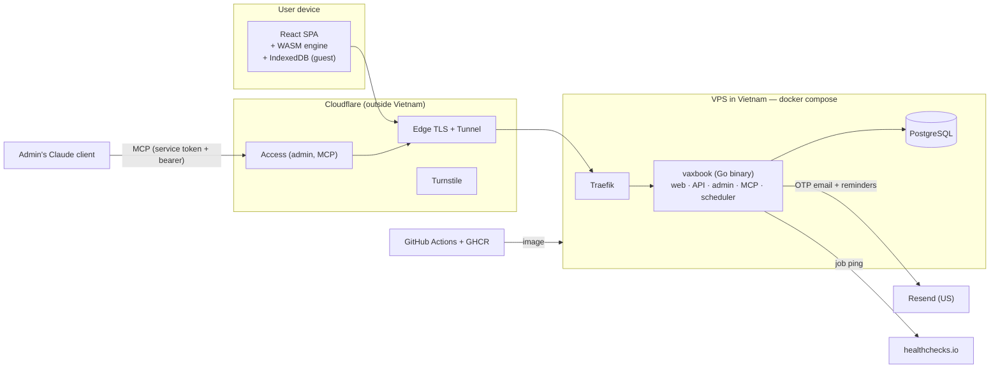
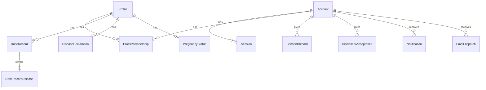
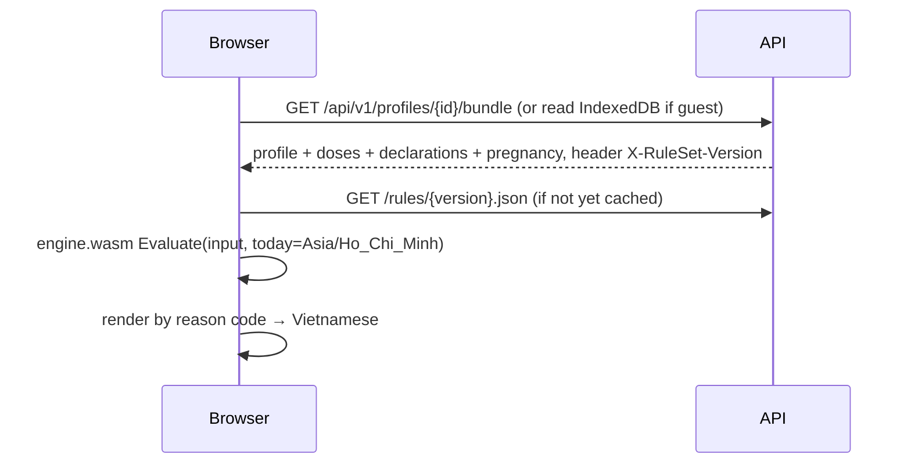

# VaxBook — Software Architecture Document (SAD)

| | |
|---|---|
| **Version** | 1.3 — 2026-11-24: accessibility target WCAG 2.2 level AA (§1, §17). 1.2 — 2026-11-21: BE skeleton decisions (§3, §8, §12, §18; issue #5). 1.1 — 2026-11-11: engine semantics (§5.6 B1–B13) settled in spec v1.2; v1.0 approved by the project owner on 2026-11-10 |
| **Date** | 2026-11-24 |
| **Inputs** | [`feature-spec-mvp.md`](feature-spec-mvp.md) v1.0 and v1.2 (engine semantics EQ1–EQ27, Appendix C), [`research/2026-11-10-feature-research.md`](research/2026-11-10-feature-research.md), SAD grilling session (Q1–Q34), engine prototype (`engine-prototype/`) |
| **Hard-to-reverse decisions** | [`docs/adr/`](adr/) — ADR-0001 → 0011 |
| **Terminology** | [`GLOSSARY.md`](../GLOSSARY.md) |

> This document describes **how to build**. Features and business rules belong to the spec; every place where the SAD proposes a spec change is collected in §17. Items marked **(UNVERIFIED)** have not been confirmed against the original source.

---

## 1. Goals, constraints, quality attributes

**Constraints**
- One operator, nonprofit, low budget. Infrastructure must run on the existing VPS (2 vCPU, 3.8 GB RAM, shared with other stacks).
- Vaccination data is **sensitive health data** (Nghị định 356/2025 (Decree 356/2025/ND-CP), Article 4(1)(d)).
- Vietnamese only, mobile first, basic PWA.
- Accessibility target: WCAG 2.2 level AA ([`ACCESSIBILITY.md`](../ACCESSIBILITY.md)).

**Quality attributes (in priority order; rows marked – are not ranked yet)**

| # | Attribute | Meaning in VaxBook | Main mechanism |
|---|---|---|---|
| 1 | **Medical safety** | Never recommend earlier than is safe; never conclude "out of age" when not certain (P1) | Pure engine, tested with golden cases, versioned rules with a publish gate, suspension valve |
| 2 | **Consistency** | The browser, email and age schedule table reach the same conclusion | One engine (ADR-0002), one rule snapshot (ADR-0004) |
| 3 | **Privacy** | Minimal collection; admin and MCP never see user data | Separation by host, no user-data screens, logs contain no PII |
| 4 | **Cheap, low-effort operation** | One binary, one database, no separate queue or worker | ADR-0001, ADR-0009, in-process scheduler |
| 5 | **Extensible (P6)** | Add prices, push, profile sharing without a large migration | `ProfileMembership`, notification content separated from delivery channel, replaceable price source layer |
| – | **Accessibility** | The web app, the admin area and, as far as applicable, the emails target WCAG 2.2 level AA (owner decision 2026-11-24); color is never the only signal, so every bucket keeps its text label. A target, not a conformance claim | [`ACCESSIBILITY.md`](../ACCESSIBILITY.md); semantic HTML and accessible component primitives (shadcn/ui, §12); automated axe-core checks through Playwright in CI once `apps/web` exists; manual keyboard, zoom and screen reader checks before each release |

---

## 2. System context



| Hostname | Purpose | Protection |
|---|---|---|
| `vaxbook.<operator-domain>` | User app + API `/api/v1` + static assets | Session cookie, Turnstile on the OTP form and the error report form |
| `vaxbook-admin.<operator-domain>` | Admin pages + API `/admin/api/v1` | Cloudflare Access (admin email OTP), app verifies the Access JWT |
| `vaxbook-mcp.<operator-domain>` | MCP streamable HTTP | Cloudflare Access service token + app bearer token |

Single-level subdomains are used because Cloudflare's free SSL certificate covers only one level (ADR-0008, ADR-0011).

**External data processors** (ADR-0005)
- **Cloudflare:** data is in cleartext while passing through the edge.
- **Resend:** email content and metadata are stored in the US for 30 days, including nicknames and disease names per F08.
- **healthchecks.io:** receives pings only, no personal data.
- **GitHub:** holds source code only.

---

## 3. Repo structure (ADR-0001)

```
vaxbook/
├── Taskfile.yml                 # build, gen, test, dev, release
├── go.mod                       # one Go module for the whole repo
├── tools/go.mod                 # dev tool requirements (oapi-codegen, ent, task), read via -modfile, apart from app deps
├── .golangci-lint-version       # the one golangci-lint version, read by the Taskfile and CI
├── .github/                     # CI, PR title check, freshness check, dependabot.yml
├── compose.dev.yaml             # local Postgres for `task run`
├── Dockerfile                   # single static binary on distroless, non-root
├── engine/                      # recommendation engine — pure Go, stdlib only, no I/O
│   ├── testdata/golden/         # test cases as golden files (JSON input + output)
│   └── wasm/                    # js/wasm entry point (build tag)
├── ruleset/                     # rule set snapshot: types, validation, changeset apply, diff
├── apps/
│   ├── api/
│   │   ├── cmd/vaxbook/         # main: HTTP (3 hosts), scheduler, migrations at startup
│   │   └── internal/            # identity, profiles, consent, guestimport, reminders,
│   │                            # notifications, feedback, editorial, admin, mcp, audit,
│   │                            # httpapi (oapi-codegen code), store (ent + migrations),
│   │                            # platform (config, logging, middleware, clock, problem)
│   └── web/                     # Vite + React; src/app (user), src/admin (separate chunk)
├── contracts/
│   ├── openapi.yaml             # OpenAPI 3.1 — source of truth for the API
│   └── ruleset.schema.json      # JSON Schema of the snapshot + engine I/O
├── reviewers/                   # prompts/skills for the 5 AI reviewer roles (ADR-0006)
├── deploy/                      # compose.yaml, .env.example, Traefik labels
└── docs/                        # spec, SAD, ADR, research
```

- **Engine contract.** The Go structs in `engine/` and `ruleset/` are the source. `contracts/ruleset.schema.json` is written alongside them, and a test confirms every golden file is valid against the schema, so the TypeScript types (generated from the schema) do not drift from Go.
- **Main Taskfile tasks:**
  - `gen`: runs oapi-codegen, openapi-typescript, ent generate, and generates TS types for the engine.
  - `build:wasm`: builds WASM, then pre-compresses it with brotli.
  - `build`: builds the web app, embeds it in the binary with `go:embed`, producing a single binary.
  - `test`: Go tests (including golden) and Vitest; it ends with `test:wasm`, which runs the engine and `ruleset` tests again under `GOOS=js GOARCH=wasm` with Node and logs the WASM size.
  - `e2e`: Playwright.
  - `migrate:diff`: generates migration files in goose format with the Atlas Go library (through ent's `NamedDiff`), against a throwaway Postgres started by testcontainers; no Atlas CLI or local database needed.
  - `gen:check`: CI drift check for generated code, migrations and `atlas.sum`, and that `go.mod` and `tools/go.mod` are tidy.
- **Tools** are pinned with `tool` directives in `tools/go.mod` (same module path as `go.mod`; `-modfile` swaps the requirement list) and run as `go tool -modfile=tools/go.mod …`, so tool dependencies never bump app dependencies. golangci-lint is the exception (its project advises against `go tool`): `task lint` uses `go run …@<version>`, CI uses the official action, and both read the version from `.golangci-lint-version`. Lint loads only one platform's files, so both also lint `engine/` and `ruleset/` a second time as js/wasm, which puts the js-tagged WASM entry point under the stdlib-only rule.
- **Dependency updates** come from Dependabot (`.github/dependabot.yml`): weekly, minor and patch grouped per ecosystem, majors separate, covering `go.mod`, `tools/go.mod`, GitHub Actions (pinned by commit SHA) and the Dockerfile and `compose.dev.yaml` images (the Dockerfile ones pinned by digest; the Dockerfile has no `# syntax=` line, so BuildKit pulls no unpinned frontend image). Values it cannot bump are kept in step by tests (Go version, Postgres image, Node major) or by a single source file (`.golangci-lint-version`); a weekly workflow opens an issue when golangci-lint or the Node LTS major falls behind.

---

## 4. Components in the `vaxbook` binary

A single process, routed by `Host`. Each module in `internal/` has a small interface and hides its internal details (deep module).

| Module | Responsibility | Main interface (sketch) |
|---|---|---|
| `engine` (outside `internal`, shared with WASM) | Computes the assessments for one profile | `New(snapshot) (*Engine, error)`; `Validate(Input) []Problem`; `Evaluate(Input) (Output, error)` |
| `ruleset` | Immutable snapshot; applies `ChangeOperation`; validation (IDs not reused, citations have a specific location…); structural diff | `Apply(base, ops) (Snapshot, []Problem)`; `Diff(a, b)`; `Validate(s)` |
| `identity` | Email OTP, session, email change, Turnstile, rate limiting | `RequestOTP`, `VerifyOTP → Session`, `Authenticate(r) → AccountID` |
| `profiles` | Account, Membership, Profile, DoseRecord, DiseaseDeclaration, PregnancyStatus; permission checks via membership; "at most one Me" constraint | `Bundle(accountID, profileID)` returns exactly the shape of `engine.Input` (except "today") |
| `consent` | ConsentRecord (account level and account–profile level), DisclaimerAcceptance, withdrawing consent triggers deletion | `Grant`, `Withdraw`, `Has` |
| `guestimport` | Imports guest data in one transaction after `engine.Validate`, upserts by client-generated ID, rejects IDs belonging to another account (F01.3) | `Import(accountID, payload) (Summary, error)` |
| `reminders` | Daily job: recomputes with the native engine, groups emails per account, prevents duplicate sends | `RunDaily(ctx, today)` |
| `notifications` | In-app notifications (stores code + parameters, the UI renders them); content separated from delivery channel (P6) | `Emit(accountID, kind, params)`, `List`, `MarkRead` |
| `feedback` | Anonymous "Báo sai dữ liệu" ("Report a data error") reports; moderation queue | `Submit`, `Moderate` |
| `editorial` | Changeset → Revision → TestRun → Finding → Approve → Publish / Rollback / Suspend | `Submit(rev)`, `Publish(rev)`, `Rollback(target, reason)`, `Suspend(target, reason)` |
| `mcp` | MCP server (Go MCP SDK v1.8): the F12 tools, calls **only** `editorial`, `ruleset`, `feedback` (moderated version) | — |
| `audit` | Append-only log (F11.7) | `Record(actor, action, subject, data)` |

**Mandatory data boundaries**
- `mcp`, `editorial` and `admin` do not import `profiles`, `consent` or `guestimport`.
- Admin sees only aggregate counts, obtained through a dedicated `stats` function (F11.1, F12).
- This boundary is enforced by an import-graph test.

---

## 5. Recommendation engine

### 5.1 Contract

```
Engine = New(snapshot)              // rejects a rule set that ruleset.Validate rejects
engine.Validate(Input) → []Problem  // input checks; run by the server and by guest import before Evaluate
engine.Evaluate(Input) → (Output, error) // pure: no clock reads, no I/O; never coerces input values
Input  = { today, profile{birth(RecalledDate), sex, historyStatus, historyStatusAt, pregnancy…},
           doses[{id, diseases[], product?, freeProduct?, date(RecalledDate), doseNumbers{disease→n}}],
           declarations[{disease, kind, createdAt, until?}], suspensions[…] }
Output = { ruleSetVersion, today, assessments[ Assessment ], historyIncompletePending[ disease ] }
Assessment = { disease, bucket | block, nextDose{number, earliest, due, overdue},
               seriesUsed[], products[], estimated, reasons[{code, params}], citations[] }
bucket = overdue | due | upcoming | unknown | complete
block  = notYetScheduled | outOfAge | infoOnly | acknowledged | pregnancyDeferred | inPregnancy
const overdueGraceDays = 7          // display constant of the contract, not a rule field (EQ1); before the maximum-age cap
```

- **"Today"** is the calendar date in `Asia/Ho_Chi_Minh`, passed in by the caller: the browser computes it itself, the server computes it in the job.
- **Dates** are calendar dates with no time. **Adding months keeps the day of the month; if the target month does not have that day, use the last day of the month** (31/01 + 1 month = 28/02). 1 week = 7 days.
- **Input errors** (EQ27, A9). `Validate` is a separate function that reports every problem in an input; the server and guest import run it before `Evaluate`. `Evaluate` never coerces values:
  - a dose date that is unparseable, out of range, after today or before the birth date, a level-4 dose date (precision `unknown`) that has a value, or a dose `product` that is not a product ID of the snapshot (engine S3a, issue #14, Q35), is **record-scoped**: every disease of that dose record becomes ⚪ with no `nextDose` and a reason of the same code (`INVALID_DATE`, `OUT_OF_RANGE`, `DATE_IN_FUTURE`, `DATE_BEFORE_BIRTH`, `UNEXPECTED_VALUE`, `UNKNOWN_PRODUCT`, params `{dose}`; the `UNKNOWN_PRODUCT` problem has params `{product}`). A record with both a product and a date problem gives both reasons, in path order. An unknown product ID comes only from version skew between a cached client and the rule set; failing the whole `Evaluate` would blank the profile, and treating it as an unknown product would coerce input. A month- or year-precision date uses its whole period: it is after today only when the period starts after today, and before the birth date only when the period ends before the older end of the birth-date range; a partial overlap is not a problem; the disease's doses are not walked (§5.3 steps 2–9 are skipped), and the record-scoped ⚪ is a data ⚪ (layer 7 of the §5.3 step 10 precedence), so layers 1–5 still win over it and keep the record reasons as masked reasons. `Validate` still reports it, so saving the record (F04.4) stays blocked; but stored data can reach this state (an edited birth date, client/server clock skew, a guest import), and one such record must not blank the whole profile and drop every reminder for it (§7.2);
  - every other problem (`today`, the birth date, including a value with precision `none`, a missing or duplicate ID, an unknown disease, an invalid precision, a `doseNumbers` key that is not one of the record's diseases (`UNKNOWN_REFERENCE`), a dose number outside 1..999, an empty `product` or `freeProduct` (`REQUIRED`), or both on one record (`MUTUALLY_EXCLUSIVE` on `freeProduct`)), or the history status "Chưa nhập xong" ("Not finished entering") without `historyStatusAt`, makes `Evaluate` return an input error instead of an `Output`.
- **Contract documents** (`contracts/ruleset.schema.json`). The Go structs in `ruleset/` and `engine/` are the source (§3). The schema and the Go decoders (`ruleset.Decode`, `engine.DecodeInput`) agree on shape: member names, required members, JSON types and the syntax of spans and dates. `null` is never valid; an optional member is omitted. Content checks live in `ruleset.Validate` and `engine.Validate`, including the schema keywords the decoders do not enforce (enums, `minLength`, `minItems`, `uniqueItems`, the ID pattern). The Input schema accepts every Input that `Evaluate` assesses, so a recalled date's `value` is any string and ⚪ `INVALID_DATE` stays reachable for a client that validates against the schema. Contract documents are I-JSON texts (RFC 7493): unique member names and well-formed Unicode. A schema cannot express that, so the decoders reject a duplicate member name, an unpaired surrogate escape or invalid UTF-8 as a decode error rather than guess or replace characters; a JavaScript client calls `String.prototype.toWellFormed()` on user-typed text before `JSON.stringify`. A future write API may use a stricter entry schema of its own (for example, a dose date that is a valid `Date`); the engine Input schema stays permissive. **The contract grows additively:** a member added after S1 is optional unless every stored document is migrated; a test freezes the S1 list of required snapshot and Input members. This protects newer readers of older documents only. An older engine or schema copy rejects a document that uses a member it does not know, as a decode error (fail closed): ignoring a rule member such as a maximum age or a validity window would give a wrong recommendation. An optional member is omitted when unused, so an older engine still loads a newer snapshot that uses no new feature. The delivery path (the first consumer, #11) must handle version skew: a cached client keeps the last snapshot it loaded rather than showing nothing, and rolling back a binary also rolls back a current rule set that uses members the older binary does not know (§10).
- **Evaluable precisions** (engine S2): a dose date has precision `day`, `month` (`YYYY-MM`), `year` (`YYYY`) or `unknown` (level 4, no `value`); the birth date has `day`, `month`, `year` or `none` (not entered, no `value`). `unknown` is not valid for a birth date. A recalled date resolves against `today` to the range `[period start, min(period end, today)]`.
- **Dose products** (engine S3a, issue #14): `product` is a product ID of the snapshot, retired ones included; `freeProduct` is the free-text name of an off-catalog product (F04.1), of which the engine reads only whether it is present, never matching it against catalog names. A record with neither has an **unknown product**. A `product` that does not list one of the record's diseases is accepted (F04.1 lets the user add diseases); for that disease the dose has an unknown product (Q36). The Input schema gives `product` no ID pattern, so ⚪ `UNKNOWN_PRODUCT` stays reachable for a client that validates against it.
- **`seriesUsed` and `products`** (engine S3a): `seriesUsed` lists the candidate series after step 3, in rule-set order, complete candidates included (§5.3 step 3); it is omitted after a step-1 or step-2 ⚪, for ⚪ `NO_BIRTH_DATE` with no dose given, for ⚪ `NO_SERIES_IN_EFFECT` (no series in effect today, engine S4c, issue #29), and for an `outOfAge` block with no dose given (engine S3b; with doses given the doses fix the candidates, so an `outOfAge` keeps them, engine S4b, Q74). With no dose given the birth dates step 4 evaluates (both ends of every start-age sub-range, step 4) can choose different start-age brackets; `seriesUsed` is then the list at the latest birth date (the later end of the birth-date range), in a ⚪ too (issue #23, Q40; PR #27), and omitted when the latest birth date has no candidate left after the maximum-age removal of §5.3 step 3 (engine S4b). `products` lists the non-retired products for the next dose, in snapshot order: each candidate series at the next dose number k contributes its product, and a generic series every non-retired product of the disease with no series of its own; it is present only with `nextDose` and when not empty.
- **Display constants** (EQ27): `overdueGraceDays = 7`, the 30-day and 6-month bucket thresholds, the 6-month threshold of the "Chưa tới lịch tiêm" ("Not yet scheduled") block and the 3-month "sau sinh — hỏi bác sĩ" ("after delivery — ask a doctor") note are engine constants, not medical rules; P2's citation requirement does not apply to them (spec v1.2 F05.2, F05.4).
- **Blocking and informational reasons** (engine S2, S3a, S3b, S4a, S4b, S4c): a blocking reason makes the assessment ⚪ unless a block of a higher precedence layer wins over it (step 10, layers 1–5, which keep it as a masked reason in `reasons[]`; since engine S4b layer 5's `outOfAge` from a maximum age), and `bucket == unknown` always comes with a blocking reason. Informational reasons (`IMPLIED_EARLIER_DOSES`, `SAFEST_SERIES`, `AGE_AT_START_UNCERTAIN`, `INTERVAL_UNVERIFIABLE`, `FIRST_DOSE_DATE_ASSUMED`, and the bucket reasons `ALTERNATIVE_PLANS`, `COMPLETE`, `PRODUCT_NOT_IN_CATALOG`, `OUT_OF_AGE`, `DUE_CAPPED_BY_MAX_AGE`, `SERIES_MAY_NOT_COMPLETE`, `ON_TRACK`) never make it ⚪ on their own; `UNKNOWN_PRODUCT` is blocking, and so are engine S4c's `NO_SERIES_IN_EFFECT` and `CATCH_UP_ASK_DOCTOR` (issue #29). The split is an explicit list in the engine, not "any reason ⇒ ⚪".
- **`estimated`** is present, and `true`, when the assessment rests on a birth date that is not day-precise or absent, a dose date of the disease that is not day-precise (level 4 included) or an implied dose (§5.3 step 1), or when `PRODUCT_NOT_IN_CATALOG` is given (EQ14); it is set on ⚪ assessments too. `AGE_AT_START_UNCERTAIN` does not set it: it usually comes with an imprecise date, but with exact dates and a snapshot that has the `FIRST_DOSE_MIN_AGE_DIFFERS` Warn it comes alone (engine S3b, Q43).
- **A ⚪ assessment has no next dose:** `bucket == unknown` ⇒ no `nextDose`. The spec gives no dates for ⚪, most ⚪ reasons have no single date, and adding the member later is additive while removing it would break consumers. The engine still computes the dates internally, because they decide the bucket a ⚪ layer masks (§5.3 step 10).
- **`notYetScheduled`** is the block "Chưa tới lịch tiêm" ("Not yet scheduled"; EQ2, EQ18): no dose given yet and dose 1 is due more than 6 months after today. Like every block it is collapsed, never red, never emailed and not counted toward the attention level (F03.4).
- **`outOfAge`** is the block "Không còn trong độ tuổi tiêm" ("No longer within the vaccination age", F05.4a). From engine S3b: no dose given yet and the person is past every start-age bracket of the disease (§5.3 step 3), with the reason `OUT_OF_AGE`. Engine S4b adds the maximum-age cases: with no dose given, every candidate certainly past its start limit (§5.3 step 3, A3); with doses given, every candidate incomplete and certainly past the last day its next dose can be given, even from the earliest possible dose dates (§5.3 step 7, step 10 layer 5; otherwise a blocking reason from steps 5–7 keeps its own ⚪, and with none the result is ⚪ with `BIRTH_DATE_IMPRECISE`, `OUT_OF_AGE_UNCERTAIN` or both). It never has `nextDose` or `products`. With no dose given it has no `seriesUsed`; with doses given it keeps `seriesUsed` and the reasons emitted before step 4 (`IMPLIED_EARLIER_DOSES`, `AGE_AT_START_UNCERTAIN`, `SAFEST_SERIES`), and may carry masked reasons, blocking ones included (Q74).
- **`historyIncompletePending[]`** lists the diseases that still carry `NOT_ENTERED` (§5.3 step 11). The server and the client decide the automatic exit from "Chưa nhập xong" ("Not finished entering") from this one field (EQ12, EQ22).
- **The identity of a next dose** is `(profile, disease, dose number)`. Email de-duplication uses the key `(next dose, due date, milestone)` (F08).
- **Reason codes** are a closed, versioned catalog (§5.4). The wording is generated by the web app and the email templates (ADR-0003).

### 5.2 Rule model (ADR-0003, ADR-0004)

The public snapshot contains `diseases`, `products`, `series`, `rules`, `tcmrLabels`, `citations`, `sourceDocuments`, `providerOfferings`, and `changeNotes`. Fixture and demo snapshots also carry `illustrative: true` (not medically verified); the publish path never sets it.

A `Product` (engine S3a, issue #14) contains `id`, `name`, `diseases[]` (at least one, each a disease of the snapshot, none repeated), `live` (the live-vaccine flag, required: an absent flag would read as non-live, which is unsafe in pregnancy; the engine reads it from S7, Q46) and `retired?` (F11.3, table C: a retired product stays in the snapshot with its series; a dose with it has an unknown product, and it is never listed for a dose not yet given). A catalog product may list a disease that has neither a series of its own nor a generic series; a dose with it falls to every series of the disease (A2).

A `Series` contains:
- `disease`
- `product?`: a product that lists the series' disease. Absent, the series is **generic**: it applies to every product of the disease that has no series of its own. The series of one disease with the same `product`, or its generic series, form a **product group**. A product group may have several series, told apart by `startAge` (EQ26, engine S3b).
- `stage` (childhood / adult)
- `startAge {min, max?}`: the **start-age bracket**, the half-open range `[min, max)` of the age at dose 1. `max` is optional: absent, the bracket is open-ended (engine S3b, Q25). Required for every series of a product group that has more than one series (EQ26). The bracket chooses the series (§5.3 step 3). The `max` of the group's **last** bracket, in the group's bracket order, also acts as a maximum age to start for dose 1 of every series of the group (engine S4a, A5, Q55); S4b's start limit uses the same `max` at the sub-range end (Q73). A non-last bracket's `max` is no limit: by the reach rule a dose 1 past it belongs to the bracket above.
- `maxAgeStart?`, `maxAgeComplete?` (engine S4a, issue #15): **exclusive** maximum ages, series-level (not per plan). Dose 1 must be given before birth + `maxAgeStart`, and every dose before birth + `maxAgeComplete`, so the last allowed day is birth + max − 1 day (the `Span` convention: "14 weeks 6 days" is written as its exclusive bound `P15W`). Dose 1's start limit is the earlier of `maxAgeStart` and the group's last bracket `max`, each when present, compared as dates at the birth date (Q55).
- `catchUpAfterAge?` (EQ26; engine S4c, issue #29): when the earliest date the next dose would show (F, §5.3 step 7) is at or after birth + this age, the engine gives ⚪ `CATCH_UP_ASK_DOCTOR` instead of any scheduled next dose (Q78, Q91). A zero `Span` built in Go is `REQUIRED` (as `maxAgeComplete`, Q89). Dose counts that shrink with the age at the *current* dose are not modelled in the MVP.
- `validFrom?`, `validTo?` (`Date`; EQ26, engine S4c, Q77): the series' **validity window**. It is in effect on day d iff (`validFrom` absent or d ≥ `validFrom`) and (`validTo` absent or d < `validTo`), a half-open window like `startAge`, so a successor needs no "−1 day" in data. The window must hold a day (`VALIDITY_EMPTY`). `Series.kind` (routine | catchUp) is deferred until a reader needs it (Q76; §5.6 table C).
- `plans[]`: more than one element means there are alternative plans; every plan in one series has the same number of doses (EQ5)
- `citations[]`

Each `plan` has `doses[]`; each element is a `DoseRule` containing:
- `minAge?`, `minInterval?` (from the previous dose), `minIntervalFromFirst?`; every dose rule has a minimum age or a minimum interval, and `minIntervalFromFirst` counts as one (A7); dose 1 has a minimum age and neither interval
- `recommended = {from: birth | firstDose | previousDose, offset}`
- `buffer?`, `tolerance?` (engine S4c: days or weeks only, Q80; `P0D` means no tolerance)

**`tolerance` semantics** (EQ27): used only when validating doses already given. It applies to the minimum age, the minimum interval and `minIntervalFromFirst`, never to the maximum ages, and it is never used to compute the earliest allowed date or the due date (P1). It is checked at both ends of the (today-capped) dose date range. Engine S4c (issue #29, Q79, Q80, Q90): each threshold is (anchor + span) − tolerance, in days (a week is 7 days), and behind undated slots never before the chain date itself (being on or after the slot before is an order, not a minimum). It applies in every step-5 comparison: `check()`, the feasibility chain of undated slots (so their maximum-age ranges and the 0b guards too, one tolerance per link) and the S2 gap search (fit test, same-day rule, gap 0's dose 1 and the threshold). It never enters C_c,k, the limits, F or any step-7 date. A tolerance at or above the minimum it lowers makes that check vacuous (`TOLERANCE_NOT_BELOW_MINIMUM`). **`buffer`** only moves the overdue date: overdue date = due date + max(buffer, `overdueGraceDays`) (EQ1).

`Rule` holds the disease-level special rules: periodic booster, pre-pregnancy, allowed additional dose, same-product requirement, information-only. The **same-product requirement** is a disease-level `Rule {kind: sameProduct, citations}` (F04.3, F11.8), not a flag on `Series` (EQ27). Details of the additional structures the prototype revealed are in §5.6 table C.

The prototype taught two things about the model:
- **A recommended milestone needs an "anchor".** The HPV 0-2-6 month schedule counts from the first dose, not from the birth date.
- **`startAge` (the starting age range used to select a series) is different from `minAge` (the minimum age at which a dose may be given).** When the prototype mistakenly entered the minimum age of Gardasil 9 as 15 years, a dose given to a 14–15-year-old was marked "invalid". The `ruleset` validation step catches this kind of error (below).

**Rule set validation** (`ruleset.Validate`, engine-semantics checks):

| Check | Severity | Source |
|---|---|---|
| Every plan within one series has the same number of doses. Plans with different dose counts can only be entered as separate series that differ by product or by non-overlapping `startAge`; otherwise the admin chooses one plan (with citation) or the disease is not scheduled | Reject | EQ5 |
| A product group with more than one series gives every series a `startAge` (`START_AGE_REQUIRED{disease, product?}` on the series), and those brackets do not overlap (`START_AGE_OVERLAP{id}` on the later series' `startAge`, one per earlier series it may overlap, `id` naming it); each bracket's `max` is certainly after its `min` (`START_AGE_EMPTY` on `startAge`); `startAge.min` and `max` are valid spans (`REQUIRED`, `INVALID_VALUE{value}`), and a bracket with an invalid span gets only that problem. Since engine S4c the group checks apply only between series whose validity windows overlap (an absent bound unbounded; issue #29 In scope 1), so a series can be replaced by a dated successor in its group without `startAge`. Intervals that overlap pairwise share a day, so the pairwise checks validate the group in effect on every day | Reject | EQ26, table C, issue #23, issue #29 |
| Every dose rule has a minimum age or a minimum interval | Reject | A7 |
| A product has a valid, unique `id` (`REQUIRED`, `INVALID_VALUE{value}`, `DUPLICATE_ID{id}`), a non-empty `name` (`REQUIRED`) and at least one disease (`EMPTY`); each of its diseases exists (`UNKNOWN_REFERENCE{disease}`, an empty one `REQUIRED`) and is listed once (`DUPLICATE_VALUE{disease}`) | Reject | issue #14 |
| A series' `product` is a valid ID of a product (`REQUIRED`, `INVALID_VALUE{value}`, `UNKNOWN_REFERENCE{product}`) that lists the series' disease (`PRODUCT_DISEASE_MISMATCH{disease, product}`) | Reject | issue #14, Q36 |
| The `minAge` of dose 1 (in any plan) is not greater than the series' `startAge.min` (`FIRST_DOSE_MIN_AGE_ABOVE_START_AGE` on that dose's `minAge`) | Warn | Gardasil 9 lesson above |
| In a product group with more than one series, every plan's dose-1 `minAge` equals plan 0's of each other series. Since engine S4c it is compared pairwise among the series whose windows overlap: with plan 0 of every earlier such series in rule-set order, then with the series' own plan 0; the Warn names the first that differs (`FIRST_DOSE_MIN_AGE_DIFFERS{id}` on the differing dose's `minAge`; issue #29). Without windows that is the old check, plus a third series naming the second when the first and third agree. Two spans are equal within one unit family (`P1Y` = `P12M`, `P1W` = `P7D`); spans of different families differ, except zero | Warn | issue #23, Q43, issue #29 |
| `maxAgeStart` and `maxAgeComplete` are valid spans (`REQUIRED` for the Go-built zero value; JSON `"P0D"` is a valid zero span; `INVALID_VALUE{value}`); a member with an invalid span gets only that problem | Reject | issue #15 |
| `maxAgeStart` or `maxAgeComplete` is certainly at or before the dose-1 `minAge` of some plan, or `maxAgeStart` is certainly at or before `startAge.min`, for every month length: the series can never start (`MAX_AGE_NOT_AFTER_MIN_AGE` on the member) | Reject | issue #15, Q60 |
| The same pairs are neither certainly after nor certainly at or before each other: the series cannot start for some birth dates (`MAX_AGE_MAY_NOT_BE_AFTER_MIN_AGE` on the member; at most one of the two per member) | Warn | issue #15, Q60 |
| `maxAgeStart` may be after `maxAgeComplete` (`MAX_AGE_START_AFTER_COMPLETE` on `maxAgeStart`) | Warn | issue #15 |
| For some plan, `maxAgeComplete` is certainly at or before a lower bound of the age at the last dose, for every month length (`SERIES_CANNOT_COMPLETE{id}` on `maxAgeComplete`, `id` naming the plan). The lower bounds add spans as numbers: minAge_j + Σ minInterval_i (i = j+1…n) for every dose j with a `minAge`, and minAge_1 + minIntervalFromFirst_j + Σ minInterval_i (i = j+1…n) for every dose j with a `minIntervalFromFirst`. Skipped when `maxAgeComplete` has the Reject | Warn | issue #15, Q60 |
| `catchUpAfterAge` is a valid span (`REQUIRED` for the Go-built zero value, `INVALID_VALUE{value}`); `tolerance` is a valid span (`INVALID_VALUE{value}`, the zero value included, as `buffer`; Q89) in days or weeks (`TOLERANCE_UNIT{value}` on the tolerance, Q80); `validFrom` and `validTo` are calendar days (`REQUIRED` for the zero `Date`, `INVALID_VALUE{value}`); `validFrom` is before `validTo` (`VALIDITY_EMPTY` on the series). A member with an invalid value gets only that problem | Reject | issue #29 |
| `catchUpAfterAge` may be at or after `maxAgeComplete`, so it never applies (`CATCH_UP_AFTER_MAX_AGE` on `catchUpAfterAge`) | Warn | issue #29 |
| A `tolerance` may be at or above the `minAge`, `minInterval` or `minIntervalFromFirst` of its dose rule, so the check it lowers is vacuous (`TOLERANCE_NOT_BELOW_MINIMUM` on the tolerance, once per rule) | Warn | issue #29 |
| A changeset ends the last series of a scheduled disease (the editorial changeset path, not `ruleset.Validate`) | Warn | EQ26 |

`ruleset` also records, per dose rule, whether its minimum age is implied by dose 1's minimum age plus the minimum intervals (minAge_k ≤ minAge_1 + Σ minInterval of doses 2…k, a missing interval counting 0; `ruleset.MinAgeImplied`). The engine needs this for profiles without a birth date (§5.3 step 7, EQ19). Spans compare exactly when every span involved is in months and years (1y = 12m) or every one is in days and weeks (1w = 7d); otherwise conservatively, a month of minAge_k counting 31 days and a month of the sum 28 days, so a mixed case is implied only if it holds for every month length. The sum adds spans as numbers; a chain of month additions that clamps at month ends can fall up to 3 days short of it, which is accepted.

**Span comparison** (engine S3b, issue #23). `START_AGE_EMPTY`, `START_AGE_OVERLAP` and `FIRST_DOSE_MIN_AGE_ABOVE_START_AGE` compare spans with the same rule as `MinAgeImplied`: exactly when both are in months and years or both in days and weeks, otherwise with a month on the side that must be smaller counting 31 days and a month on the other side 28 days. A month added to a date is 28–31 days, so two brackets count as disjoint only if they are disjoint for every month length and every birth date; within a validated group the brackets therefore have a total order by `min`, with an open-ended bracket last. The maximum-age checks (engine S4a) use the same rule: "certainly after" is the strict comparison, "certainly at or before" is `SpanAtMost(max, min)`, and anything else is the uncertain band. `MAX_AGE_NOT_AFTER_MIN_AGE` rejects only the certain case, unlike `START_AGE_EMPTY`, which rejects the uncertain band for brackets: the 31/28 rule is loose for long or multi-month spans (it cannot prove that `P2M` is after `P8W`, although two calendar months are at least 59 days), and a Reject must be certainly a data error (Q60). For the same reason `SERIES_CANNOT_COMPLETE` fires only when certain: `minAge` P18Y, `minInterval` P4W and `maxAgeComplete` P20Y give 216 × 31 + 28 = 6724 > 240 × 28 = 6720, which is the uncertain band.

### 5.3 Assessment procedure (per disease)

Steps 1–3 prepare the doses and the candidate series; steps 5–9 are evaluated at each end of the birth-date range and compared as described in step 4; step 10 applies the precedence that decides the final bucket or block; step 11 computes `historyIncompletePending`. Dose-level validation and the maximum-age checks always run **per candidate series**. Reasons from every end, candidate and masked layer are kept in `reasons[]` (A8, EQ21); after a step-1 ⚪, steps 2–9 add none.

1. **Collect the dose records** for the disease. A record whose date cannot be parsed, is out of range, is after today or is before the birth date, or whose product the snapshot does not have, makes the disease ⚪ with a reason of that code (`INVALID_DATE`, `OUT_OF_RANGE`, `DATE_IN_FUTURE`, `DATE_BEFORE_BIRTH`, `UNEXPECTED_VALUE`, `UNKNOWN_PRODUCT`; §5.1). Steps 2–9 are skipped for that disease: without that record's date the other doses cannot be placed in time, so they add no reasons (no `DOSE_INVALID`, `COMPLETE`, `ON_TRACK` or `ALTERNATIVE_PLANS`). Step 10 still runs: the record-scoped ⚪ is a data ⚪ (layer 7), its reasons are the record reasons sorted by record ID, and layers 1–5 (information-only, acknowledged declaration, suspension, pregnancy, certainly out of age) still win over it and keep those reasons as masked reasons (F04.6, F05.11, A8). With layers 1–6 not yet implemented (S1), the record reasons are the disease's only reasons. Level 2–3 dose dates (month-year, year only) become the range **[period start, min(period end, today)]** (EQ7); this today-capped range is used for ordering, validation and the next-dose computation alike. The later end of the birth-date range is also capped at today (EQ17). Mark `estimated` if the birth date or a dose date is not at full-day precision, or if any dose is at level 4 or implied (EQ20d).
2. **Assign positions** (F04.2, A4, EQ20a). One position-assignment algorithm: walk the dated doses in time order; a user-entered dose number places that dose at its number and resets the counter. Positions do not depend on the birth date. A ⚪ from this step skips steps 5–9, like a step-1 ⚪.
   - Conflicting user-entered numbers (duplicates, or numbers that contradict the time order) → ⚪ `NUMBERING_CONFLICT{dose, number}` on the later record. The time-order check assumes every earlier dated dose takes a position, so it never depends on dose validity.
   - Overlapping date ranges → ⚪ `OVERLAPPING_ESTIMATED_DATES{doses}`, unless every dose of the overlapping group has a user-entered number; the numbers then order the group. Two ranges overlap when they intersect and are not both single days. Exact doses on the same day do not overlap and have no time order between them, so a number on one of them never contradicts the time order: the numbered ones sit at their numbers, the unnumbered ones take the free positions after the position reached before that day, by ID, and the day's doses are walked in position order. Without numbers they keep their order by ID.
   - A **numbered** level-4 dose sits at its number. An **unnumbered** level-4 dose counts toward the number of doses given but has no position.
   - A user-entered dose number greater than the number of records makes the missing earlier doses **implied doses** (counted, undated), with `IMPLIED_EARLIER_DOSES{numbers}` (informational). Positions below the highest position taken are filled first by unnumbered level-4 doses (by ID); only the rest are implied. An unnumbered level-4 dose that fills no gap may be the latest dose (step 7).
   - With several candidate series (engine S3a), the blocking outcomes of this step do not depend on the series and are reported once. Implied positions and doses beyond the series length are per candidate for the walk. Whether the disease has implied doses at all (step 3) is decided from the records alone, and `IMPLIED_EARLIER_DOSES` is emitted once, its `numbers` capped at the length of the longest candidate.
   - Allowed additional doses (`ExtraDoseRule`) do not count toward the series.
3. **Select the candidate series** (F05.3, F05.5, EQ10, EQ14, EQ26):
   - **Effective dating** (EQ26): the next dose uses the series and rules in effect today; a recorded dose is valid if it satisfies the rule in effect on its dose date **or** the rule in effect today (step 5). A scheduled disease with no series in effect → ⚪ `NO_SERIES_IN_EFFECT`; it is never silently dropped. Engine S4c (issue #29, Q77, Q82): the windows `[validFrom, validTo)` of a disease's series cut time into **validity segments** at their sorted, unique bounds; the same series are in effect throughout a segment, so the engine compiles the disease once per segment (tiers, product groups, the no-dose list, catalog and generic products, bracket order, floors, `groupMax`) and runs steps 3–9 on the segment that contains today. A product whose own series are all out of window falls through the tiers there (the generic series, else every series). With no series in effect today (a disease with no series included) the result is ⚪ `NO_SERIES_IN_EFFECT` alone, with no `seriesUsed`, `products` or `nextDose`, even for a history complete under an ended series (Q82). It is decided after steps 1–2 (whose ⚪ wins) and before the `NO_BIRTH_DATE` stop below; `estimated` keeps step 1's value and `IMPLIED_EARLIER_DOSES` is not added. A snapshot without windows has one segment.
   - **Products, doses given** (A2, EQ14, F11.3; engine S3a, issue #14): determine the candidates **per dose record**, then take the union, so one record's specific series never hides another record's fallback. A non-retired catalog product that lists the disease gives that product's series for the disease, else the disease's generic series, else every series of the disease. A retired product, a `freeProduct`, no product, or a product that does not list the disease (Q36) gives every series of the disease, retired ones included: the "possible products" of such a dose are the catalog products, including retired ones (EQ14). Implied doses count as unknown-product doses (Q30). The tier comes from product identity alone (Q39); start-age brackets apply inside the chosen tier (S3b): the union is a union of whole product groups, and each group keeps the series its brackets choose. If a product's own brackets do not match, the dose does not fall back to the generic series; the no-match rule below applies within that product.
   - **Products, no dose yet** (F05.3, F11.3, Q38): every series of the disease except the series of retired products; if that leaves none, every series of the disease, retired ones included (`products` is then empty and omitted). Start-age brackets then apply at each birth-date end (below). With no birth date and no dose, ⚪ `NO_BIRTH_DATE` comes without choosing candidates.
   - **Start age, doses given** (F05.2, F05.5, C1–C3, A5; engine S3b, issue #23). This runs once, before step 4, so both birth-date ends use the same candidates. In each product group of the union:
     - **Reach.** For choosing, each bracket covers its **reach**: from the `max` of the bracket before it in the group's order (from birth for the first bracket) up to its own `max` (no upper bound when `max` is absent). §5.2's validation puts each `max` at or below the next `min`, so the reaches of a group tile every age below the last `max`, and a gap between two brackets belongs to the bracket above it (Q33; PR #27, 2026-11-23).
     - **Age test.** The age at a dose is a range. A bracket's reach possibly contains the age at a dose with range D iff (it is the first bracket, or D.hi ≥ birthLo + the previous bracket's `max`) and (`max` absent or D.lo < birthHi + `max`), birthHi being the today-capped later end of the birth-date range. With a known birth date every comparison is between dates (`Date.AddSpan`), so mixed span units need no month rule. Each test is monotone in D, so a wider or extra dose-1 candidate can only add matches (P1).
     - **Which dose is dose 1** (Q32, Q49). Each bracket's series is walked at both birth-date ends. Its dose-1 candidates are the doses counted at position 1 at either end (they differ when a minimum age is met at one end only); a floating level-4 dose (unnumbered, filling no gap) when one may be dose 1, i.e. when the series has floating doses, no record holds position 1 whatever the dates (a level-4 dose numbered 1 or filling the gap at 1, an implied dose 1, or a dated dose numbered 1: step 5 never places a floating dose in front of them), and either no counted dated dose or a first counted dated dose that is an insertion point of step 5's floating rule (no number, and no numbered dated dose after it), with the range [birthLo, R.Hi of that dose, or today when there is none]; and, when neither gives one at either end, the dose at position 1, else the earliest dated dose. A level-4 or implied dose 1 at a fixed position uses the range [birthLo, R.Hi of the earliest dated dose, or today]. These walks run without the maximum-age checks (engine S4a, issue #15 In scope 2), so the series chosen are S3b's: a dose 1 past a series' maximum age to start stays dose 1's record, and the checks apply in step 5 after the choice.
     - **Matching.** A bracket matches when its reach possibly contains the age at one of its dose-1 candidates. An exact age, or a range wholly inside a gap, matches only the bracket above the gap; a range that may fall in a bracket or in the gap above it matches both (F05.5). "Certainly younger than every bracket" matches the first bracket, whose reach starts at birth (A5). **One match:** use it. **Several matches:** use the matching series with the **most doses**; on a tie keep every tied series, merged as the safest series (Q34); add `AGE_AT_START_UNCERTAIN{candidates}` listing every match in rule-set order, one reason per such group. **No match:** with a the earliest dose-1 candidate date across the group, keep the first bracket whose `max` is absent or after a (birthHi + `max` after a; A5), else the bracket with the latest `max`, and count the doses normally. When the dose-1 `minAge` is the same across the group, every bracket reads the same dose-1 record, so no match happens only when every dose-1 candidate is at or past the last bracket's `max` (**older than every bracket**), and the latest-`max` bracket is kept; today's age does not matter (C3), and step 5 gives dose 1 `DOSE_AFTER_MAX_AGE{checks: [maxAgeStart]}` against that last `max` (engine S4a, Q55). With the `FIRST_DOSE_MIN_AGE_DIFFERS` Warn (Q43) each bracket walks its own dose 1, so nothing can match while a candidate is younger than every `max` (one bracket's candidate past its own `max`, the next one's below its reach); a then keeps the bracket whose reach holds the earliest candidate, and the P1 claim of the age test is not made for such groups.
     - A series in progress continues on the bracket of its first dose (F05.2, C3). A group of one series without `startAge` matches every age (C8). "Smallest `min`" and "latest `max`" use the group's bracket order, which §5.2's validation makes total.
     - **No birth date** (Q37): every bracket possibly matches, so the most-doses rule applies, with `AGE_AT_START_UNCERTAIN` when more than one bracket matches.
     - **Exact dates.** When the dose-1 `minAge` is the same across a group (no `FIRST_DOSE_MIN_AGE_DIFFERS` Warn), every bracket counts the same record as dose 1, so with a day-precise birth date, day-precise dose dates and no level-4 or implied dose at most one bracket matches and `AGE_AT_START_UNCERTAIN` is not emitted. When it differs, two brackets can match with exact dates (Q43); the reason is then emitted without `estimated`.
     - `IMPLIED_EARLIER_DOSES` is capped at the longest series chosen here (Q48).
   - **Start age, no dose yet** (EQ10, A5, Q24, Q33, Q50): each birth date evaluated in step 4 chooses on its own, from the age today. In each product group of the no-dose candidates, it uses the first bracket (smallest `min`) whose `max` is absent or after the age today (birth date + `max` after today), which is the bracket whose reach contains the age today: the bracket the age falls in, the next one above a gap, or the earliest one; the "more doses" rule does not apply. A group with no bracket left at that end is dropped. When every non-retired group is dropped but a retired group still has a bracket, the choice is redone over every group, retired ones included (Q50 (b); `products` is then omitted). When no group is left, the end is the `outOfAge` block with `OUT_OF_AGE` (Q24), with no candidates and k = 0. Candidates that are already out of age are removed (A3), so n = 0 never produces `CHECK_PRODUCT_NAME`.
   - **Maximum ages, no dose yet** (engine S4b, A3, EQ10, Q65, Q72). At each evaluated birth date, after the start-age choice and before step 7, a candidate is removed when its own F_c (today, or the earliest date of its most lenient plan if later) is past its Limit_c,1 (step 7). Then, until nothing changes, a candidate whose Limit_c,1 is past the merged F of the candidates left (step 7) is removed too: it could be given only before the date the others need, so step 7 never gives `CHECK_PRODUCT_NAME` or `MIXED_PRODUCTS` with no dose (A3). The candidate with the latest earliest date is never removed that way. When every candidate of the non-retired choice is removed and the choice over every group differs, that choice is filtered instead (`products` omitted; Q72, Q50 (b) extended). When none is left: the `outOfAge` block with `OUT_OF_AGE` if every removed candidate is past its limit at that birth date itself (certain), otherwise ⚪ `BIRTH_DATE_IMPRECISE{fullBirthDate}`; both with no candidates. `products` and `SAFEST_SERIES` list only the candidates left. S3b's start-age `outOfAge` is unchanged.
   - If several candidate series remain, use the **safest series** (F05.3, `SAFEST_SERIES`, whose `candidates` param lists each candidate as `{series, product}`, `product` omitted for a generic series, in rule-set order, complete candidates included). With doses given the candidates do not depend on the birth-date end, so it is emitted once, before step 4; with no dose given it is a bucket reason of each birth date evaluated in step 4.
4. **Evaluate at both ends of the birth-date range and compare** (F05.5, EQ17). Steps 5–9 run at the older end (earliest possible birth date) and at the later end (latest possible birth date, capped at today).
   - Dates driven by a minimum age or a minimum interval come from the **later** end; dates capped by a maximum age come from the **older** end (EQ15).
   - Results that differ only in how far away a milestone is, all within {"Chưa tới lịch tiêm" ("Not yet scheduled") block, 🟡, ✅ "Đang theo phác đồ" ("On series")}, are **not** different results: show the later end's result with the estimated label.
   - Any other difference, i.e. one involving 🟠, 🔴, out of age, a cap or dose validity → ⚪ `BIRTH_DATE_IMPRECISE{hint}`. When either end hits an age limit, the hint is "Nhập ngày sinh đầy đủ" ("Enter the full date of birth") (A8).
   - Identical results → the later end's result.
   - Concretely (engine S2, S3a, S3b): the ends agree when they have the same next dose number, the same blocking reasons and either the same class or two classes within {`notYetScheduled`, 🟡, ✅ `ON_TRACK`}; dates alone never make them differ. Otherwise the result is ⚪ `BIRTH_DATE_IMPRECISE{hint}`, hint `birthMonth` for a year-precision birth date and `fullBirthDate` for a month-precision one, except that when any compared result has an age-limit reason the hint is `fullBirthDate` whatever the precision (an end hits an age limit; engine S4a, Q58). The age-limit reasons are `OUT_OF_AGE`, `DOSE_AFTER_MAX_AGE`, a `DOSE_POSSIBLY_INVALID` whose `checks` include `maxAgeStart` or `maxAgeComplete`, `CHECK_PRODUCT_NAME` and `MIXED_PRODUCTS` (S4b adds its two cap reasons); on S3b's inputs this is "an end is `outOfAge` and the other is not", since two `outOfAge` results agree; its reasons are the later end's, then the older end's not already listed (A8). When the ends agree on a result that is not ⚪, the bucket reasons (`COMPLETE`, `ON_TRACK`, `ALTERNATIVE_PLANS`, `PRODUCT_NOT_IN_CATALOG`, `OUT_OF_AGE`, and with no dose given `SAFEST_SERIES`) come from the later end only. With no dose given the birth-date range is split as below; the S2 key is unchanged (Q40), so results that all agree take the latest result with its `seriesUsed`, `products` and bucket reasons, and a ⚪ keeps the latest `seriesUsed`, omits `products` and keeps every result's reasons. Two `outOfAge` results agree; an `outOfAge` result never agrees with one that has a next dose.
   - **No dose given, start-age split** (engine S3b, PR #27, 2026-11-23). The start-age choice (step 3) is measured on today: a bracket with a `max` is open at birth date b iff b + `max` is after today. As b gets later each bracket opens at most once, at c, the first birth date with c + `max` after today (computed with the month-end rule of §5.1). Each such c inside the range where the choice changes splits the birth-date range into closed sub-ranges [birthLo, c₁ − 1], [c₁, c₂ − 1], …, [c_k, birthHi], each with one choice. Steps 5–9 run at both ends of every sub-range under its own candidates, and all results are compared with the key above: they agree when each agrees with the latest one. Agree → the latest result, with its `seriesUsed`, `products` and bucket reasons, plus the other results' reasons that are not bucket reasons. Otherwise ⚪ `BIRTH_DATE_IMPRECISE{hint}`, then every result's reasons, latest birth date first, without repeats; the hint follows the age-limit rule above. An `outOfAge` sub-range is always the oldest one. Within a sub-range the dates move one way with the birth date, so its ends bound every day in it, and a calm result means every birth date in the range is calm. With doses given the candidates do not depend on the birth date, and the two ends are still enough. Example: birth year 2011, no HPV dose, today 2026-11-10 (illustrative brackets 9–14 and 15–45) gives ⚪, since a birth on 2011-11-10 turns 15 today and has 15–45's dose 1 due today (🟠).
   - **Maximum ages** (engine S4b, Q65, Q68). The maximum ages of the next dose use the older end of the **whole** birth-date range (b_old) at every evaluated date, for removal, conclusions and capping; the start-age bracket term of S_c uses the older end of the evaluated sub-range (b_s, Q45, Q73). With doses given every evaluated date therefore has the same limits; with no dose given the sub-ranges can have different candidates and start-limit terms. Whether an out-of-age conclusion is **certain** is judged with the evaluated date's own limits and the earliest possible dose dates (step 7); step 4 then gives `outOfAge` only when it is certain at every compared date (at the young end, F05.4a). Given doses are still validated at the evaluated date. No split point is added: A3's removal can change inside a sub-range (F_c grows with the birth date), and a day inside then keeps a superset of the later end's candidates, which only adds product options; so with maximum ages the ends of a sub-range bound every day in it only in that sense. The agreement key gains the cap reason, `DUE_CAPPED_BY_MAX_AGE` or `SERIES_MAY_NOT_COMPLETE` **with its `lastDay`**, so a capped and an uncapped result disagree (F05.5), and so do two capped results with different last days: otherwise an agreeing later no-dose sub-range could show a last day past an earlier birth date's (P1). With doses given the last days are always equal, so only the presence of the code can differ (Q68, refined in S4b review). Two `outOfAge` results agree on the block alone, whatever their masked reasons and k; their reasons are merged in the reason order (§5.4), the per-dose group latest first. The hint's age-limit list (Q58) gains both cap codes, `OUT_OF_AGE_UNCERTAIN`, and a compared result that is itself an age-limit ⚪ `BIRTH_DATE_IMPRECISE{fullBirthDate}`, whose reason is then listed once. A ⚪ whose latest date has no candidates omits `seriesUsed` and keeps the earlier dates' `SAFEST_SERIES` (A8).
   - **No birth date** (EQ19): a single evaluation without any age-based step; see steps 5 and 7.
5. **Validate the doses already given** (F05.10, EQ7, EQ8, EQ20b, EQ26, EQ27), per candidate series, at both ends of each (today-capped) date range:
   - A dose is valid if it satisfies at least one alternative plan's dose rule; the plan is never inferred (A7, EQ27). It may satisfy either the rule in effect on its dose date or the rule in effect today (EQ26).
   - **Rule versions** (engine S4c, issue #29 In scope 3, F05.10, Q77, Q93–Q96). For a dated dose g at position p with range R in the series of today's candidate c, the versions are c (on all of R) and each series d of another validity segment j such that: d is in g's product tier in segment j (every series for a dose with no product or another product), and d is in c's product group or c is in g's tier today, neither tier being the every-series fall-through (Q94); d has at least p doses, and when p is c's last dose it is d's last too (Q96); and d's reach in segment j ([floor, max) compiled there; a series alone in its group there holds every age, C8, Q95) certainly or possibly holds the age at dose 1 over the birth range [b_old, b_late] (Q93). Dose 1's range is R ∩ segment j for p = 1, a counted dated dose 1's range, or for an undated dose 1 [birth.Lo, R.Hi of the dated dose it lies before, or today]; no birth date or no dose 1 counted makes a bracketed d possible. R is cut at the segment bounds. On each part, c is judged at the evaluated birth date b and each version whose segment holds the part by the worse of its verdicts at b_old and b_late: its S4a verdict with its own tolerance and its own maximum ages (`maxStart`, `maxComplete`, `groupMax` of segment j); its interval checks use the same predecessor and dose 1, and behind undated slots the chain dates of today's c (P1). The part takes the best certain verdict (smallest severity; a tie goes to c, then rule-set order); a possible version that is not definite turns a definite part possible, never OK. The parts combine to OK when all are, definite when all are (checks unioned per kind), else possible; the dose takes the better of that and c's own verdict on all of R (a tie goes to c), so a re-issue with identical rules of a series alone in its product group changes nothing. Known exceptions, open for the owner: re-issuing one series of a bracketed group makes the group's other series versions in the older segment, and with no dose 1 counted such a version matches possibly whatever the dose's date, so it can turn a definite failure possible and count the dose (`TestIdenticalCopyInBracketedGroup`); and a version that passes a dose at b_old only, with c failing it at both ends, gives a definite failure at both step-4 ends that narrowing the birth date to b_old turns into a counted dose (`TestVersionBirthRangeDefinite`; P1-safe, the wider result being ⚪). For a fixed position, range, predecessor and dose 1 versions never make a verdict worse; over a whole walk they can, as tolerance can (counting another record moves dose 1). Undated slots (feasibility chain, slot maximum ages, the trailing check and its gap search) use today's c only, except the envelope below; the bracket-choice walk (step 3) uses the versions without maximum ages.
   - Checks: minimum age; minimum interval to the dose **adjacent in time** (never against dose j−2); `minIntervalFromFirst`; `maxAgeStart` for dose 1 only (A6); `maxAgeComplete` for every dose. `tolerance` applies as defined in §5.2: each minimum threshold below is lowered by the dose rule's tolerance, in `check()`, the feasibility chain and the gap search (engine S4c, Q79, Q90), never in C_c,k or step 7.
   - A definite violation of a minimum (age or interval) → ⚪ `DOSE_INVALID`; the dose is not counted.
   - Dose 1 certainly after `maxAgeStart`, or any dose certainly after `maxAgeComplete` → ⚪ `DOSE_AFTER_MAX_AGE` ("mũi này tiêm sau độ tuổi khuyến cáo — hỏi bác sĩ" ("this dose was given after the recommended age — ask a doctor")); the dose is not counted (EQ7).
   - **Maximum ages** (engine S4a, issue #15): the dose at position 1 is checked against its start limit (the earlier of `maxAgeStart` and the group's last bracket `max`, reported as `maxAgeStart`, Q55), and every dose at a position 1…length against `maxAgeComplete`; doses beyond the series length are not checked, though a record beyond the length can carry an implied slot's failure with its own position or number (maximum ages on undated doses, below). The limit date at birth end b is b + span, an exclusive bound: for a dose range R the check fails **definitely** when R.Lo ≥ the limit date, **possibly** when R.Hi ≥ it, and is met otherwise (the mirror of the inclusive minimums). The checks are series-level, so A7's "best over plans" applies to the minimums only. The dose's verdict combines them: a definite minimum failure (best plan) → `DOSE_INVALID{checks}` (minimums only); a definite maximum failure → `DOSE_AFTER_MAX_AGE{checks, dose, number}` (maximum ages only); both → both, `DOSE_INVALID` first; either makes the dose not counted, and a dose that is not counted drops its possible checks (Q62). Otherwise any possible failure → one `DOSE_POSSIBLY_INVALID` listing every possible check, minimum and maximum, in catalog order; the dose is counted. `INTERVAL_UNVERIFIABLE` is given only to a dose with no other reason.
   - A violation at only one end of the date ranges → ⚪ `DOSE_POSSIBLY_INVALID` (the dose is counted). For a dose range R and a dated predecessor P: definite when R.Hi < P.Lo + minInterval, possible when R.Lo < P.Hi + minInterval; likewise for the minimum age (R against birth + minAge at the evaluated birth end) and `minIntervalFromFirst` (against a counted dated dose 1, or, when dose 1 is level 4 or implied, against the earliest dates the feasibility chain below gives it). `DOSE_INVALID` lists the checks failed at every end.
   - Candidates that disagree on a minimum (engine S3a, Q31): a dose is counted per candidate, and a `DOSE_INVALID` or `DOSE_POSSIBLY_INVALID` from any candidate is kept, which makes the result ⚪ (F05.3: minimum interval = longest, minimum age = latest). Reasons from every candidate are kept, de-duplicated.
   - Candidates that disagree on a maximum age (engine S4a, EQ16, Q52), per evaluated birth date: a record **disagrees** when some candidate gives it `DOSE_AFTER_MAX_AGE` and another candidate **counts** it (no reason, `INTERVAL_UNVERIFIABLE` or `DOSE_POSSIBLY_INVALID`; a floating level-4 dose that fits counts) or is complete and leaves it unchecked beyond its length. A candidate that gives it `DOSE_INVALID` only, or leaves it unchecked while incomplete, neither agrees nor disagrees. A record that disagrees loses its `DOSE_AFTER_MAX_AGE` reasons, and the result gets one ⚪ `CHECK_PRODUCT_NAME` when some dose of the disease has an unknown product, otherwise ⚪ `MIXED_PRODUCTS`. Otherwise the `DOSE_AFTER_MAX_AGE` reasons are kept, de-duplicated. Every other per-dose reason of every candidate is kept (Q31), a possible maximum-age failure included: a possible failure is never a disagreement. Counting, k and the masked dates stay per candidate (the S3a merge). No conclusion of "no dose given" or "out of age" is drawn from a dose being uncounted: step 7's maximum-age conclusions come from the counted view below (engine S4b). A single candidate never disagrees.
   - **Named and unknown products** (F05.3, Q53, Q54), only for choosing between those two reasons and separate from step 3's candidate rule: a dose is **named** when it has a catalog product that lists the disease, retired or not, or a `freeProduct`; it is **unknown** with no product, with a catalog product that does not list the disease, or when it is implied (any implied dose step 3 sees, including one numbered above every candidate's length, which `IMPLIED_EARLIER_DOSES` does not list). A disagreement with a single retired or free-text product therefore gives `MIXED_PRODUCTS`.
   - **Undated predecessor** (EQ8, EQ20b): the minimum interval to a level-4 or implied predecessor cannot be checked; the dose is trusted (counted), the result is estimated, reason `INTERVAL_UNVERIFIABLE`, and the disease may reach ✅. This waives **only** that interval: minimum age, maximum ages and `minIntervalFromFirst` are always checked whenever the needed dates exist. If no placement of the undated dose(s) satisfies every constraint (given the dated neighbours and the birth-date range) → ⚪ `DOSE_INVALID`. Feasibility: each undated position takes its earliest date (on or after the previous one, previous + minInterval − tolerance, birth + minAge − tolerance, dose 1 + `minIntervalFromFirst` − tolerance; engine S4c) under the most lenient plan, from a dated dose before the run that the positions allow, or from the birth date (the dated dose before the run, except for the trailing run below); the dated dose after the run must meet its own minimum interval from that chain end, every later dose must meet its `minIntervalFromFirst` from dose 1's earliest date when dose 1 is undated, and undated doses after the last dated dose must fit by today (the last of them is checked like a dose given today; its `checks` name the minimums that push it past today). Since the engine S2 fix (issue #35, Q98, Q99), when the dated dose before the trailing run is uncounted and unnumbered, it holds no position in the walk, so the last trailing undated slot S at position n (a numbered or gap-filling level-4 dose, or an implied dose; not a floating dose) may lie before it. Let U1 < … < Um be the uncounted unnumbered dated doses back to P, the latest dated dose that is counted or numbered (or the birth date), and q_k Uk's step-2 position (q_0 = P's, or 0). For each k < m with q_k < n (otherwise S after Uk contradicts the numbers), S may lie after Uk and before U(k+1). Positions q_k + 1 … n − 1 are then undated or implied doses between them, the chain runs from Uk (P, or birth) through them to S (from birth it runs through position 1, so dose 1 for `minIntervalFromFirst` is that position at its earliest date), and the gap fits when S's earliest date is before U(k+1).Hi, or on it when S walks first on that day: dated on U(k+1)'s day, a numbered S walks before U(k+1) only when q_(k+1) > n (same-day order, step 2), and otherwise measures its interval from U(k+1), which is the next gap. For an implied S the record dated on that day is its carrier, the level-4 dose #N beyond the series, so the same rule applies with N in place of n; an unnumbered S fits on the day. S's minimum interval is definite only when it fails at every gap that fits and behind Um: the definite threshold is the earliest predecessor chain end over the fitting gaps plus S's minInterval, less S's tolerance but never before that chain end (engine S4c; a fitting gap with an unbounded chain is never definite), and the possible threshold stays the walked one. Every chain of the search is tolerant, so the fit test and the same-day rule read S's tolerant earliest date, and gap 0's dose 1 is birth + minAge − tolerance (Q90). A slot that fits an earlier gap is `DOSE_POSSIBLY_INVALID{checks: [minInterval]}` and counted. Its minimum age, maximum ages and carrier are unchanged, and the dated doses keep their walk positions and verdicts. A dose beyond the series length is not checked itself, but the undated doses before it must fit on or before it; when they do not, it carries the `DOSE_INVALID` (or `DOSE_POSSIBLY_INVALID`) with `checks: [minInterval]`, like a dated dose after the run. When the last trailing undated dose is implied, the level-4 record whose number (beyond the series) implies it carries the reason, with that number; implied doses stay counted. Unnumbered level-4 doses that fill no gap have no position, so every placement among the dated doses is tried (as many of them as the series still needs, the last ones by ID): each goes in front of a counted dated dose that has no user-entered number and no numbered dated dose after it, which moves that dose and the ones after it up one position, or after every dated and undated dose. A placement fits when, checked as above, it adds no `DOSE_INVALID`: the dated doses meet their (possibly moved) positions, the undated doses fit before the dated dose after them, and the last of them fits by today. A placement that fits at every end of the date ranges adds nothing. When every placement that fits does so only at one end (it adds a `DOSE_POSSIBLY_INVALID` on a record that has no `DOSE_INVALID` or `DOSE_POSSIBLY_INVALID` without the floating doses), the engine checks each day inside the dated ranges: when every day has some placement that fits (for example one placement fits when a neighbour is early and another when it is late), nothing is added either. Otherwise the first placement tried that fits at one end (all of them after the last dated dose, then in front of the earliest insertion point first) adds those `DOSE_POSSIBLY_INVALID` reasons: the doses stay counted, but the result is ⚪, not ✅, because some day inside the ranges leaves no placement and narrowing a dose range must never make a counted dose invalid (§5.7). The days are checked by halving the widest range while no placement decides a half; past a budget of 512 box checks per series per birth-date end (each halving checks two boxes) the result stays ⚪ (conservative). Since engine S4b (issue #28 In scope 0b, Q83) a placement is also tried in front of an unnumbered dated dose D that the walk does not count, after the last numbered dated dose: in each run of such doses (no counted dated dose between them) only the first member whose guard holds gets a point, so the search stays bounded. The guard is that the inserted doses lie on or before D (the chain's best date ≤ D.Hi), computed without an extra walk; D is walked at the next free position, and its own reasons do not count against the placement. A D that such a placement counts is **rescued**: it counts at its own position, and its definite failure becomes one `DOSE_POSSIBLY_INVALID` with the same checks and number. A record after the earliest rescued D, dated or a level-4 slot, keeps a definite reason only if the rescuing placement's walk gives it one too; otherwise it is counted with `DOSE_POSSIBLY_INVALID`, or with no reason when that walk puts it beyond the series, repeated until stable (at most the series length rounds). The fit of the floating doses then runs on that walk: the reasons of these forced records at their positions there never count against a placement, and a rescued D moved to another position is checked there like any other dose. In practice only a start-limit failure is rescued. Since the engine S2 fix (Q103), a definite reason that a placement's walk gives a slot that the gap search made counted (its definite minimum-interval failure made possible, and no maximum age fails definitely) does not count against the placement, in the floating fit and in the rescue (it counts as possible, like a reason at one end). Such a slot is not kept definite after a rescue: it is counted with `DOSE_POSSIBLY_INVALID`. **Trailing slot envelope** (engine S4c, Q105 (b), F05.10): when the last trailing fixed slot S still fails a minimum definitely after the walked check and the gap search, both are rerun on an envelope, today's c with the plans of every version d added that applies to S (Q94 for S's product, c's group only for an implied slot; Q96 for S's position) and whose segment meets [P.Lo, today] (P as above, else [birth.Lo, today], else (−∞, today]); there is no bracket test, since S has no date. The chain and the check take the most lenient plan per position. Not definite there, S is `DOSE_POSSIBLY_INVALID` with the envelope's checks (c's when the envelope passes it), counted and treated like a slot the gap search demoted, unless a maximum age fails it definitely. It never makes S OK and never feeds a date: the chain dates, slot maximum ages, the 0b guards, step 7 and C_c,k stay c's. Floating doses and undated maximum ages are not covered (§5.7). When no placement fits, the last of them by ID is `DOSE_INVALID` and not counted, with the number and `checks` it fails when they all go after the last dated dose.
   - **Maximum ages on undated doses** (engine S4a, Q56): every undated slot at a position ≤ the series length (numbered and gap-filling level-4 doses, implied doses, and floating level-4 doses at each placement tried) is checked against the maximum ages at the earliest dates the feasibility chain gives it: best (from the dated predecessor's Lo) and worst (from its Hi). Definite when best ≥ the limit date, possible when best < the limit date ≤ worst. A level-4 slot carries its own reason (`DOSE_AFTER_MAX_AGE`, not counted, or `DOSE_POSSIBLY_INVALID`); an implied slot's reason is carried, like a chain failure, by the record after the run (a dated dose, the last trailing level-4 slot, or the lowest level-4 record beyond the series), and the implied dose stays counted. The last trailing slot merges its own, the carried and its by-today verdicts into one. A placement of floating doses that adds a `DOSE_AFTER_MAX_AGE` does not fit, like one that adds a `DOSE_INVALID`; one that adds a maximum-age `DOSE_POSSIBLY_INVALID` fits only at one end. When no placement fits, the last floating dose by ID is named as above, with `DOSE_AFTER_MAX_AGE` when a maximum age is what fails when they all go after the last dated dose; it alone is not counted. When that failure is at another floating dose's position (dose 1 past its start limit while the last one is within its limits), the last one by ID gets that reason, with that position's number. The other floating doses stay counted and keep any `DOSE_POSSIBLY_INVALID` they get there; the named one drops its own (Q62). Since engine S4b (issue #28 In scope 0a, 0c; Q84, Q87) a definite verdict on an undated slot must hold for every placement in time the positions allow. Its range is clamped at its upper bound U, the range of the dated dose that closes its run (in the series or beyond it) or [today, today] for a trailing slot: [best, min(worst, U.Hi)] when best ≤ U.Hi, and U itself when the chain overshoots U (the closing record already reports that as a chain failure). Behind one or more uncounted unnumbered dated doses, best is taken from the chain that skips them (from the dated dose before them that is counted or numbered, or from birth), and a slot whose skipping chain is unbounded is never definite.
   - **Two views of the walks** (engine S4b, Q64, Q85). The **as-walked** view is the walk and merge above: it gives the reasons and the masked dates. The **counted view** walks each candidate again with **every record counted**, at the position it reaches when all records count, and every floating level-4 dose counted, with no placement search. A record is **questioned** when some candidate gives it `DOSE_INVALID` or `DOSE_AFTER_MAX_AGE`; with none, the two views are the same and no extra walk runs. Step 7's maximum-age conclusions come only from the counted view, so a dose's being uncounted never makes a series out of age, and "if counting the questioned dose would complete the series, ⚪ is kept" (F05.10) holds by construction.
   - **No birth date** (EQ19, A6): minimum age, `maxAgeStart`, `maxAgeComplete` and the bracket limit are not checked; interval checks are kept.
   - **Switching products** (EQ27): when the disease has a `sameProduct` Rule, `SWITCHED_PRODUCT` is emitted only when two or more distinct *known* (catalog or retired) products appear among the doses that are not allowed additional doses. It is informational and does not change the bucket.
6. **If the series is complete**, ✅ `COMPLETE` (a candidate with all doses counts as complete, A1; with several candidates the result is complete only when every candidate is, and a complete candidate never makes it complete on its own), then continue with periodic boosters (step 8). When some dose uses an off-catalog product and the series is complete per the safest series over the catalog products → ✅ with `PRODUCT_NOT_IN_CATALOG{doses}` and the estimated label ("có mũi ngoài danh mục — xác nhận với bác sĩ đã đủ mũi" ("includes an off-catalog dose — confirm with a doctor that the series is complete"); EQ14). A retired product does not give it (Q29): its own series stays a candidate, so completion per the safest series already covers it.
7. **Otherwise compute next dose k** with the rules in effect today (F05.4, EQ1, EQ6, EQ15, EQ19, EQ20, EQ26):
   - **Per plan of each candidate series:** earliest allowed date = max(minimum age, previous dose + minimum interval, first dose + `minIntervalFromFirst`), using the later (today-capped) end of each date range. Due date = max(earliest allowed date, recommended milestone). Overdue date = due date + max(buffer, `overdueGraceDays`) (EQ1).
   - **Repeated dose 1:** a dose 1 repeated after an uncounted dose 1 has earliest = minimum age: dose 1 has no minimum interval in the rule model (`FIRST_DOSE_HAS_INTERVAL`), so the repeat is also validated against the minimum age only (open for clinical review, §15).
   - **Undated predecessor:** if dose k−1 is a numbered level-4 dose, or an unnumbered level-4 dose may be the latest dose → ⚪ `PREVIOUS_DOSE_DATE_UNKNOWN{dose}` (subject to step 10). Dose k−1 is the counted dose at the highest position (any undated record there, also a gap-filling one); an uncounted dated dose walked after it does not change that. The reason stops step 7: no dates, `ALTERNATIVE_PLANS`, `ON_TRACK` or `FIRST_DOSE_DATE_ASSUMED`.
   - **First-dose anchor without a first-dose date** (EQ20c): if dose 1 is level 4 or implied and a milestone or interval is anchored on the first dose (e.g. HPV 0-2-6), the earliest dated dose stands in for the first-dose date (this can only push dates later); estimated, reason `FIRST_DOSE_DATE_ASSUMED`.
   - **No birth date** (EQ19): milestones anchored on the first dose or the previous dose are computed normally. A birth-anchored milestone for dose k becomes due date = max(earliest allowed date, previous dose + (milestone_k − milestone_{k−1})), labelled estimated (e.g. measles dose 2 = dose 1 + 9 months). If dose k has a minimum age that is not implied by dose 1's minimum age plus the minimum intervals (§5.2) → ⚪ `NO_BIRTH_DATE`. Doses with `maxAgeComplete` stay ⚪ (F05.5): the next dose of a candidate whose series has `maxAgeComplete` is ⚪ `NO_BIRTH_DATE` (engine S4a, Q59). `maxAgeStart` and the bracket limit apply only to dose 1 (A6), so a series with only a maximum age to start keeps computing dose 2 onward; with no birth date and doses given, dose 1 is always counted (no age is checked and dose 1 has no interval), so a next dose 1 with doses given does not arise.
   - **Candidates at k** (engine S3a, A1): k is the smallest next dose number among the candidates that still need a dose; candidates disagree on k only when some candidate has a blocking reason, and the result is then ⚪. Only the candidates still needing dose k are merged and contribute `ALTERNATIVE_PLANS`, `ON_TRACK` and `products`; this also decides the masked dates and bucket of a ⚪ result. When any of them stops step 7 (`PREVIOUS_DOSE_DATE_UNKNOWN`, `NO_BIRTH_DATE`), the merged step 7 stops.
   - **Merge** (EQ6), in this order:
     1. Within each candidate series, collapse the alternative plans (F05.4): the due date comes from the plan with the earliest due date, and the earliest allowed date from that same plan (A7); the overdue date comes from the latest plan. Plans with the same due date: the earliest allowed date is the latest of theirs (P1). One reason `ALTERNATIVE_PLANS{series}` per candidate series at k that has alternatives, in rule-set order (Q28).
     2. Across the candidate series at k (safest series, F05.3): earliest allowed date, due date and overdue date each take their latest value, and the bucket is classified once from the merged dates.
     3. Apply the maximum-age cap below.
   - **Maximum-age limits** (engine S4b, EQ15; issue #28). At an evaluated birth date b, for a candidate c needing dose k (every limit a last allowed day, one day before the exclusive limit date of step 5):
     - L_c = b_old + `maxAgeComplete` − 1 day; S_c = min(b_old + `maxAgeStart`, b_s + the group's last bracket `max`) − 1 day (step 4); Limit_c,k = L_c, and min(L_c, S_c) when k = 1: past it, dose k can no longer be given.
     - C_c,k (Q70) = the latest day d for dose k such that the remaining doses k+1…n, each on max(previous + `minInterval`, dose 1 + `minIntervalFromFirst`, b_late + `minAge`) under the most lenient plan for that dose (as step 5's feasibility chain, A7), still end on or before L_c. Dose 1 is d when k = 1, else the first-dose anchor of this step (R.Hi of dose 1 or of its EQ20c stand-in). The chain end never decreases as d grows, so C_c,k is found by bisection; C_c,n = L_c. It honours `minIntervalFromFirst`, later minimum ages and the month-end rule, which "L minus the sum of the minimum intervals" does not.
     - L_c,k = min(C_c,k, S_c when k = 1): the last allowed day for dose k that leaves room to complete.
     - Each limit is **absent** (no limit), **impossible** (no day works, for example when dose 1 + `minIntervalFromFirst` alone puts the last dose past L_c) or a date; min(impossible, x) is impossible and min(absent, x) is x. The same values with b in place of b_old and b_s (Limit^b_c,k, L^b_c), with F_c^lo, decide only whether an out-of-age conclusion is certain at b (step 4).
     - F = max(today, earliest allowed date). A candidate's own **F_c** uses its most lenient plan's earliest date (Q86); its plans whose own F is past Limit_c,k are dropped before the plan choice of merge 1 (Q88); the merged F uses the merged earliest date.
     - **F_c^lo** (owner 2026-11-24, PR #31) is F_c from the earliest possible dose dates: max(today, the smallest over c's plans of max(b + `minAge`, R.Lo of the latest dose in time + `minInterval`, R.Lo of dose 1 + `minIntervalFromFirst`)). R.Lo of the latest dose in time is the largest R.Lo of the dated doses, at most R.Hi of the latest one: the latest dose is on or after each of them, and when user numbers order overlapping ranges the record walked last can have the earliest R.Lo. The dose-1 term is left out when dose 1 is the EQ20c stand-in (dose 1 undated at level 4, or implied): the real dose 1 is earlier than the stand-in by an unknown amount, so the stand-in gives no lower bound. F_c^lo = F_c when every dose date involved is one day and there is no stand-in. It is used only for certainty; out, merged-out, plan dropping and the cap keep F from R.Hi, so a next dose is never drawn from the earliest dates (P1).
   - **Maximum-age conclusions** (engine S4b, A1, EQ11, EQ16; Q63, Q64, Q69, Q75, Q86), in the counted view (step 5), per incomplete candidate at its own k: **out** when its step 7 runs and F_c > Limit_c,k, or when it stops on `PREVIOUS_DOSE_DATE_UNKNOWN` and today > L_c (EQ11; a candidate without `maxAgeComplete` is never out this way). **Certainly out** when it is out even at the young end and from the earliest possible dose dates: Limit^b_c,k < F_c^lo (R.Lo of every imprecise dose date involved, no EQ20c stand-in term), or for the EQ11 stop today > L^b_c, which involves no dose date. A stop on `NO_BIRTH_DATE` is never out. **Merged-out**: not out, but its step 7 runs and the merged F is past Limit_c,k.
     - No candidate complete and every incomplete one certainly out → layer 5 (step 10).
     - Otherwise a blocking reason from steps 5–7 keeps the data ⚪ (layer 7), with its masked dates uncapped.
     - Otherwise (no blocking reason, so the two views are the same): every incomplete candidate out, none complete, not all certainly → ⚪ with no next dose, and for the candidates not certainly out, with X = Limit^b_c,k < F_c and Y = Limit_c,k < F_c^lo: `BIRTH_DATE_IMPRECISE{fullBirthDate}` when the birth date would decide for one of them (¬X ∨ Y; always for an EQ11 stop), then `OUT_OF_AGE_UNCERTAIN{numbers}` when a dose date would (X ∨ ¬Y), with `numbers` the positions, ascending, whose exact date could decide: the latest dated dose (its `minInterval` term) or 1 (its `minIntervalFromFirst` term, from dose 1 or the stand-in), when for some plan of dose k whose F^lo = max(today, its earliest date from the earliest possible dose dates) is not past Limit^b_c,k, that term from the position's latest possible date (R.Hi, or the stand-in's) is after F^lo and past Limit_c,k. Such a term can put the plan out while it can also be in, so the position's date can decide; a term that never passes the limit, or that the other terms outweigh, cannot, and an exact date never does. A dose cause always leaves a position (the plan with the smallest F^lo has such a term), and every position that can decide is listed. Only a dose date imprecise (exact birth): `OUT_OF_AGE_UNCERTAIN` alone; only the birth date (exact dose dates, no stand-in): `BIRTH_DATE_IMPRECISE` alone, as before; neither alone deciding, or each alone: both. Some out or merged-out → ⚪ `CHECK_PRODUCT_NAME` (some dose unknown) or `MIXED_PRODUCTS` (every dose named), A1's "complete vs out of age" and different maximum ages; none → the cap below. These conclusions emit no step-7 reason.
   - **Maximum-age cap** (EQ15, Q66), after the merge, over the candidates at k with their plans not dropped: L_k = the smallest L_c,k and Lim = the smallest Limit_c,k (the "smallest L", over the candidates still needing dose k only; complete candidates do not count).
     - F ≤ L_k: due date and overdue date = min(current value, L_k), whatever the source of the buffer. A dose whose date this lowers is capped: reason `DUE_CAPPED_BY_MAX_AGE{lastDay: L_k}`, it is **never 🔴**, it shows 🟠 until L_k with the wording "hạn chót DD/MM" ("last day DD/MM"), and the pre-due emails (7 days, 1 day) use the capped due date. When nothing is lowered there is no reason.
     - L_k < F ≤ Lim (an impossible L_k included): due date and overdue date = min(current value, Lim), reason `SERIES_MAY_NOT_COMPLETE{lastDay: Lim}` ("có thể không kịp đủ phác đồ — hỏi bác sĩ" ("may not be able to complete the series — ask a doctor")), informational, never 🔴 (🟠 until Lim; for k ≥ 2 Lim is F05.4b's L), and no `DUE_CAPPED_BY_MAX_AGE` even when a date is lowered (Q66). The output carries only the next dose; the remaining-dose chain of F05.4b is a consumer display (§17 item 11, Q71).
     - F > Lim: no next dose; this is the out-of-age conclusion above.
     - The earliest date is never changed, and since F ≤ the cap day, due stays on or after it. A capped overdue date may equal the due date. Candidates without any limit contribute nothing; with no birth date there is no limit (`NO_BIRTH_DATE` already stops a series with `maxAgeComplete`, step 7). `ALTERNATIVE_PLANS` is given for a candidate with two or more plans not dropped. The cap reason comes after `ALTERNATIVE_PLANS`.
   - **Catch-up** (EQ26): if the series has `catchUpAfterAge` and the next dose would fall after that age → ⚪ `CATCH_UP_ASK_DOCTOR` ("lịch tiêm bù — hỏi bác sĩ" ("catch-up schedule — ask a doctor")) instead of any scheduled next dose. Engine S4c (issue #29, Q78, Q91, Q92): it runs after the cap, on a clean scheduled next dose (any bucket, ✅ `ON_TRACK` or `notYetScheduled`; no `outOfAge` block, which wins, and no blocking reason, so S4b's ⚪ conclusions and an as-walked blocking result stay as they are) at a known birth date. With F = max(today, the merged earliest date), the earliest date the result would show (A7's plan, the latest possible dose dates; not the first day some plan allows, Q91), the result is ⚪ when some candidate at k has `catchUpAfterAge` and F ≥ b + `catchUpAfterAge`, b the evaluated birth date. Its dates stay masked and its step-7 reasons stay as masked reasons, the cap reason with its `lastDay` included (Q92); `CATCH_UP_ASK_DOCTOR` goes before a trailing `ON_TRACK`, else last. With no birth date the next dose of such a candidate is ⚪ `NO_BIRTH_DATE`. With two birth ends the code is blocking, so ends that differ give ⚪ `BIRTH_DATE_IMPRECISE{fullBirthDate}` (an age-limit reason, Q58).
   - **Later segments** (engine S4c): step 7 uses the series in effect today only, as EQ26 reads; its dates and limits are not checked against a series that takes effect after today. Engine S4d (issue #36, Q97 (b)) closes that gap.
   - **Maximum age, no next dose possible:** when the person is certainly past `maxAgeStart` (n = 0) or `maxAgeComplete` for every candidate, the result is the `outOfAge` block (`OUT_OF_AGE`); engine S4b computes this as the maximum-age conclusions above and step 3's no-dose removal. Start age (engine S3b): with no dose given, past every start-age bracket at the later end of the birth-date range gives a certain `outOfAge`; past at the older end only gives ⚪ `BIRTH_DATE_IMPRECISE{fullBirthDate}` (step 3, step 4). Candidates that reach different conclusions (only possible with doses given, A3) → ⚪ `CHECK_PRODUCT_NAME` (some dose has an unknown product) or `MIXED_PRODUCTS` (every dose has a named product) (A1, EQ16).
8. **Periodic boosters** (EQ24), reason `BOOSTER_DUE`. The booster starts after the primary series is complete; dose numbers continue those of the series. A disease that only has a periodic booster (e.g. adult influenza) is modelled as a one-dose series plus a booster.
   - **"Every N months":** earliest allowed date = last dose + minimum interval; due date = last dose + N months; overdue date = due date + max(buffer, `overdueGraceDays`).
   - **"By season":** due date = start of the season window; overdue date = end of the window (no 7-day grace). If the window passes without a dose, the next dose rolls to the next season's window (🟡, ✅ or a block), never 🔴.
   - **Last dose unknown:** when the last dose is at level 4, or the primary series is ⚪ because of the history status or a history declaration (`FORGOT_CHILDHOOD`, `NOT_ENTERED`, level 5) with no dated dose, follow the rule's `onLastDoseUnknown`: `treatAsDue` → 🟠 with the estimated label, never 🔴 and no overdue email; `unknown` → ⚪. Without a source the default is ⚪ (F05.2).
9. **Assign the bucket** (F05.4, EQ1, EQ2, EQ18):
   - 🔴 Quá hạn ("Overdue"): today ≥ overdue date and the person is certainly within age. A dose capped by EQ15, a `treatAsDue` booster and a seasonal booster never become 🔴 (engine S4b: a generic `neverRed` flag of the classifier, set for both cap reasons; where the rules give 🔴 the result is 🟠, since today ≥ overdue ≥ due ≥ earliest). With buffer 0 a dose is 🟠 on its due date and 🔴 from due date + 7 days.
   - 🟠 Đến hạn ("Due"): today ≥ earliest allowed date, due date ≤ today + 30 days, today < overdue date.
   - 🟡 Sắp tới ("Upcoming"): due date in (today + 30 days, today + 6 months], or today < earliest allowed date and due date ≤ today + 30 days.
   - ✅ "Đang theo phác đồ" ("On series", `ON_TRACK`): at least one dose given and the next dose more than 6 months away.
   - `notYetScheduled` block: no dose given and dose 1 due more than 6 months after today (EQ2). Item label: "Chưa tới tuổi tiêm — dự kiến MM/YYYY" ("Not yet of vaccination age — expected MM/YYYY") when today < earliest allowed date; otherwise "Theo lịch khuyến cáo — dự kiến MM/YYYY, có thể tiêm từ MM/YYYY" ("Per the recommended schedule — expected MM/YYYY, may be given from MM/YYYY") (EQ18). It moves to 🟡 and then 🟠 as time passes.
10. **Apply the precedence** (EQ21, spec v1.2 F05.11). Highest first; the first layer that applies decides the bucket or block; reasons from masked layers stay in `reasons[]`:
    1. Information-only disease → `infoOnly` block "Chỉ lưu trữ" ("Record only"), `INFO_ONLY`.
    2. Active **acknowledged declaration** (already immune, doctor advised against, postponed until, chose not now) → `acknowledged` block "Đã ghi nhận" ("Recorded"), `DECLARED_*`. These win while active even when dose records exist (EQ23).
    3. Suspension of the disease, series or rule → ⚪ `SUSPENDED`.
    4. Pregnant and the disease is on the "consider during pregnancy" list → `inPregnancy` block "Trong thai kỳ" ("During pregnancy"), `IN_PREGNANCY`.
    5. **Certainly out of age** → `outOfAge` block "Không còn trong độ tuổi tiêm" ("No longer within the vaccination age"), `OUT_OF_AGE`: today ≥ `maxAgeComplete` at the young end of the birth-date range regardless of previous dose dates (EQ11), or step 7 gives a certain `outOfAge` (certainly past `maxAgeStart` with n = 0, or past `maxAgeComplete` for every candidate, or the cap's "F > L" case at the young end of the birth-date range and from the earliest possible dose dates, owner 2026-11-24), or, with no dose given, the person is past every start-age bracket at the later end of the birth-date range (step 3, engine S3b; past at the older end only is ⚪ `BIRTH_DATE_IMPRECISE{fullBirthDate}`). It wins over the history-status defaults (layer 6), over the level-4 ⚪ and over a dose-validity ⚪ when the series would still be incomplete even if every questioned dose were counted; if counting the questioned dose would complete the series, ⚪ is kept (P1, A1). Engine S4b implements this layer over layer 7 at each evaluated birth date (Q63): the maximum-age conclusions of step 7 in the counted view, EQ11 included. When certainty fails only because a dose date is imprecise or stands in, a data ⚪ (layer 7) stays as it is, with no added reason. The result keeps `seriesUsed` and every as-walked reason as a masked reason: the reasons from steps 5–6 before `OUT_OF_AGE`, and, when the as-walked result is blocking, its step-7 reasons (`PREVIOUS_DOSE_DATE_UNKNOWN`) after it. Layers 1–4 and 6, and layer 5 over a step-1 or step-2 ⚪ (where no walk gives the limits), are engine S5.
    6. **History-status defaults** (F03.6, F04.5): ⚪ `NOT_ENTERED` for milestones due before `historyStatusAt` with option 1 "Chưa nhập xong" ("Not finished entering"), including the adult quick-button variant (a `NOT_ENTERED` parameter that only changes the label); ⚪ `FORGOT_CHILDHOOD` with option 2, only for milestones of childhood-stage series whose due date is before `historyStatusAt` (EQ13). Later milestones are computed normally.
    7. **Data ⚪:** the history declaration "chưa rõ" ("unknown", level 5), which covers only milestones whose due date is before the declaration's `createdAt` (EQ23); dose validity; level-4 previous dose; disagreement between the ends of an imprecise birth date; product uncertainty; no birth date; no series in effect (`NO_SERIES_IN_EFFECT`) and catch-up (`CATCH_UP_ASK_DOCTOR`), both engine S4c. Layers 1–4 and 6 win over both; layer 5 wins over `CATCH_UP_ASK_DOCTOR` and cannot apply to `NO_SERIES_IN_EFFECT` (no series, no limit).
    8. The bucket from step 9, or the `notYetScheduled` block.
    - **History declarations** (EQ23): a dose record for the disease takes precedence over a history declaration ("chưa rõ" ("unknown") or "đã xác nhận chưa tiêm" ("confirmed not vaccinated")); a history declaration takes precedence over the history status. "Đã xác nhận chưa tiêm" ("confirmed not vaccinated") lets the computed bucket stand.
    - **Acknowledged declarations over time** (EQ23): when "Hoãn đến [ngày]" ("Postpone until [date]") expires, the item returns to the bucket the engine computes (the in-app banner is F08.1). "Tôi chọn không tiêm lúc này" ("I choose not to get vaccinated at this time") stays in "Đã ghi nhận" ("Recorded") until the user answers the 12-month re-ask.
    - **Pregnancy** (F05.7, EQ18, EQ25), after layer 8:
      - Pregnant: live-vaccine products are removed from the listed products; an item in 🔴/🟠/🟡 with no product left moves to the `pregnancyDeferred` block "Hoãn trong thai kỳ" ("Postponed during pregnancy"), `PREGNANCY_DEFERRED`, with no email (EQ21 layer 8, EQ25a); if non-live products remain, it stays in its bucket listing only those.
      - Pregnant: a live-vaccine item in the `notYetScheduled` block or in ✅ "Đang theo phác đồ" ("On series") whose expected month is on or before the estimated delivery date shows "sau sinh — hỏi bác sĩ" ("after delivery — ask a doctor") instead of the month.
      - The "sau sinh — hỏi bác sĩ" ("after delivery — ask a doctor") note lasts 3 months after the estimated delivery date, or until a dose for that disease is recorded.
      - A live vaccine recorded in the 3 months before the pregnant flag was turned on → `LIVE_VACCINE_BEFORE_PREGNANCY` ("hỏi bác sĩ" ("ask a doctor")) on that disease.
      - Planning flag on: the before-pregnancy rule only adds `PRE_PREGNANCY`, the note "nên tiêm xong ít nhất 3 tháng trước khi mang thai" ("should be completed at least 3 months before pregnancy"), to the disease's normal assessment; it never creates 🔴 by itself. Emails never mention pregnancy (F08).
11. **Compute `historyIncompletePending`** (EQ12, EQ22): the diseases that still have a milestone with `NOT_ENTERED` at either end of the birth-date range, taken from layer 6 **before** the suspension and pregnancy layers (3, 4) are applied. Acknowledged declarations (layer 2) and certain out of age (layer 5) remove a disease; milestones after a level-4 dose are not pending. Entering dose 1 of 3 does not remove the disease. The consumers (server and client) use the field as follows:
    - the profile leaves "Chưa nhập xong" ("Not finished entering") when the user taps "Tôi đã nhập xong" ("I have finished entering"), or automatically when the list is empty;
    - the automatic exit is evaluated only right after the user saves a dose record or a disease declaration, never on passive recomputation (new rule version, rollback, suspension, passage of time);
    - a profile without a birth date leaves the state only through the button.

### 5.4 Reason code catalog (v1)

From the prototype: `SAFEST_SERIES`, `AGE_AT_START_UNCERTAIN`, `ALTERNATIVE_PLANS`, `OVERLAPPING_ESTIMATED_DATES`, `DOSE_INVALID`, `DOSE_POSSIBLY_INVALID`, `PREVIOUS_DOSE_DATE_UNKNOWN`, `CHECK_PRODUCT_NAME`, `OUT_OF_AGE`, `NOT_ENTERED`, `BIRTH_DATE_IMPRECISE`, `NO_BIRTH_DATE`, `FORGOT_CHILDHOOD`, `ON_TRACK`, `COMPLETE`, `IMPLIED_EARLIER_DOSES`, `PRODUCT_NOT_IN_CATALOG`.

For the parts the prototype did not build: `SUSPENDED`, `DECLARED_*`, `PREGNANCY_DEFERRED`, `IN_PREGNANCY`, `PRE_PREGNANCY`, `BOOSTER_DUE`, `SWITCHED_PRODUCT`, `INFO_ONLY`.

Added by the engine semantics decisions (spec v1.2):

| Code | Meaning | Wording shown to the user |
|---|---|---|
| `DUE_CAPPED_BY_MAX_AGE` | Due and overdue dates capped at the last allowed day L_k; never 🔴 (EQ15) | "hạn chót DD/MM" ("last day DD/MM") |
| `SERIES_MAY_NOT_COMPLETE` | The next dose can still be given, but not early enough to complete the series before the maximum age; informational (EQ4, EQ15) | "có thể không kịp đủ phác đồ — hỏi bác sĩ" ("may not be able to complete the series — ask a doctor") |
| `OUT_OF_AGE_UNCERTAIN` | The next dose is past a maximum age when counted from the latest possible date of an earlier dose (an imprecise date or the EQ20c stand-in), but not from the earliest possible dates; ⚪ with no next dose (engine S4b, owner 2026-11-24) | "có thể đã quá tuổi tiêm mũi tiếp theo — nhập ngày tiêm chính xác của mũi N để biết" ("the next dose may already be past the age limit — enter the exact date of dose N to find out") |
| `DOSE_AFTER_MAX_AGE` | Dose 1 certainly after `maxAgeStart`, or a dose certainly after `maxAgeComplete`; not counted (EQ7) | "mũi này tiêm sau độ tuổi khuyến cáo — hỏi bác sĩ" ("this dose was given after the recommended age — ask a doctor") |
| `INTERVAL_UNVERIFIABLE` | Interval to a level-4 or implied predecessor cannot be checked; dose trusted (EQ8) | "không kiểm tra được khoảng cách — đối chiếu sổ tiêm" ("interval cannot be checked — compare with the vaccination record") |
| `FIRST_DOSE_DATE_ASSUMED` | Earliest dated dose used as the first-dose anchor (EQ20c) | — |
| `MIXED_PRODUCTS` | Candidates disagree on maximum age and every dose has a named product (EQ16) | "đã dùng nhiều loại vaccine — hỏi bác sĩ" ("several vaccine types were used — ask a doctor") |
| `NUMBERING_CONFLICT` | User-entered dose numbers conflict (A4) | — |
| `INVALID_DATE` | Unparseable dose date (A9, EQ27) | — |
| `NO_SERIES_IN_EFFECT` | A scheduled disease has no series in effect today (EQ26; engine S4c) | — |
| `CATCH_UP_ASK_DOCTOR` | The earliest date the next dose would show is at or after `Series.catchUpAfterAge` (EQ26; engine S4c) | "lịch tiêm bù — hỏi bác sĩ" ("catch-up schedule — ask a doctor") |
| `LIVE_VACCINE_BEFORE_PREGNANCY` | Live vaccine recorded in the 3 months before the pregnant flag was turned on (EQ25d) | "hỏi bác sĩ" ("ask a doctor") |

Added by the engine S1 contract review (2026-11-21), each record-scoped like `INVALID_DATE` (§5.1):

| Code | Meaning | Wording shown to the user |
|---|---|---|
| `OUT_OF_RANGE` | A dose date outside [1900-01-01, 2199-12-31]; the record's diseases are ⚪ | — |
| `DATE_IN_FUTURE` | A dose date after today; the record's diseases are ⚪ | — |
| `DATE_BEFORE_BIRTH` | A dose date before the birth date; the record's diseases are ⚪ | — |

Added by engine slice S2 (issue #13): `UNEXPECTED_VALUE`, record-scoped like `INVALID_DATE` (§5.1): a level-4 dose date that has a value.

Added by engine slice S3a (issue #14): `UNKNOWN_PRODUCT`, record-scoped like `INVALID_DATE` (§5.1): a dose product the snapshot does not have. `SAFEST_SERIES` and `PRODUCT_NOT_IN_CATALOG` get typed params. `CHECK_PRODUCT_NAME` moves to S4a with `MIXED_PRODUCTS`: every trigger involves a maximum age (Q23).

Added by engine slice S3b (issue #23): the engine now emits `AGE_AT_START_UNCERTAIN` and `OUT_OF_AGE` (both from the prototype list) with typed params, and the block `outOfAge` for the start-age case (§5.3 step 3).

Added by engine slice S4a (issue #15): the engine now emits `DOSE_AFTER_MAX_AGE`, `CHECK_PRODUCT_NAME` and `MIXED_PRODUCTS` (§5.3 step 5), and the `checks` values `maxAgeStart` and `maxAgeComplete`, after `minIntervalFromFirst` in catalog order. They are used by `DOSE_AFTER_MAX_AGE` and `DOSE_POSSIBLY_INVALID`, never by `DOSE_INVALID`, which stays about minimums. `CHECK_PRODUCT_NAME` carries no `doses` (Q57): an implied dose has no record ID.

Added by engine slice S4b (issue #28): the engine now emits `DUE_CAPPED_BY_MAX_AGE` and `SERIES_MAY_NOT_COMPLETE` (§5.3 step 7), informational bucket reasons with the new `Date` param `lastDay` (Q67), the first date param. `OUT_OF_AGE` and the `outOfAge` block also come from maximum ages and with doses given (§5.3 steps 3, 7 and 10), and `CHECK_PRODUCT_NAME` and `MIXED_PRODUCTS` also from step 7. After the PR #31 review (owner 2026-11-24) it also emits `OUT_OF_AGE_UNCERTAIN{numbers}`, blocking: every candidate is out of age when counted from the latest possible dose dates, but some is not certainly out from the earliest possible ones (§5.3 step 7), so the engine asks for the exact date of the doses at `numbers` instead of concluding `outOfAge` or showing a next dose.

Added by engine slice S4c (issue #29): the engine now emits `NO_SERIES_IN_EFFECT` (§5.3 step 3: no series of the disease in effect today, also for a disease with no series; the only reason of its assessment) and `CATCH_UP_ASK_DOCTOR` (§5.3 step 7: the earliest date a clean next dose would show is at or after a candidate's catch-up age), both blocking with no params, data ⚪ of layer 7.

**Params and kind of the codes the engine emits** (S4a, S4b, S4c). Blocking codes make the assessment ⚪; informational codes never do on their own (§5.1).

`BIRTH_DATE_IMPRECISE` hints: `birthMonth` ("Nhập tháng sinh để gợi ý chính xác hơn" ("Enter the birth month for a more accurate recommendation")) for a year-precision birth date, `fullBirthDate` ("Nhập ngày sinh đầy đủ" ("Enter the full date of birth")) for a month-precision one. When any compared result has an age-limit reason (`OUT_OF_AGE`, `DOSE_AFTER_MAX_AGE`, a `DOSE_POSSIBLY_INVALID` listing `maxAgeStart` or `maxAgeComplete`, `CHECK_PRODUCT_NAME`, `MIXED_PRODUCTS`; since engine S4b `DUE_CAPPED_BY_MAX_AGE`, `SERIES_MAY_NOT_COMPLETE`, `OUT_OF_AGE_UNCERTAIN`, and a compared result that is itself ⚪ `BIRTH_DATE_IMPRECISE{fullBirthDate}` from an age limit), the hint is `fullBirthDate` whatever the precision (§5.3 step 4, Q58).

| Code | Params | Kind |
|---|---|---|
| `INVALID_DATE`, `OUT_OF_RANGE`, `DATE_IN_FUTURE`, `DATE_BEFORE_BIRTH`, `UNEXPECTED_VALUE`, `UNKNOWN_PRODUCT` | `dose` | blocking |
| `OVERLAPPING_ESTIMATED_DATES` | `doses` (record IDs in time order, ≥ 2) | blocking |
| `NUMBERING_CONFLICT` | `dose`, `number` (the user-entered number) | blocking |
| `IMPLIED_EARLIER_DOSES` | `numbers` (implied positions, ascending) | informational |
| `SAFEST_SERIES` | `candidates` (`[{product?, series}]` in rule-set order, ≥ 2; `product` omitted for a generic series) | informational |
| `AGE_AT_START_UNCERTAIN` | `candidates` (every matching start-age bracket of one product group, as `[{product?, series}]` in rule-set order, ≥ 2); one reason per such group, doses given only | informational |
| `BIRTH_DATE_IMPRECISE` | `hint` (`birthMonth` \| `fullBirthDate`) | blocking |
| `DOSE_INVALID` | `checks` (`minAge`, `minInterval`, `minIntervalFromFirst`), `dose`, `number` | blocking |
| `DOSE_AFTER_MAX_AGE` | `checks` (`maxAgeStart`, `maxAgeComplete`), `dose`, `number` (the position checked; for an implied slot's failure carried by the record after its run (§5.3 step 5), the carrier's position, or the number of the level-4 record beyond the series that carries it, so `number` can exceed the series length and a carried `maxAgeStart` can come with a number above 1) | blocking |
| `DOSE_POSSIBLY_INVALID` | `checks` (`minAge`, `minInterval`, `minIntervalFromFirst`, `maxAgeStart`, `maxAgeComplete`), `dose`, `number` (a carried maximum-age check as for `DOSE_AFTER_MAX_AGE`) | blocking |
| `CHECK_PRODUCT_NAME`, `MIXED_PRODUCTS` | — (at most one of them per result) | blocking |
| `INTERVAL_UNVERIFIABLE` | `dose`, `number` | informational |
| `COMPLETE` | — | informational |
| `PRODUCT_NOT_IN_CATALOG` | `doses` (the records with `freeProduct`, by ID, ≥ 1) | informational |
| `OUT_OF_AGE` | — (the reason of the `outOfAge` block, from start-age brackets or maximum ages; a bucket reason of one end; a step-4 ⚪ can list it from one end) | informational |
| `OUT_OF_AGE_UNCERTAIN` | `numbers` (the series positions whose exact date would decide, ascending, ≥ 1; positions, not record IDs, since an implied dose 1 has no record) | blocking |
| `PREVIOUS_DOSE_DATE_UNKNOWN` | `dose` (the undated record) | blocking |
| `NO_BIRTH_DATE` | — | blocking |
| `FIRST_DOSE_DATE_ASSUMED` | `dose` (the stand-in record) | informational |
| `ALTERNATIVE_PLANS` | `series` (one reason per candidate series at k with alternatives; since S4b with two or more plans not dropped by a maximum age) | informational |
| `DUE_CAPPED_BY_MAX_AGE` | `lastDay` (L_k, the last allowed day of the next dose) | informational, bucket reason |
| `SERIES_MAY_NOT_COMPLETE` | `lastDay` (Lim, the last day the next dose can still be given) | informational, bucket reason |
| `NO_SERIES_IN_EFFECT` | — (the only reason of its assessment) | blocking |
| `CATCH_UP_ASK_DOCTOR` | — | blocking |
| `ON_TRACK` | — | informational |

Within an assessment the reasons are ordered by step: `IMPLIED_EARLIER_DOSES`; `AGE_AT_START_UNCERTAIN` (one per product group, in rule-set order of the groups' first series); `SAFEST_SERIES` with doses given (emitted once); `BIRTH_DATE_IMPRECISE`; `SAFEST_SERIES` with no dose given (a bucket reason of each end); the per-dose reasons in walk order (dated doses in placement order, then undated records by the position the reason names and then by ID), then by candidate in rule-set order, and for one dose under one candidate `DOSE_INVALID`, `DOSE_AFTER_MAX_AGE`, `DOSE_POSSIBLY_INVALID`, `INTERVAL_UNVERIFIABLE`; `CHECK_PRODUCT_NAME` or `MIXED_PRODUCTS`; `COMPLETE`; `PRODUCT_NOT_IN_CATALOG`; `OUT_OF_AGE` or `OUT_OF_AGE_UNCERTAIN` (never both; in one evaluated date's ⚪, `OUT_OF_AGE_UNCERTAIN` comes after its `BIRTH_DATE_IMPRECISE`); `PREVIOUS_DOSE_DATE_UNKNOWN`; `NO_BIRTH_DATE`; `FIRST_DOSE_DATE_ASSUMED`; `ALTERNATIVE_PLANS` by series in rule-set order; `DUE_CAPPED_BY_MAX_AGE` or `SERIES_MAY_NOT_COMPLETE` (at most one per evaluated date; a step-4 ⚪ may list both, from different dates); `CATCH_UP_ASK_DOCTOR`; `ON_TRACK`. `NO_SERIES_IN_EFFECT` is alone in its assessment. Under layer 5's `outOfAge` the masked per-dose reasons come before `OUT_OF_AGE` and a masked `PREVIOUS_DOSE_DATE_UNKNOWN` after it. Items from `BIRTH_DATE_IMPRECISE` on are one evaluated birth date's list. Step 4 compares the results of every birth date it evaluates: the two ends of the birth-date range, or with no dose given the ends of every start-age sub-range (inner points c − 1 and c included). In a ⚪ from that comparison, `BIRTH_DATE_IMPRECISE` is followed by each result's reasons not already listed, latest birth date first, so an earlier result's `SAFEST_SERIES` or `OUT_OF_AGE`, an inner sub-range end's included, comes after the reasons of every later one. When the results agree on a result that is not ⚪, the bucket reasons of every result but the latest are dropped; when they agree on ⚪, every result's reasons are kept, latest first. The record-scoped reasons stay alone, sorted by record ID.

Codes without wording here get their text when the web app and email templates are written; the wording is not part of the engine contract.

**Params are typed members** (`reasons[].params`, and likewise the `params` of input and rule set problems). IDs and enums are strings, counts are integers, dates are `Date` strings, lists are arrays, and there are no booleans. Each code uses a fixed set of members, documented with the code in Go. Example: `DOSE_INVALID {checks: ["minAge"], dose: "r1", number: 1}`.

Adding a new code does not break compatibility. Changing the meaning of an existing code requires bumping `engineContractVersion`.

### 5.5 Prototype results (2026-11-10)

| Question | Result |
|---|---|
| Can it represent the 5 hard cases? | **Yes.** Safest series for Rota with an unknown product (including ⚪ when the products disagree on maximum age); overlapping estimated dates; Gardasil 9 started at an estimated age of 14–15 (3-dose series selected); 2-3-4 / 2-4-6 series (🟠 window spanning from 15/09 to 15/10); "Chưa nhập xong" ("Not finished entering") before and after the chosen point in time |
| Native = WASM? | **20/20 steps byte-identical** (comparing the JSON output strings) |
| WASM size (Go 1.27.3, `-s -w`) | 4.45 MB raw · 1.23 MB gzip · **906 KB brotli** |
| Time for one evaluation (including JSON) | native 8.5 µs · browser about 110 µs · **about 190–260 µs with 4× CPU slowdown emulation** |
| WASM startup | about 70 ms on first load (desktop) |

Conclusion: keep ADR-0002. WASM size is the main cost and is acceptable, because it loads only after the user ticks the disclaimer and is cached long-term. Go 1.27 is about 180 KB brotli heavier than 1.26, due to `encoding/json` v2.

### 5.6 Findings from the engine prototype review

The adversarial review had 5 reviewers and 5 verifiers. All 37 findings were reproducible: 27 were confirmed as-is, 10 were reclassified, **no finding was rejected**. Details and repros: [`research/2026-11-10-engine-prototype-review.md`](research/2026-11-10-engine-prototype-review.md).

**Architectural conclusions:**
- No finding requires abandoning typed data rules or the Go engine running in both places. Every gap can be handled by **adding data structures** (table C below) or **settling additional rules in the spec** (table B).
- A prototype of about 600 lines had more than ten high-severity logic bugs, so this is indeed the riskiest part. Each finding in table A becomes a **mandatory golden case** for the real engine. The adversarial review is kept as a fixed step whenever engine logic changes.

**A. Logic bugs: each must have a test when the real engine is written**

| # | Bug | Fix direction |
|---|---|---|
| A1 | Safest mode: a candidate that **already has all doses** is treated as "out of age", leading to a definite conclusion "không còn trong độ tuổi" ("no longer within the age range") (violates P1) | A candidate with all doses counts as "complete". Disagreeing candidates give ⚪ `CHECK_PRODUCT_NAME` |
| A2 | When doses use different products, one product's specific series masks the other product's general or "unknown" series, giving a result **less safe** than the unknown-product case | Determine candidates **per dose** (specific series → general series → every series for the disease), then take the union |
| A3 | No doses given yet, and products have different maximum ages to start, produces ⚪ "kiểm tra tên vaccine" ("check the vaccine name") | When n = 0, remove candidates that are already out of age from the product list. Never produce `CHECK_PRODUCT_NAME` when there are no doses yet |
| A4 | Ordering with level-4 doses or user-entered dose numbers: a dose given earlier than allowed is still counted; duplicate or out-of-order dose numbers skip the interval check; an unnumbered dose after dose "#2" is placed in the wrong position | A single **position-assignment** algorithm (walk in time order; a user-entered number resets the counter), add code `NUMBERING_CONFLICT` ⚪. Always check the interval between doses that are adjacent in time. Golden case from review finding dates-validity-2: a numbered level-4 dose that may be later than an unnumbered dated dose → ⚪ `PREVIOUS_DOSE_DATE_UNKNOWN` |
| A5 | A person **older than every starting age range** (e.g. 50 years old) is assigned the HPV 9–14-year series and gets 🔴 | Use the "earliest age range" only when the person is definitely **younger** than every range. The upper bound of the starting age range acts as a maximum age to start |
| A6 | No birth date: an in-progress HPV series is turned entirely into ⚪, only because the series has a maximum age to start | Check age limits per dose (maximum age to start applies only to dose 1) |
| A7 | Alternative plans: `earliest` takes the largest value across plans, pushing the due date to the latest plan | Compute each plan separately; `earliest` and `due` follow the plan that gives the earliest due date. Every dose rule must have a minimum age or a minimum interval |
| A8 | When computing at both ends of the birth date range, the reasons from the earlier end are lost | Keep the reasons from both ends; suggest "nhập ngày sinh đầy đủ" ("enter the full birth date") when either end hits an age limit |
| A9 | An unparseable date is silently treated as level 4 | Return an `INVALID_DATE` error during input validation |

**B. Gaps in the spec: settled on 2026-11-11** (engine semantics session, decisions EQ1–EQ27, folded into spec v1.2, Appendix C; the procedure in §5.3 implements them)

| # | Question | Option suggested by the review | Decision |
|---|---|---|---|
| B1 | Default buffer is 0 and `earliest` = `due`, so a dose moves straight from 🟡 to 🔴 on the very day it becomes allowed; **🟠 never appears** | 🔴 when today is **after** the overdue date, or a default buffer ≥ N days | EQ1: overdue date = due date + max(buffer, 7 days), 7 days being the display constant `overdueGraceDays`; 🟠 on the due date, 🔴 from due + 7. Spec v1.2 F05.2, F05.4 |
| B2 | No doses given yet and the first milestone is more than 6 months away: belongs to no bucket (prototype temporarily uses `notYet`) | ✅ "Chưa tới tuổi — mũi đầu dự kiến MM/YYYY" ("Not yet of age — first dose expected MM/YYYY"), or add a block | EQ2, EQ18: new block "Chưa tới lịch tiêm" ("Not yet scheduled"), `notYetScheduled`. Spec v1.2 F05.4, F05.4a |
| B3 | Due date falls **after** the maximum age to complete: shows ✅/🟡 then jumps straight into the "out of age" block | Move the due date back to the last day the dose can still be given, code `DUE_CAPPED_BY_MAX_AGE`. Consider checking "is there still time to complete the whole series" | EQ15 (supersedes EQ3, EQ4): unified cap at the last allowed day L_k computed at the older end; `DUE_CAPPED_BY_MAX_AGE` (never 🔴) or `SERIES_MAY_NOT_COMPLETE`. Spec v1.2 F05.4, F05.4a |
| B4 | Alternative plans have **different numbers of doses**: a person who completed the shorter plan still gets 🔴 | Require plans to have the same number of doses, or ⚪ "có thể đã đủ" ("may already be complete") | EQ5: rule set validation rejects plans with different dose counts in one series (§5.2). Spec v1.2 F05.2, F05.4a |
| B5 | Merge order when there are both alternative plans and an unknown product | Merge alternative plans within each series first, then apply the safest series across series | EQ6: plans within each series, then latest value across series, then the EQ15 cap. Spec v1.2 F05.3 |
| B6 | Doses use **known but different** products: which age limit applies | Take the strictest limit, with a dedicated code (do not use "kiểm tra tên vaccine" ("check the vaccine name")) | EQ15 (smallest L among candidates), EQ16: `MIXED_PRODUCTS` when every dose has a named product. Spec v1.2 F05.3 |
| B7 | Dose 1 given **after** the maximum age to start; a dose given right after a level-4 dose or an implied dose cannot have its interval checked | Extend F05.10: definite violation or unverifiable gives ⚪ | EQ7: `DOSE_AFTER_MAX_AGE` ⚪, today-capped date ranges. EQ8, EQ20: the dose after an undated predecessor is trusted with `INTERVAL_UNVERIFIABLE` (may reach ✅); `DOSE_INVALID` when no placement is feasible. Spec v1.2 F04.2, F05.10 |
| B8 | No birth date: a recommended milestone anchored to the birth date cannot be computed, so the "still compute the next dose" clause of F05.5 in practice never applies | When there is no birth date: due date = earliest allowed date, labeled as estimated | EQ19 (supersedes EQ9): keep the recommended gap between milestones; no age-based validation; ⚪ `NO_BIRTH_DATE` when the next dose's minimum age is not implied. Spec v1.2 F05.5 |
| B9 | No doses given yet and the birth date range straddles an age range boundary | Each end of the birth date range uses its own age range. The "more doses" rule applies only when doses already exist | EQ10: as suggested. Spec v1.2 F05.5 |
| B10 | Priority between "previous dose at level 4" and "definitely out of age" | "Definitely out of age" takes priority | EQ11, EQ21: certainly out of age wins, also over the history-status defaults (full precedence in §5.3 step 10). Spec v1.2 F05.11 |
| B11 | **Contradiction in F03.6:** the auto-exit condition for "Chưa nhập xong" ("Not finished entering") is per disease, but ⚪ is per milestone | Exit when no assessment carries `NOT_ENTERED` any more. The engine also returns the list of diseases still "not entered" | EQ12, EQ22: per milestone, `Output.historyIncompletePending[]`, evaluated only after the user saves a record. Spec v1.2 F03.6 |
| B12 | "Không nhớ thời nhỏ" ("Don't remember childhood") makes **every future milestone** of a young child stay ⚪ forever | Apply only to milestones due before the chosen point in time, like option 1 | EQ13: as suggested, for childhood-stage series. Spec v1.2 F04.5 |
| B13 | An off-catalog product may have a longer series than every product in the catalog | ⚪ instead of ✅ when complete per the catalog but some dose uses an off-catalog product | EQ14: ✅ with `PRODUCT_NOT_IN_CATALOG` and the estimated label; possible products = catalog products including retired ones. Spec v1.2 F05.3, F05.4 |

The same session also decided items beyond B1–B13: the two-end comparison (EQ17), the precedence (EQ21), the two kinds of disease declaration (EQ23), periodic boosters (EQ24), pregnancy details (EQ25), effective dating and catch-up (EQ26), and wording-only clarifications (EQ27). All are reflected in §5.1–§5.4 and table C.

**C. Data structures to add to the rule set snapshot and engine input** (supplements §5.2)

| Structure | Serves |
|---|---|
| `Product.retired` (a soft-deleted product stays in the snapshot, remains a candidate, but can no longer be chosen for a new dose) | F11.3: dose records using a soft-deleted product |
| `Disease.scheduling = scheduled \| infoOnly \| pregnancyInfoOnly` | Information-only diseases such as rabies, cholera, RSV (the prototype **drops** diseases without a series from the output) |
| `BoosterRule {disease, afterSeries, every \| seasonWindow, minInterval, buffer, onLastDoseUnknown: treatAsDue \| unknown, citations}` | Periodic booster |
| `ExtraDoseRule {disease, products, maxAgeAtDose, countsTowardSeries=false}` + the disease-level `Rule {kind: sameProduct, citations}` (EQ27; not a `Series` flag) | Allowed additional dose (newborn hepatitis B + 6in1); warning on switching vaccine type (F04.3, `SWITCHED_PRODUCT`) |
| `Series.kind = routine \| catchUp` (deferred until a reader needs it: no engine step reads it, engine S4c Q76), `Series.catchUpAfterAge?` (EQ26; engine S4c) + validation (§5.2): `startAge` required and non-overlapping when a (disease, product) pair has more than one series, all alternative plans have the same number of doses (EQ5), the `minAge` of dose 1 does not exceed `startAge.min` | Catch-up (`CATCH_UP_ASK_DOCTOR`); the data error found via Gardasil 9 |
| `validFrom/validTo` on Series, Rule, TCMRLabel; `TCMRLabel {product, audience, validFrom, validTo, scopeNote}` | F05.1 "in effect on the evaluation date", F07 |
| `Input.declarations[]` with `createdAt`, in two kinds (EQ23): **history** declarations ("chưa rõ" ("unknown", level 5), "đã xác nhận chưa tiêm" ("confirmed not vaccinated")), ordered dose record > history declaration > history status; **acknowledged** declarations (the four F04.6 records), which win while active even when dose records exist | F04.6, quick button for adults in F03.6 |
| `Input.suspensions[]` (kept **outside** the RuleSet so a rollback cannot delete them) | F11.8 |
| `Profile.pregnancy {status, dueDate, setAt, confirmBy}`, `PrePregnancyRule {disease, leadTime}`, `Disease.pregnancyConsider`, the `pregnancyDeferred` and `inPregnancy` blocks | F05.7, EQ25 |
| The `notYetScheduled` block "Chưa tới lịch tiêm" ("Not yet scheduled") | EQ2, EQ18 |
| `DoseRule.tolerance` (validation of given doses only, never maximum ages, §5.2) | F05.10, EQ27 |
| `Output.historyIncompletePending[]` | B11, EQ12, EQ22 |

### 5.7 Engine testing

- **Golden files** live in `engine/testdata/golden/*.json`; each file is `{ruleset, input, output}` and is decoded strictly (unknown members fail). They run twice: native (`go test`), and WASM via Node (`task test:wasm`: `GOOS=js GOARCH=wasm go test` with `go_js_wasm_exec` from `$(go env GOROOT)/lib/wasm`). Both runs compare the encoded output with the same golden bytes, so they are byte-identical by construction.
- **Golden expectations are written by hand from the spec, before the code** (one derivation line per file in `engine/testdata/golden/README.md`). The golden test decodes each expectation with the contract's shape rules and re-encodes it. An expectation that does not decode (an unknown, renamed, missing or null member, a wrong type, a bad date), or that writes an optional member with an empty or zero value, is an error. A difference in encoding only (member order, spacing) fails with a hint, and the `-update` flag rewrites the `output` member with the canonical encoding of the expectation itself. Any value difference fails, and `-update` never writes it: a changed expectation is re-derived by hand. A contract migration (a rename or a type change) is its own commit: it changes the Go types, the schema and the fixture and golden files (by hand or with an uncommitted script) and no decision logic, so the unchanged engine then checks the migrated files byte for byte. One carve-out: a migration that adds an output member may add the code that emits it, and changes no other decoded value (issue #14, `seriesUsed`).
- **Fixture rule sets** are shared and named: `engine/testdata/rulesets/*.json`, referenced by the golden files' `ruleset` member. Each one carries `"illustrative": true` (not medically verified) and must pass `ruleset.Validate` with no problems. Rule sets that must be rejected live in `ruleset/testdata/validate/` with their expected problems.
- **Schema check:** a test in `contracts/` (outside `engine/`, which stays stdlib-only) validates every fixture rule set and every golden input and output against `contracts/ruleset.schema.json`, and checks the schema's members against the Go structs. An agreement test mutates every node of those documents (delete, null, other JSON kinds, an unknown member, edge strings) and checks four invariants: **I1** schema-valid ⇒ decodes; **I2** decodes and `Validate` reports nothing (no Reject for a snapshot) ⇒ schema-valid; **I3** an Input that decodes and that `Evaluate` assesses is schema-valid, so ⚪ `INVALID_DATE` stays reachable; **I4** every Output validates against `$defs/Output`.
- **Mandatory test cases (F13.2)** live in the admin-only part of the snapshot. Each time a revision is submitted for review, the server runs all test cases with the native engine and stores a `TestRun`.
- In addition, there are **property tests**:
  - date addition (month-end rule of §5.1);
  - P1: for every input, the earliest allowed date is never before the minimum age computed at the later (today-capped) end of the birth-date range;
  - with F = max(today, earliest allowed date): whenever F ≤ L_k, the due date and the overdue date are never after the last allowed day L_k computed at the older end of the birth-date range; when L_k < F ≤ Lim, the result carries `SERIES_MAY_NOT_COMPLETE`; F > Lim never comes with an emitted next dose (EQ15; engine S4b checks it in package `engine_test` against the candidates at k, recomputing L_k and Lim from the snapshot, C_c,k by a day-by-day scan of the forward chain);
  - with no birth date, no age-based validation takes place: the minimum age, `maxAgeStart` and `maxAgeComplete` never make a dose invalid (EQ19); since engine S4a no `DOSE_AFTER_MAX_AGE` appears and no reason lists `minAge`, `maxAgeStart` or `maxAgeComplete`;
  - a dose capped by EQ15, a `treatAsDue` booster and a seasonal booster are never 🔴 (engine S4b: a result with a cap reason is never 🔴).
  - maximum ages of the next dose (engine S4b, issue #28):
    - with no dose given, the result never has `CHECK_PRODUCT_NAME` or `MIXED_PRODUCTS` (A3);
    - a complete candidate never yields `outOfAge`: for a doses-given `outOfAge`, each candidate series evaluated alone is never complete (A1);
    - `OUT_OF_AGE` with doses given never comes from an uncounted dose: the counted view has no complete candidate and every incomplete one is certainly out at that date, recomputed from the snapshot, with F_c^lo from the largest R.Lo of the dated records and R.Lo of dose 1 (no dose-1 term when position 1 holds no dated record); it also runs on in-test inputs with an imprecise latest dose near `maxAgeComplete` (the fixtures' near-limit inputs seldom have one), with a counter that fails when they reach no `OUT_OF_AGE_UNCERTAIN` (the inputs on which certainty from R.Hi would fail it);
    - certain `outOfAge` from the earliest possible dose dates (owner 2026-11-24): when a disease has a next dose, widening any one of its day-precise doses to that day's month or year never gives `outOfAge` (same `seriesUsed`, no step-1 or step-2 reason); dropping dose 1's date (so that step 7 uses the EQ20c stand-in) never turns a next dose into `outOfAge`, on an in-test series with `minIntervalFromFirst` and `maxAgeComplete` (no fixture has both); `OUT_OF_AGE_UNCERTAIN` never appears when every dose of the disease is day-precise and none is implied. The first two each have a counter that fails when no `OUT_OF_AGE_UNCERTAIN` is reached; the third has one that fails when no assessment with exact dose dates is checked;
    - `outOfAge` for a month- or year-precision birth date implies `outOfAge` at every exact birth date in the range;
    - a definite `DOSE_AFTER_MAX_AGE` on an undated record (In scope 0), and since the engine S2 fix (issue #35, Q100) a definite `DOSE_INVALID` listing `minInterval` on one, holds for every exact day in [birth, today] that the record could have, skipping the days that give a step-2 reason, `CHECK_PRODUCT_NAME` or `MIXED_PRODUCTS` or move a dated record some candidate counts. The minimum-interval check runs on `minimal-single`, `illustrative-vn` pertussis and `illustrative-max-age` with a pinned seed, with a counter that fails when no such record behind an uncounted unnumbered dated dose is checked. It draws one undated record, and the minimum-interval half holds only for a record that no undated slot follows. The check dates one undated record at a time, so a counterexample needs a recheck that dates every undated record together: the floating-dose residual recorded here after the S2 fix was refuted on 2026-11-25 (dating both undated records together, every day that clears one gives step 2's `NUMBERING_CONFLICT`, so the definite verdict is right under F05.10 and Q98 (a)). Since engine S4c (issue #29, Q105 (b)) both undated-definite properties hold on windowless snapshots; on windowed ones only the minimum-interval half, for fixed slots (the trailing slot's envelope, §5.3 step 5): floating doses and undated maximum ages use today's rules only and can be definite although a day in an older segment clears them. The minimum-interval check also runs on `minimal-tolerance` (a tolerance-free gap search fails it) and on `minimal-effective-dating` at today's segment with a numbered undated record, logging the envelope's demotions that no day clears. A differential check (Q103) walks one floating and one numbered undated record with the gap search on and off, and fails when the search gives a record a definite reason the walked chain did not. It runs on four fixtures, `minimal-tolerance`, `minimal-effective-dating` at today's segment (the envelope switches with the gap search) and an in-test series whose draws reach 0b's floating fit with a demoted slot (the fixtures' draws reach only the rescue), with counters that fail when no slot is demoted or no floating fit sees one;
    - the shape: overdue ≥ due + 7 days unless a cap reason lowered them (then due ≤ overdue ≤ its `lastDay`); a blocking reason makes the result ⚪ except under `outOfAge`; `outOfAge` has `OUT_OF_AGE`, no `nextDose` and no `products`, and `seriesUsed` iff the disease has a dose; `OUT_OF_AGE_UNCERTAIN` comes only in an estimated ⚪, never under `outOfAge`, its `numbers` strictly ascending; a cap reason comes with a next dose, or in a step-4 ⚪ with `BIRTH_DATE_IMPRECISE`, or in the ⚪ of `CATCH_UP_ASK_DOCTOR`, the one ⚪ of one evaluated date that keeps a cap reason (engine S4c, Q92).
  - narrowing the birth date to a day inside its range never turns ✅, 🟡 or `notYetScheduled` into 🟠 or 🔴 unless the wider result is ⚪ (issue #13), when the narrowed result has the same `seriesUsed` as the wider one or the disease has no dose (engine S3b, issue #23, Q44 extension: with doses given a narrower birth date can choose another start-age bracket, with other dates; with no dose given the birth-range split of §5.3 step 4 compares every start-age choice in the range, PR #27);
  - narrowing a dose range (month or year → a day inside it) never makes a counted dose invalid, and never moves the earliest allowed, due or overdue date later. It **may** move them earlier and turn 🟡 into 🔴 with no ⚪: step 7 measures the next dose from the later (today-capped) end of a dose range on purpose (F04.2), so an imprecise dose never brings a reminder before the minimum interval (P1). Decided by the owner on 2026-11-22: step 7 stays, and the property is stated in this form. Amended for engine S3b (issue #23, Q44 and its extension, approved by the owner on 2026-11-22): both clauses hold only when the narrowed result has the same `seriesUsed` as the wider one. F05.5's "more doses" rule can select another bracket when a dose range narrows, and its dates and dose validity can then differ with the same k and no ⚪ (for example a `gardasil9` dose 1 in 2025-06 for a child born 2010-06-15 matches both brackets and uses 15–45; narrowed to 2025-06-10 it selects 9–14, due later). Amended for engine S4a (issue #15): the doses not counted include `DOSE_AFTER_MAX_AGE` (by dose and position; an unnumbered level-4 dose, which has no position of its own, by dose alone: the floating dose named when no placement fits takes the number of the position that fails, which narrowing can change), and the presence of `CHECK_PRODUCT_NAME` or `MIXED_PRODUCTS` stays; a wider result with a `DOSE_POSSIBLY_INVALID`, minimum or maximum, is skipped as before. Known exception, open for the owner: a record whose `DOSE_AFTER_MAX_AGE` a disagreement drops (Q52) shows no reason from the candidate that does not count it, and a possible check hidden there because the dose is not counted (Q62) can narrow to a definite `DOSE_INVALID` that the wider result gave no sign of, with the same disagreement. In the pinned case (`TestNarrowingDisagreeingRecordShape`) no candidate's count of the record changes, only the reasons do. The property test allows a change only on such a record, with the same disagreement. Amended for engine S4b (issue #28): the validity clause compares only the step-5 disagreements, since step 7's `CHECK_PRODUCT_NAME` or `MIXED_PRODUCTS` (one candidate out of age, another not) counts from the latest dose's R.Hi and can end when that dose narrows (the wider result is the more cautious ⚪); and the date clause skips a pair where a result has a cap reason and a candidate has a later dose with `minIntervalFromFirst`, since C_c,k measures it from dose 1's R.Hi (no fixture has both yet). Amended after the PR #31 review (owner 2026-11-24): a wider `outOfAge` with doses given stays `outOfAge` when narrowed, with the same `seriesUsed` and its doses placed, since certainty is judged from the earliest possible dose dates. Besides a random day, every imprecise dose of the disease is also narrowed to its earliest day at once, on the near-limit inputs and on the counted-view property's in-test inputs; a counter fails when no ⚪ `OUT_OF_AGE_UNCERTAIN` is left without `outOfAge` that way (the inputs on which certainty from R.Hi would fail the clause).
  - products and candidate series (engine S3a, issue #14):
    - unknown is never less safe (P1): replacing a dose's catalog product with no product never turns a result that is not ✅ into ✅, and when both results have a next dose with the same number it never moves earliest, due or overdue earlier;
    - the merged earliest, due and overdue dates are each at or after the same date of every candidate at k, and without a blocking reason all candidates that still need a dose agree on k. Amended for engine S4b: a superset of candidates can lower the smallest L, so here and in "unknown is never less safe" due and overdue are compared only when no result has a cap reason;
    - when step 3 ran, `SAFEST_SERIES` appears if and only if two or more candidates remain, and its `candidates` match `seriesUsed`; when it did not run, neither appears. Refined in engine S3b: with no dose given and ends that chose different candidates, the rule holds for the later end when the results agree on a result that is not ⚪ (Q40); in such a ⚪ there is one `SAFEST_SERIES` per sub-range list with two or more series, latest first, while `seriesUsed` is the later end's list, so `seriesUsed` may have one element while a `SAFEST_SERIES` is present. For an `outOfAge` with no dose given (engine S4b, Q74), neither `seriesUsed` nor `SAFEST_SERIES` appears;
    - `products` present implies `nextDose` present, and `products` never lists a retired product; every listed product lists the disease;
    - `seriesUsed`, when present, is not empty, and with no dose given it holds no retired product's series unless no non-retired series can be started at the later end of the birth-date range (Q38, Q50 (b)).
  - start-age brackets (engine S3b, issue #23):
    - `AGE_AT_START_UNCERTAIN` never appears when the birth date and every dose date are day-precise, no dose is level 4 or implied, and `ruleset.Validate` gives the snapshot no Warn;
    - with no dose given, the bracket chosen at an end never has a `max` the person has passed at that end, and it is the first open bracket of its group; with no dose given, `outOfAge` occurs only when, at the later end, no series of the disease (retired or not) can be started, or every one that can is certainly past a maximum age (A3; so it never comes from removing retired series, Q50 (b), Q72);
    - for a snapshot `ruleset.Validate` accepts, at most one bracket of a product group contains any exact age, with containment computed by calendar arithmetic (random brackets in mixed units, checked in package `engine_test` because `ruleset` has no calendar arithmetic);
    - a dose given on the earliest allowed date is counted; when the disease had no dose, the new dose may select another bracket of the same product group (its age at dose 1 can be years before today), so only product groups are compared for "no new candidate". Amended for engine S4a: such a dose never fails a minimum (no new `DOSE_INVALID`, no `DOSE_POSSIBLY_INVALID` listing a minimum on it); without S4b's cap the earliest date can be at or past a maximum age, so "counted" and "no new candidate" skip a result with `DOSE_AFTER_MAX_AGE`, a maximum-age `DOSE_POSSIBLY_INVALID`, `CHECK_PRODUCT_NAME` or `MIXED_PRODUCTS`. Amended for engine S4b: a next dose is emitted only when it can still be given, so "counted" also skips a next dose with `SERIES_MAY_NOT_COMPLETE` (after which dose k+1 can be past every limit), and the near-limit inputs must reach a capped next dose;
    - with no dose given and a month- or year-precision birth date, the result matches every day of the birth-date range evaluated as an exact birth date (PR #27): ⚪ `BIRTH_DATE_IMPRECISE` iff some day disagrees with the latest day under step 4's key, otherwise the latest day's result; a ⚪ has the latest day's `seriesUsed`, and its hint is `fullBirthDate` iff the birth date is month-precise or some day is `outOfAge` while another is not. With a maximum age (engine S4b, Q65) the range computes the limits from its older end at every date, which no exact day does, so only three weaker clauses hold: a range `outOfAge` means every day is `outOfAge`, a range next dose has due and overdue on or before the latest day's with the same number, and the range's `seriesUsed` is a subset of the latest day's (no fixture has both yet);
    - with doses given, narrowing a dose date never matches a bracket the wider date did not (P1), checked on snapshots with no Validate problem, and only when both results have `seriesUsed`, the doses are placed (no `OVERLAPPING_ESTIMATED_DATES` or `NUMBERING_CONFLICT`), no dose at position 1 is `DOSE_INVALID` or `DOSE_POSSIBLY_INVALID`, and the wider result has no `DOSE_POSSIBLY_INVALID`.
  - maximum ages (engine S4a, issue #15):
    - `CHECK_PRODUCT_NAME` and `MIXED_PRODUCTS` appear only with a dose of the disease and two or more series in `seriesUsed`, never both; `MIXED_PRODUCTS` iff every record of the disease is named (§5.3 step 5) and there is no implied dose, re-derived from the input and the snapshot;
    - for each record some candidate gives `DOSE_AFTER_MAX_AGE`, the reason is in the result iff no other candidate counts the record or is complete and leaves it beyond its length; `CHECK_PRODUCT_NAME` or `MIXED_PRODUCTS` appears iff some record disagrees (checked in package `engine` against the per-candidate walks);
    - random ages rarely reach a maximum age, so these properties also draw inputs whose today lies within 60 days of a maximum age or bracket `max`, with counters that fail when the properties become vacuous.
  - effective dating, catch-up and tolerance (engine S4c, issue #29):
    - windows that contain every relevant date (from the earliest dose date, today with no dose, or from birth when the disease has an undated record, with no lower bound when there is no birth date either, to the latest overdue date shown) change nothing, byte for byte;
    - a series alone in its product group, split into two identical copies with adjacent windows inside the dose history, changes nothing once the copy's ID is read as the original's (the better-of dose verdict), with near-limit inputs and cuts inside imprecise dose ranges, which must reach a cut inside a dose range of a series with a maximum age;
    - `NO_SERIES_IN_EFFECT` appears iff no series of the disease is in effect today (given no step-1 or step-2 ⚪), alone; `seriesUsed` names only series in effect today;
    - for a fixed position, range, predecessor and dose 1, a dated dose's verdict with versions is never worse than today's c alone, and is OK only when every day of the range is counted by c or by a series of that day's segment that certainly qualifies (Q93, Q94, Q96, read from the segments' models; package `engine`); the whole-walk counterexample is an engine test;
    - with an exact birth date, a clean next dose has no candidate at k with F ≥ b + `catchUpAfterAge`, and `CATCH_UP_ASK_DOCTOR` comes in a ⚪ with no next dose, never with `OUT_OF_AGE`, `outOfAge` or another blocking reason, and only when some candidate at k triggers it (F read from the shown or masked earliest date);
    - with every tolerance removed, a result that counts the same records at the same positions has the same per-plan earliest dates, next-dose dates and cap last days (EQ27), on inputs that include near-limit ones with a tolerance on every rule, which must reach a capped next dose; `check()` and the feasibility chain are monotone in the tolerance (package `engine`);
    - the window-blind oracles above read the snapshot as of today and skip a disease whose history meets another segment; a dose on the earliest date skips a disease with a validity boundary in (today, earliest] (the gap engine S4d closes); every property also runs on seeded catch-up, tolerance and windowed variants of three fixtures (the catch-up ones mostly below the series' maximum ages, so that catch-up meets the cap; the windowed ones split series into successors), so the narrowing properties run with windows too, and every property passes at 10× `propertyRuns` locally.
- **Golden cases for every reason code** added in spec v1.2 (§5.4): at least one golden file per code, including the F13.2 cases listed in spec v1.2 (e.g. Rotarix dose 1 at 16 weeks 4 days → `DOSE_AFTER_MAX_AGE`; RotaTeq dose 1 at 14 weeks, today 29 weeks → `SERIES_MAY_NOT_COMPLETE`; Rotarix dose 1 + RotaTeq dose 2 given after Rotarix's maximum age to complete → `MIXED_PRODUCTS`; HPV with a level-4 dose 2 → `INTERVAL_UNVERIFIABLE` or `DOSE_INVALID`), and a `ruleset` test that rejects alternative plans with different dose counts (EQ5).

### 5.8 Delivery to the browser

- `GET /api/v1/ruleset/current` returns `{version, checksum, url}`.
- `GET /rules/{version}.json` returns the public part of the snapshot, with header `Cache-Control: public, max-age=31536000, immutable`.
- `/assets/engine.{hash}.wasm` is pre-compressed with brotli. It loads only after the user has ticked the disclaimer (F02.2).
- The service worker caches the app shell, the WASM and the current snapshot, so guests can still use the app offline.
- CSP needs `script-src 'self' 'wasm-unsafe-eval' https://challenges.cloudflare.com`.

---

## 6. Data

### 6.1 User data (Postgres, ent — ADR-0009)

Every primary key is a **UUIDv7**. Profile, dose and declaration IDs can be generated by the client (guest data, F01.3).



| Entity | Key fields / constraints |
|---|---|
| `Account` | email (unique, citext), created_at, settings (email_reminders_enabled is derived from consent) |
| `OtpChallenge` | email_hash, code_hash, expires_at (10'), attempts (≤ 5), resend_after (60") |
| `Session` | id (hashed cookie value), account_id, last_seen_at, expires_at (30 days, extended on use) |
| `Profile` | nickname, birth_value + birth_precision, sex?, history_status + history_status_at |
| `ProfileMembership` | (account_id, profile_id) PK, role (MVP: `owner`), is_self (partial unique index: at most one "Me" profile (self profile) per account), notify_enabled |
| `DoseRecord` | profile_id, product_id? (stable ID within the snapshot), free_product_name?, date_value + date_precision, place?, lot?, note?, record_source (`self` / `ocr` / `sync`, P6) |
| `DoseRecordDisease` | (dose_record_id, disease_id) PK, dose_number? |
| `DiseaseDeclaration` | (profile_id, disease_id) unique, kind (history: unknown / confirmedNotVaccinated; acknowledged: immune / doctorAdvisedAgainst / postponedUntil / declined, EQ23), created_at (cut-off for level 5), until_date?, reask_at?, origin (level5 / forgotChildhood / quickButton / user) |
| `PregnancyStatus` | profile_id PK, kind (pregnant / planning), due_date? / reconfirm_at? |
| `ConsentRecord` | account_id, profile_id?, kind (storeHealthData / emailReminders / adultProfile), text_version, action (grant / withdraw), at — **append-only** |
| `DisclaimerAcceptance` | account_id, version, at |
| `Notification` | account_id, profile_id?, kind, params jsonb, created_at, read_at |
| `EmailDispatch` | account_id, send_date, item_keys[] (unique `(profile, disease, dose_number, due_date, milestone)` in a child table), resend_id, status |

- **Hard delete** (F01.4): foreign keys use `ON DELETE CASCADE` from Profile and Account. The two tables that do not cascade are `ConsentRecord` (deleted per account when the account is deleted) and `AuditLog` (contains no PII).
- **Logs and journals** contain only internal UUIDs, never email addresses or nicknames.

### 6.2 Editorial data

| Entity | Notes |
|---|---|
| `RuleSetVersion` | number, snapshot jsonb (public + admin-only), checksum, created_by_action (publish / rollback / suspend), change_notes, created_at — **immutable** |
| `RuleSuspension` | target (series / rule / disease + id), reason, created_at, lifted_by_version? — persists across all versions, including rollback, until lifted through a changeset (F11.5, F11.8) |
| `Changeset` | base_version, status (Draft / InReview / Approved / Published / Rejected / Stale) |
| `Revision` | changeset_id, number, ops jsonb (`ChangeOperation[]`), locked_at |
| `Finding` | revision_id, role (5 roles), severity, citation?, status (Open / Fixed / Dismissed + reason) |
| `TestRun` | revision_id, results jsonb, passed |
| `FeedbackReport` | kind, description, reference?, target_ref, ruleset_version, status (F11.6); does **not** contain account or profile |
| `AuditLog` | actor (admin / mcp:role), action, subject, data jsonb, at — the app's DB role **has no UPDATE/DELETE privileges** (`REVOKE`) |
| `McpToken` | token_hash, label, created_at, revoked_at |

### 6.3 Guest data (IndexedDB)

- Stores `profiles`, `doses`, `declarations`, `pregnancy`, `meta` (including `schemaVersion`, `disclaimerVersionAccepted`), with **the same structure as the import payload**.
- **"Tải dữ liệu của tôi" ("Download my data")** (F01.7) exports exactly this format as JSON with `schemaVersion`, shared by both guests and accounts.
- **Data transfer** (F01.3): calls `POST /api/v1/guest-import` in **a single transaction**. The server upserts by ID; an ID that already belongs to another account returns 409. The client deletes the on-device copy only after receiving 200.
- **Account holders** (Q9): the server is the source of truth. TanStack Query keeps only an in-memory cache; account data is not written to IndexedDB. Logging out clears the cache.

---

## 7. Main flows

### 7.1 Displaying recommendations (all users)



### 7.2 Daily reminder job (06:00 Vietnam time)

1. Take an advisory lock in Postgres so that only one job instance runs (in case two containers overlap during a deploy). Write `JobRun`.
2. For each account with the "Nhận email nhắc lịch" ("Receive reminder emails") consent, get the profiles with `notify_enabled`. Run native `engine.Evaluate` with the current snapshot and the active suspensions.
3. Select next doses with `due` = today + 7, or today + 1, or today − 7 (the "Bạn đã tiêm chưa?" ("Have you been vaccinated yet?") email, sent once). Skip ⚪ items, items in blocks outside the 5 buckets, and items that already have an `EmailDispatch` with the same key. A dose capped by the maximum age uses its capped due date; a `treatAsDue` booster gets no today − 7 email (§5.3 steps 7–8).
4. Combine into **at most one email per account per day**. The subject and preview line are always neutral. Send through Resend with `Idempotency-Key = dispatch id`.
5. Generate `Notification` entries for the in-app notification center, including the in-app-only events in F08.1: reconfirm "dự định mang thai" ("planning a pregnancy"), re-ask after 12 months, postponement date reached, pregnancy flag expired.
6. Ping healthchecks.io when finished.

### 7.3 Publish, rollback, suspension

- **Submit for review:** lock the Revision; the server runs all test cases; the AI (via MCP) writes Findings.
- **Publish** when all four conditions of F11.5 are met: `ruleset.Apply`, `Validate`, create a new `RuleSetVersion`, and every open changeset with an old base version moves to Stale. Then **immediately** run the "rule change" job: compare the before and after assessment of every profile, and generate **one** combined notification per affected account (F08.1).
- **Rollback:** copy the target snapshot into a new version, keep the existing suspensions unchanged, then run the same job as above.
- **Suspension:** create a `RuleSuspension` and a new version (exempt from the publish gate), **immediately cancel** related reminder emails not yet sent, and generate notifications.

### 7.4 Withdrawing consent and deletion (F01.4, F01.5)

- The dialog has a "Tải về trước" ("Download first") button (reuses the F01.7 exporter).
- **Keep a copy on this device:** the client writes the bundle into IndexedDB as guest data **before** calling the delete API.
- Server: one transaction hard-deletes the profile(s) entirely, writes `ConsentRecord(withdraw)` and an audit entry (IDs only). Deleting the account also deletes all sessions.

---

## 8. API

- **OpenAPI 3.1** in `contracts/openapi.yaml`, written first, then code is generated. Go uses the oapi-codegen 2.8 strict server (target `std-http-server`) on the standard library `net/http` `ServeMux`, **no web framework**. TS uses openapi-typescript 7 + openapi-fetch.
- **Per-operation middleware** looks the operation up in the embedded spec by `r.Pattern`: if the operation declares `security`, it requires a live session; then it validates the request against the spec with kin-openapi. oapi-codegen does not expose `security` itself, so the spec stays the single place that says which operations need a session.
- **Middleware order:** recover (outermost) → request id → access log → host routing → CSRF (app host) → body limit → per-operation middleware.
- **Route groups:**
  - `/api/v1`: auth, me, profiles, doses, declarations, pregnancy, consents, guest-import, export, notifications, feedback, ruleset.
  - `/admin/api/v1`: catalog (reads the snapshot), changesets, revisions, findings, versions, publish, rollback, suspensions, feedback-queue, stats.
- **Errors:** use `application/problem+json`.
- **CSRF:** every write request must carry the header `X-VaxBook-CSRF: 1`, in addition to `SameSite=Lax`.
- **MCP tools** (F12): read the catalog, rules, versions, changesets, and moderated reports; create or edit changesets in Draft state; add findings; run the engine on simulated profiles; compare against source documents. There are **no** tools to publish, approve, roll back, suspend, or change finding status.

---

## 9. Security and privacy

| Topic | Design |
|---|---|
| User authentication | Email OTP (6 digits, 10 minutes, 5 wrong attempts, 60-second wait before resend, stored as a hash) → server-side session, cookie `__Host-session` (ADR-0010) |
| Admin | Cloudflare Access plus verification of the Access JWT and the email against an allowlist (ADR-0008) |
| MCP | Cloudflare Access service token plus the app's bearer token (hashed, rotatable), rate-limited |
| Authorization | Every profile access checks `ProfileMembership`. Client-generated IDs never allow overwriting another account's profile |
| Abuse prevention | Turnstile on the OTP request form and the error report form; rate limiting per IP (`CF-Connecting-IP`) and per email. Resend Free allows only 100 emails/day, OTP included |
| Headers | HSTS and the security headers already come from the Traefik middleware; CSP as in §5.8; `Referrer-Policy: no-referrer` |
| Logging | `slog` as JSON, internal UUIDs only, no body logging; no Sentry |
| Secrets | `.env` on the VPS (not committed), `.env.example` in the repo |
| Encryption in transit | Browser ↔ Cloudflare uses TLS; Cloudflare ↔ VPS goes through the tunnel; inside the VPS, internal HTTP on the docker network |
| Encryption at rest / backups | **Not in the beta** (ADR-0007); a pre-launch condition (before public launch) |
| External data recipients | Cloudflare, Resend (ADR-0005); declared in the cross-border data transfer dossier |

---

## 10. Infrastructure and deployment

**Stack** `<stacks-dir>/vaxbook/compose.yaml`, following the existing conventions on the VPS:
- `name: vaxbook`
- `security_opt: no-new-privileges`, `cap_drop: ALL`, non-root user
- json-file logging 10m×3, healthcheck, `TZ=Asia/Ho_Chi_Minh`

| Service | Image | Network | Limits |
|---|---|---|---|
| `vaxbook` | `ghcr.io/<owner>/vaxbook:<x.y.z>` (pinned by version) | `<proxy-network>`, `vaxbook_internal`, `<monitoring-network>` | 256 MB, 0.5 CPU |
| `vaxbook-db` | `postgres:19` (or 18) | `vaxbook_internal` only (internal) | 384 MB, 0.5 CPU, `pg_isready` |

- **Traefik labels:** three `Host(...)` routers on the `web` entrypoint, no TLS configuration (TLS terminates at Cloudflare).
- **Prometheus:** scrapes `/metrics` on an internal port via `<monitoring-network>`.
- **CI/CD:**
  - GitHub Actions runs on **GitHub-hosted runners**, not on a self-hosted runner on the VPS. Steps: gen, test (including native and WASM golden tests), multi-stage build, push the image to GHCR.
  - release-please tags `x.y.z`.
  - Deploy: on the VPS, change the tag in `.env`, then `docker compose pull && up -d` (can be added to the operator's existing update script).
  - Rollback: change the tag back. If the current rule set uses snapshot members the older binary does not know, roll the rule set back too, or the older engine refuses it and assesses nothing (§5.1).
- **Migration:** goose runs at binary startup and holds an advisory lock. Only additive (expand) migrations are used; schema narrowing (contract) is deferred to a later release.
- **Private repo** during the beta (Q26).

---

## 11. Operations

| Task | How |
|---|---|
| Uptime | External check calls `/healthz` |
| Daily job | Ping healthchecks.io; if no ping arrives, email the admin |
| Metrics | Existing Prometheus/Grafana: request count, latency, emails sent/failed, job duration |
| Bounce | Resend webhook (Svix signature verification, deduplication by `svix-id`) → mark the email as failed, stop sending |
| Email quota | Alert when exceeding 70 emails/day → upgrade to Resend Pro |
| Runbook | Deploy / rollback; rotate the MCP token; emergency suspension (suspend scheduling); handling "có thể gây hại" ("may cause harm") reports; 72-hour data breach incident procedure (Luật 91/2025 (Law 91/2025/QH15 on Personal Data Protection)) |

---

## 12. Technology and versions (checked 2026-11-10, Go/DB rows rechecked 2026-11-21)

| Part | Choice |
|---|---|
| Go | **1.27.4**, `net/http` + `ServeMux`, no web framework |
| API | OpenAPI 3.1, **oapi-codegen 2.8.2**, **kin-openapi 0.153** (request validation) |
| DB | **PostgreSQL 19** (GA 2026-11-19), **pgx 5.13**, **ent 0.14.6**, Atlas as a Go library at the version ent requires (dev only, `task migrate:diff`), **goose 3.30** |
| MCP | **modelcontextprotocol/go-sdk 1.8.0** |
| Email | **resend-go v4.12** |
| Web | **React 19.3.1**, **Vite 8.3**, **React Router 8.5** (Data mode), **TanStack Query 5.107**, **openapi-typescript 7.13 + openapi-fetch 0.17**, **vite-plugin-pwa 2.0**, `idb`, **Tailwind CSS 4 + shadcn/ui** |
| Testing | Go `testing` + golden files, **testcontainers-go 0.45** (real Postgres: one migrated template database, one database per test); Vitest; Playwright |
| Build | Node 26 (build only), **Taskfile 3.54** (pinned in `tools/go.mod`), **golangci-lint 2.15**, GitHub Actions, GHCR, release-please |

---

## 13. Pre-launch conditions (before public launch) (ADR-0007)

1. Encryption at rest for health data.
2. Encrypted off-machine backups, with the retention period stated on the "Về dữ liệu" ("About the data") page.
3. Lawyer's opinion: impact assessment dossier, cross-border data transfer dossier (Cloudflare, Resend), how Article 21(4) of Nghị định 356 (Decree 356/2025/ND-CP) applies to a health-tracking service (UNVERIFIED).
4. A doctor or pharmacist reviews the rule set.
5. Own domain, with a plan to migrate guest data (ADR-0011).

## 14. Post-MVP backlog

| Priority | Item |
|---|---|
| **High** | **Rule set backup via git:** a daily GitHub Action calls the data export endpoint (Cloudflare service token + read-only token) and commits every version, changeset, and finding into `rules-data/`; plus a `task rules:restore` command |
| High | The conditions in §13 |
| Medium | Prerender static HTML for the catalog / age schedule table pages on each publish (SEO) |
| Per spec §6 | Pricing, web push, sharing / transferring / splitting profiles, Google sign-in, OCR, VNeID, English |

## 15. Risks and open questions

| Risk | Level | Mitigation |
|---|---|---|
| Total data loss (no backups) | High during the beta | Honest notice on the "Về dữ liệu" ("About the data") page, encourage users to download their data; high priority after MVP |
| Shared VPS, only 3.8 GB RAM | Medium | Per-service memory limits; build on GitHub runners |
| WASM ~0.9 MB on weak mobile networks | Low | Load after the disclaimer step, cache with a service worker, serve brotli |
| Resend Free 100 emails/day | Low during the beta | Monitor, upgrade to the Pro plan |
| Cloudflare Access service token on the Free plan (UNVERIFIED) | Low | Fallback: use only the app's bearer token |
| OTP abuse until per-IP/per-email limits and Turnstile land: an attacker gets 5 guesses per email per 60 s (the resend wait survives a killed challenge), bounded overall by the mail quota; anyone can also kill a victim's pending code with 5 wrong guesses | Medium before public launch | Follow-up identity hardening: attempt budgets bound to IP/device as well as email, a per-email failure budget with backoff, Turnstile (§9) |
| Expired OTP challenges and sessions are never purged until the scheduler exists | Low | Purge in the daily job (§7.2) |
| Engine semantics open for clinical review (S1 contract review, 2026-11-21). **Q1:** should a too-early dose that a valid dose has repeated still keep the disease ⚪? Today it does, per the literal F05.10, and ⚪ sends no reminders for the rest of the series. **Q4:** should a repeated dose be spaced from the invalid dose? Today a dose 1 repeat needs only the minimum age (§5.3 step 7). Decide them together: Q1 alone would clear ⚪ after a badly spaced repeat | Medium | Clinical review before public launch. If a repeat must be spaced, the additive path is rule data: allow a sourced "interval from a preceding uncounted dose" on dose 1; `check()` and `dates()` already measure to the adjacent dose in time (A4). Pinned today by goldens `dose-invalid-masks-on-track` and `repeat-dose-1-counted-from-min-age` |
| One ent client for the whole graph: once editorial tables exist, an import-graph test alone cannot stop `editorial`/`mcp`/`admin` from querying user tables (§4) | Medium | Decide when editorial is built: two ent graphs (user data / editorial data) or another enforcement; moving the schema is still cheap then |

## 16. ADR index

| # | Decision |
|---|---|
| [0001](adr/0001-monorepo-taskfile.md) | One shared repo + Taskfile |
| [0002](adr/0002-engine-go-native-and-wasm.md) | Go engine, running native and as WASM |
| [0003](adr/0003-rules-as-typed-data.md) | Rules are fixed-typed data; the engine returns reason codes |
| [0004](adr/0004-ruleset-immutable-snapshots.md) | Immutable rule set snapshots; changesets on stable IDs |
| [0005](adr/0005-vn-vps-with-cross-border-processors.md) | VPS in Vietnam; Cloudflare and Resend as cross-border processors |
| [0006](adr/0006-ai-review-client-side-via-mcp.md) | AI review runs client-side via MCP |
| [0007](adr/0007-beta-without-encryption-and-backups.md) | Beta without encryption and without backups; pre-launch conditions |
| [0008](adr/0008-admin-behind-cloudflare-access.md) | Admin behind Cloudflare Access; two-layer MCP tokens |
| [0009](adr/0009-postgres-ent-goose.md) | Postgres + ent + goose |
| [0010](adr/0010-server-side-sessions-not-jwt.md) | Server-side sessions instead of JWT |
| [0011](adr/0011-beta-domain-and-origin-bound-guest-data.md) | Beta domain; guest data bound to the domain |

## 17. Spec changes

1. **Terminology:** rename `ProfileDiseaseStatus` to `DiseaseDeclaration`; add `Assessment`, `Bucket`, `Block` and `Next dose` (per `GLOSSARY.md`).
2. **F01.4 / F10.2:** the beta has no backups; data may be lost if the server fails; users should use "Tải dữ liệu của tôi" ("Download my data").
3. **F11.8:** a suspension target can only be a Series, Rule or Disease, not an individual dose rule.
4. **§6:** add "Rule set backup via git" (high priority).
5. **Engine semantics:** the 13 gaps in §5.6 B1–B13, settled in the engine semantics session (EQ1–EQ27, 2026-11-11).
6. **F05.1:** a dose date that is out of range, after today or before the birth date is treated like an unparseable one (⚪ for the record's diseases, as a data ⚪ in F05.11 layer 7, so layers 1–5 still win over it); apply in the next spec bump.

7. **F04.1, F04.2, F05.5, F05.10 (engine S2 clarifications, issue #13):** a level-4 dose date with a value is ⚪ for the record's diseases (`UNEXPECTED_VALUE`), like an unparseable one; an imprecise dose date is after today or before birth only when its whole period is; an overlap of estimated dates is resolved only when every overlapping dose has a user-entered number; gaps below an entered number are filled by unnumbered level-4 doses before any dose is implied; a violation at one end of the ranges is ⚪ `DOSE_POSSIBLY_INVALID` even when the overlap was resolved by numbers (a positive minimum interval always fails at one end); the two ends of a birth-date range differ only in class, next dose number or blocking reasons, never in dates alone. Apply in the next spec bump.

8. **F04.1, F05.3, F11.3 (engine S3a clarifications, issue #14):** `ALTERNATIVE_PLANS` comes only from the candidates at the next dose number, one note per series (Q28; F05.3 says the note is "kept if any candidate series has alternative plans"); a product that does not list one of the record's diseases counts as an unknown product for that disease (Q36); implied doses count as unknown-product doses (Q30); with no dose given, retired products' series are excluded, with the fallback to every series when none is left (Q38); a dose with a retired product does not give `PRODUCT_NOT_IN_CATALOG` (Q29, F11.3). Apply in the next spec bump.

9. **F05.3, F05.4a, F05.5 (engine S3b clarifications, issue #23):**
   - which dose is dose 1 for bracket matching: a dose counted as dose 1 under the bracket's own series at either birth-date end, a floating level-4 dose that may be dose 1 (no record holds position 1; range from the birth date to the first counted dated dose, or today), else the dose at position 1 or the earliest dated dose (Q32, Q49);
   - an age in a gap between brackets uses the next bracket above, with and without doses (Q33); for doses given, each bracket's reach extends down over the gap below it, so a dose-1 age range that may fall in a bracket or in the gap above it also matches the bracket above the gap (PR #27, 2026-11-23);
   - a tie on "most doses" keeps every tied bracket, merged as the safest series (Q34);
   - with no birth date and doses given, every bracket possibly matches (Q37);
   - with no dose given, the birth-date range is split where the start-age choice changes; every sub-range's ends are compared; when all agree, the output takes the later end's series and products (Q40, amended 2026-11-23). Birth year 2011, no HPV dose, today 2026-11-10 is therefore ⚪ "Nhập tháng sinh để gợi ý chính xác hơn" ("Enter the birth month for a more accurate recommendation"), since a birth on 2011-11-10 is 🟠;
   - a birth date that is out of age while another is not gives the hint "Nhập ngày sinh đầy đủ" ("Enter the full date of birth") whatever the birth precision;
   - `IMPLIED_EARLIER_DOSES` is capped at the longest series chosen after the bracket choice (Q48 (a)); with no dose given, when every non-retired product group is past its brackets but a retired one is not, the choice is redone over every group, so "Không còn trong độ tuổi tiêm" ("No longer within the vaccination age") means that no series of the disease covers the age (Q50 (b));
   - the floating level-4 placement rule of engine S3a (PR #24, §5.3 step 5): a placement "fits" when it adds no `DOSE_INVALID` and no new `DOSE_POSSIBLY_INVALID`, unless the one-end placements together cover every day of the range (checked by halving, capped at 512 box checks per series per birth-date end, ⚪ past the cap). When placements fit only at one end and some day leaves none, the first such placement's `DOSE_POSSIBLY_INVALID` names the dated dose at its moved position. When no placement fits, the last floating dose by ID is `DOSE_INVALID`, not counted, with the number and checks it fails when every floating dose goes after the last dated dose.
   Apply in the next spec bump.

10. **F05.3, F05.5, F05.10, F13.2 (engine S4a clarifications, #15):**
   - F13.2's "Rotarix dose 1 + RotaTeq dose 2, today past Rotarix's limit but before RotaTeq's → ⚪ `MIXED_PRODUCTS`" contradicts A1 and EQ15 (Rotarix is complete, so the smallest L is over RotaTeq alone); it becomes "Rotarix dose 1 + RotaTeq dose 2 given after Rotarix's maximum age to complete (before RotaTeq's) → ⚪ `MIXED_PRODUCTS` (F05.3, F05.10)" (Q42, owner decision 2026-11-22);
   - maximum ages are exclusive bounds, and the last allowed day is birth + max − 1 day;
   - a disagreement means some candidate gives `DOSE_AFTER_MAX_AGE` and another counts the dose (or is complete without checking it); a candidate that does not count it either does not disagree; a possible violation is kept from any candidate (Q52);
   - a catalog product that does not list the disease counts as unknown for the reason (Q53);
   - a single retired or free-text product can give `MIXED_PRODUCTS` (Q54);
   - the group's last bracket `max` is dose 1's start limit (Q55);
   - undated doses are checked at the earliest dates the feasibility chain gives them, definite or possible (Q56);
   - `MAX_AGE_NOT_AFTER_MIN_AGE` rejects only a series that can never start; the uncertain band is a Warn (Q60);
   - the hint is "Nhập ngày sinh đầy đủ" ("Enter the full date of birth") whenever a compared result has an age-limit reason (Q58).
   Apply in the next spec bump.

11. **F05.3, F05.4a, F05.4b, F05.5, F05.11, F13.2 (engine S4b clarifications, #28):**
   - layer 5 over the data ⚪ (layer 7) is engine S4b: EQ11 and "if counting the questioned dose would complete the series, ⚪ is kept"; F13.2's "3-year-old with one Rota dose at level 4 → `outOfAge`" moves from S5 to S4b (Q63);
   - the maximum ages of the next dose use the older end of the whole birth-date range at every evaluated date, and certainty uses each date's own limits; no split point is added for them (Q65);
   - when the next dose can still be given but the series can no longer be completed (F05.4b case 2), due and overdue are capped at the last day the dose can be given (Lim) and the result is never 🔴, with only `SERIES_MAY_NOT_COMPLETE{lastDay}` (Q66); the "chain of remaining doses computed from F" of F05.4b case 2 describes a consumer display, not an engine output (Q71);
   - a capped result and an uncapped one disagree in step 4, and so do two capped results with different last days, possible only with no dose given across start-age sub-ranges (Q68, refined: Q68 compared the code only, on the premise that every evaluated date has the same last day, which holds only with doses given);
   - with several candidates, each one is out or in by its own F; the merged F only splits the cap from ⚪ `CHECK_PRODUCT_NAME`/`MIXED_PRODUCTS`; `outOfAge` needs every incomplete candidate certainly out and none complete (Q69, Q75, Q86);
   - L_k is the latest day for dose k from which the remaining doses, each on its earliest date under its most lenient plan (with `minIntervalFromFirst`, later minimum ages and the month-end rule), still end before the maximum age, not "L minus the sum of the minimum intervals" (Q70);
   - dose 1's start limit for the cap uses the group's last bracket `max` at the older end of the start-age sub-range (Q45 re-read under the reach rule, Q73);
   - a candidate's plans whose own F is past its limit are dropped before the plan choice; the candidate is out only when every plan is dropped (Q88);
   - F05.4a/F05.4b case 3/F05.11 layer 5: "certainly over age" also needs the earliest possible dose dates (R.Lo of an imprecise date, no EQ20c stand-in for an undated or implied dose 1); otherwise ⚪ `OUT_OF_AGE_UNCERTAIN{numbers}` ("có thể đã quá tuổi tiêm mũi tiếp theo — nhập ngày tiêm chính xác của mũi N để biết" ("the next dose may already be past the age limit — enter the exact date of dose N to find out")), and no next dose is drawn from the earliest dates (P1) (owner 2026-11-24, PR #31).
   Apply in the next spec bump.

12. **§2, §3.1 (accessibility, owner decision 2026-11-24):** add a principle or a line next to the platform statement ("mobile-first web, Vietnamese only, basic PWA"): the web app, the admin area and, as far as applicable, the emails target WCAG 2.2 level AA ([`ACCESSIBILITY.md`](../ACCESSIBILITY.md)); color is never the only signal, so every bucket keeps its text label in every surface, emails and the print page included. Apply in the next spec bump.

13. **F05.1, F05.2, F05.10 (engine S4c clarifications, #29):**
   - validity windows are half-open, `[validFrom, validTo)`, like `startAge` (Q77); the EQ26 overlap checks apply only between series whose windows overlap;
   - "the rule in effect on its dose date" is a series of another validity segment in the dose product's tier there and in today's candidate's product group, or today's candidate in that product's tier today, never through the every-series fall-through (Q94); whose bracket reach in its own segment (a lone series holds every age) certainly or possibly holds the age at dose 1 over the birth-date range, a possible match softening a definite failure only (Q93, Q95); and which, for the series' last dose, ends there too (Q96). It is judged per part of the dose date range, with its own maximum ages, and the dose takes the better of that and today's rule. The last trailing fixed undated dose that fails a minimum definitely is checked again with the versions' plans added (a demote-only envelope, Q105 (b));
   - known gap: next-dose dates follow EQ26's "the rule in effect today" literally and are not checked against a series that takes effect after today (engine S4d, #36, Q97);
   - catch-up replaces any scheduled next dose (🔴, 🟠, 🟡, ✅ "Đang theo phác đồ" ("On series") or "Chưa tới lịch tiêm" ("Not yet scheduled")), not only 🟠/🔴, as soon as it applies (Q78);
   - catch-up's F is the earliest date the result would show, not the first day some plan allows (Q91), and a catch-up ⚪ keeps the step-7 reasons as masked reasons, the cap's last day included (Q92);
   - a tolerance is in days or weeks, and applies only when doses already given are validated, the feasibility chain of undated doses and the S2 gap search included, never to a next-dose date or limit (Q79, Q80, Q90);
   - a disease with no series in effect today is ⚪ `NO_SERIES_IN_EFFECT` even when its history was complete under an ended series (Q82).
   Apply in the next spec bump.

Items 1–4 were applied in spec v1.1 (Appendix B); item 5 was applied in spec v1.2 (Appendix C); items 6–13 wait for the next spec bump. Appendix A was not edited.

## 18. Next steps

1. ~~The project owner reviews this SAD together with ADR-0001 → 0011.~~ Done 2026-11-10.
2. ~~An "engine semantics" grilling session to settle §5.6 B1–B13, then bump the spec to v1.2.~~ Done 2026-11-11 (spec v1.2).
3. **Next:** split the work (GitHub Issues) in this order. On 2026-11-21 the owner moved the BE skeleton ahead of the engine, so later features have a source shape to grow into:
   - (b) repo skeleton and CI, with a thin identity slice (email OTP → session → `/me`): issue #5;
   - (a) engine, `ruleset` and golden cases (table A in §5.6, the spec v1.2 F13.2 cases and the §5.7 property tests): parent issue #11 (slices S1–S8 = issues #12–#19; S3 is split into S3a, #14, and S3b, start-age brackets, #23; S4 into S4a, maximum ages on given doses, #15, S4b, the cap and out of age, #28, and S4c, effective dating, catch-up and tolerance, #29);
   - (c) the rest of identity (Resend, Turnstile, per-IP/per-email rate limits, email change), profiles, consent;
   - (d) guest web with WASM;
   - (e) editorial with MCP;
   - (f) reminders.
4. Test the Cloudflare Access service token on the Free plan (ADR-0008).
