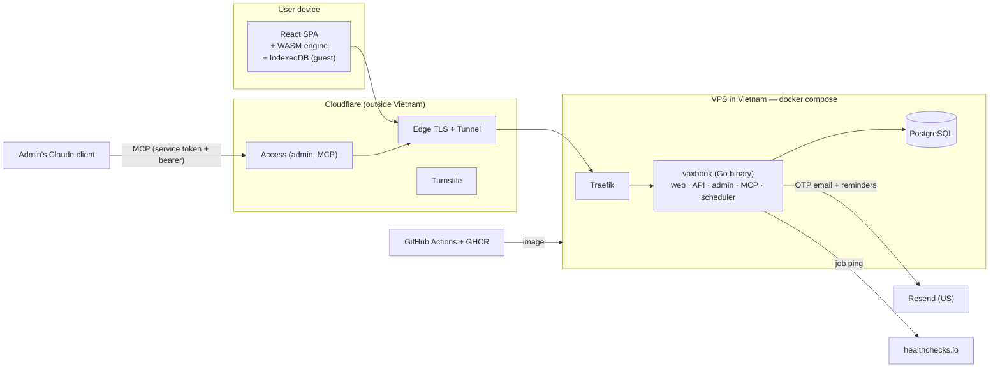
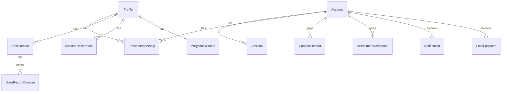
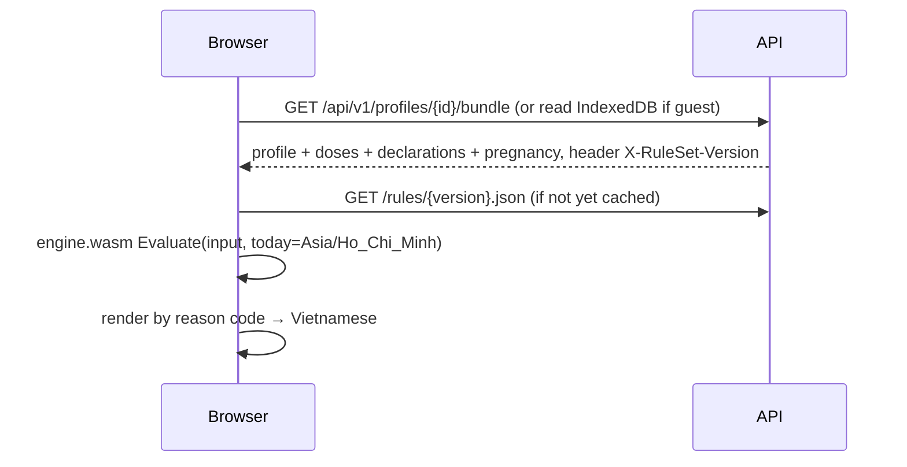

# VaxBook — Software Architecture Document (SAD)

| | |
|---|---|
| **Version** | 1.1 — 2026-11-11: engine semantics (§5.6 B1–B13) settled in spec v1.2; v1.0 approved by the project owner on 2026-11-10 |
| **Date** | 2026-11-11 |
| **Inputs** | [`feature-spec-mvp.md`](feature-spec-mvp.md) v1.0 and v1.2 (engine semantics EQ1–EQ27, Appendix C), [`research/2026-11-10-feature-research.md`](research/2026-11-10-feature-research.md), SAD grilling session (Q1–Q34), engine prototype (`engine-prototype/`) |
| **Hard-to-reverse decisions** | [`docs/adr/`](adr/) — ADR-0001 → 0011 |
| **Terminology** | [`GLOSSARY.md`](../GLOSSARY.md) |

> This document describes **how to build**. Features and business rules belong to the spec; every place where the SAD proposes a spec change is collected in §17. Items marked **(UNVERIFIED)** have not been confirmed against the original source.

---

## 1. Goals, constraints, quality attributes

**Constraints**
- One operator, nonprofit, low budget. Infrastructure must run on the existing VPS (2 vCPU, 3.8 GB RAM, shared with other stacks).
- Vaccination data is **sensitive health data** (Nghị định 356/2025 (Decree 356/2025/ND-CP), Article 4(1)(d)).
- Vietnamese only, mobile first, basic PWA.

**Quality attributes (in priority order)**

| # | Attribute | Meaning in VaxBook | Main mechanism |
|---|---|---|---|
| 1 | **Medical safety** | Never recommend earlier than is safe; never conclude "out of age" when not certain (P1) | Pure engine, tested with golden cases, versioned rules with a publish gate, suspension valve |
| 2 | **Consistency** | The browser, email and age schedule table reach the same conclusion | One engine (ADR-0002), one rule snapshot (ADR-0004) |
| 3 | **Privacy** | Minimal collection; admin and MCP never see user data | Separation by host, no user-data screens, logs contain no PII |
| 4 | **Cheap, low-effort operation** | One binary, one database, no separate queue or worker | ADR-0001, ADR-0009, in-process scheduler |
| 5 | **Extensible (P6)** | Add prices, push, profile sharing without a large migration | `ProfileMembership`, notification content separated from delivery channel, replaceable price source layer |

---

## 2. System context



| Hostname | Purpose | Protection |
|---|---|---|
| `vaxbook.<operator-domain>` | User app + API `/api/v1` + static assets | Session cookie, Turnstile on the OTP form and the error report form |
| `vaxbook-admin.<operator-domain>` | Admin pages + API `/admin/api/v1` | Cloudflare Access (admin email OTP), app verifies the Access JWT |
| `vaxbook-mcp.<operator-domain>` | MCP streamable HTTP | Cloudflare Access service token + app bearer token |

Single-level subdomains are used because Cloudflare's free SSL certificate covers only one level (ADR-0008, ADR-0011).

**External data processors** (ADR-0005)
- **Cloudflare:** data is in cleartext while passing through the edge.
- **Resend:** email content and metadata are stored in the US for 30 days, including nicknames and disease names per F08.
- **healthchecks.io:** receives pings only, no personal data.
- **GitHub:** holds source code only.

---

## 3. Repo structure (ADR-0001)

```
vaxbook/
├── Taskfile.yml                 # build, gen, test, dev, release
├── go.mod                       # one Go module for the whole repo
├── engine/                      # recommendation engine — pure Go, stdlib only, no I/O
│   ├── testdata/golden/         # test cases as golden files (JSON input + output)
│   └── wasm/                    # js/wasm entry point (build tag)
├── ruleset/                     # rule set snapshot: types, validation, changeset apply, diff
├── apps/
│   ├── api/
│   │   ├── cmd/vaxbook/         # main: HTTP (3 hosts), scheduler, migrations at startup
│   │   └── internal/            # identity, profiles, consent, guestimport, reminders,
│   │                            # notifications, feedback, editorial, admin, mcp, audit,
│   │                            # httpapi (oapi-codegen code), store (ent + migrations)
│   └── web/                     # Vite + React; src/app (user), src/admin (separate chunk)
├── contracts/
│   ├── openapi.yaml             # OpenAPI 3.1 — source of truth for the API
│   └── ruleset.schema.json      # JSON Schema of the snapshot + engine I/O
├── reviewers/                   # prompts/skills for the 5 AI reviewer roles (ADR-0006)
├── deploy/                      # compose.yaml, .env.example, Traefik labels
└── docs/                        # spec, SAD, ADR, research
```

- **Engine contract.** The Go structs in `engine/` and `ruleset/` are the source. `contracts/ruleset.schema.json` is written alongside them, and a test confirms every golden file is valid against the schema, so the TypeScript types (generated from the schema) do not drift from Go.
- **Main Taskfile tasks:**
  - `gen`: runs oapi-codegen, openapi-typescript, ent generate, and generates TS types for the engine.
  - `build:wasm`: builds WASM, then pre-compresses it with brotli.
  - `build`: builds the web app, embeds it in the binary with `go:embed`, producing a single binary.
  - `test`: Go tests (including golden) and Vitest.
  - `e2e`: Playwright.
  - `migrate:diff`: runs Atlas, generates migration files in goose format.

---

## 4. Components in the `vaxbook` binary

A single process, routed by `Host`. Each module in `internal/` has a small interface and hides its internal details (deep module).

| Module | Responsibility | Main interface (sketch) |
|---|---|---|
| `engine` (outside `internal`, shared with WASM) | Computes the assessments for one profile | `New(snapshot) (*Engine, error)`; `Validate(Input) []Problem`; `Evaluate(Input) (Output, error)` |
| `ruleset` | Immutable snapshot; applies `ChangeOperation`; validation (IDs not reused, citations have a specific location…); structural diff | `Apply(base, ops) (Snapshot, []Problem)`; `Diff(a, b)`; `Validate(s)` |
| `identity` | Email OTP, session, email change, Turnstile, rate limiting | `RequestOTP`, `VerifyOTP → Session`, `Authenticate(r) → AccountID` |
| `profiles` | Account, Membership, Profile, DoseRecord, DiseaseDeclaration, PregnancyStatus; permission checks via membership; "at most one Me" constraint | `Bundle(accountID, profileID)` returns exactly the shape of `engine.Input` (except "today") |
| `consent` | ConsentRecord (account level and account–profile level), DisclaimerAcceptance, withdrawing consent triggers deletion | `Grant`, `Withdraw`, `Has` |
| `guestimport` | Imports guest data in one transaction after `engine.Validate`, upserts by client-generated ID, rejects IDs belonging to another account (F01.3) | `Import(accountID, payload) (Summary, error)` |
| `reminders` | Daily job: recomputes with the native engine, groups emails per account, prevents duplicate sends | `RunDaily(ctx, today)` |
| `notifications` | In-app notifications (stores code + parameters, the UI renders them); content separated from delivery channel (P6) | `Emit(accountID, kind, params)`, `List`, `MarkRead` |
| `feedback` | Anonymous "Báo sai dữ liệu" ("Report a data error") reports; moderation queue | `Submit`, `Moderate` |
| `editorial` | Changeset → Revision → TestRun → Finding → Approve → Publish / Rollback / Suspend | `Submit(rev)`, `Publish(rev)`, `Rollback(target, reason)`, `Suspend(target, reason)` |
| `mcp` | MCP server (Go MCP SDK v1.8): the F12 tools, calls **only** `editorial`, `ruleset`, `feedback` (moderated version) | — |
| `audit` | Append-only log (F11.7) | `Record(actor, action, subject, data)` |

**Mandatory data boundaries**
- `mcp`, `editorial` and `admin` do not import `profiles`, `consent` or `guestimport`.
- Admin sees only aggregate counts, obtained through a dedicated `stats` function (F11.1, F12).
- This boundary is enforced by an import-graph test.

---

## 5. Recommendation engine

### 5.1 Contract

```
Validate(Input) → []Problem         // input checks; run by the server and by guest import before Evaluate
Evaluate(Input) → (Output, error)   // pure: no clock reads, no I/O; never coerces input values
Input  = { today, profile{birth(FuzzyDate), sex, historyStatus, historyStatusAt, pregnancy…},
           doses[{id, diseases[], product?, freeProduct?, date(FuzzyDate), doseNumber{disease→n}}],
           declarations[{disease, kind, createdAt, until?}], suspensions[…] }
Output = { ruleSetVersion, today, assessments[ Assessment ], historyIncompletePending[ disease ] }
Assessment = { disease, bucket | block, nextDose{number, earliest, due, overdue},
               seriesUsed[], products[], estimated, reasons[{code, params}], citations[] }
bucket = overdue | due | upcoming | unknown | complete
block  = notYetScheduled | outOfAge | infoOnly | acknowledged | pregnancyDeferred | inPregnancy
const overdueGraceDays = 7          // display constant of the contract, not a rule field (EQ1)
```

- **"Today"** is the calendar date in `Asia/Ho_Chi_Minh`, passed in by the caller: the browser computes it itself, the server computes it in the job.
- **Dates** are calendar dates with no time. **Adding months keeps the day of the month; if the target month does not have that day, use the last day of the month** (31/01 + 1 month = 28/02). 1 week = 7 days.
- **Input errors** (EQ27, A9). `Validate` is a separate function that reports every problem in an input; the server and guest import run it before `Evaluate`. `Evaluate` never coerces values:
  - an unparseable dose date gives ⚪ `INVALID_DATE` for every disease of that dose record;
  - an invalid birth date, or the history status "Chưa nhập xong" ("Not finished entering") without `historyStatusAt`, makes `Evaluate` return an input error instead of an `Output`.
- **Display constants** (EQ27): `overdueGraceDays = 7`, the 30-day and 6-month bucket thresholds, the 6-month threshold of the "Chưa tới lịch tiêm" ("Not yet scheduled") block and the 3-month "sau sinh — hỏi bác sĩ" ("after delivery — ask a doctor") note are engine constants, not medical rules; P2's citation requirement does not apply to them (spec v1.2 F05.2, F05.4).
- **`notYetScheduled`** is the block "Chưa tới lịch tiêm" ("Not yet scheduled"; EQ2, EQ18): no dose given yet and dose 1 is due more than 6 months after today. Like every block it is collapsed, never red, never emailed and not counted toward the attention level (F03.4).
- **`historyIncompletePending[]`** lists the diseases that still carry `NOT_ENTERED` (§5.3 step 11). The server and the client decide the automatic exit from "Chưa nhập xong" ("Not finished entering") from this one field (EQ12, EQ22).
- **The identity of a next dose** is `(profile, disease, dose number)`. Email de-duplication uses the key `(next dose, due date, milestone)` (F08).
- **Reason codes** are a closed, versioned catalog (§5.4). The wording is generated by the web app and the email templates (ADR-0003).

### 5.2 Rule model (ADR-0003, ADR-0004)

The public snapshot contains `diseases`, `products` (live vaccine flag), `series`, `rules`, `tcmrLabels`, `citations`, `sourceDocuments`, `providerOfferings`, and `changeNotes`.

A `Series` contains:
- `disease`
- `product?` (empty = applies to every product for the disease)
- `stage` (childhood / adult)
- `startAge [min, max)`: required whenever a (disease, product) pair has more than one series (EQ26)
- `maxAgeStart?`, `maxAgeComplete?`
- `catchUpAfterAge?` (EQ26): when the next dose would fall after this age, the engine gives ⚪ `CATCH_UP_ASK_DOCTOR` instead of 🟠/🔴. Dose counts that shrink with the age at the *current* dose are not modelled in the MVP.
- `plans[]`: more than one element means there are alternative plans; every plan in one series has the same number of doses (EQ5)
- `citations[]`

Each `plan` has `doses[]`; each element is a `DoseRule` containing:
- `minAge?`, `minInterval?` (from the previous dose), `minIntervalFromFirst?`; every dose rule has a minimum age or a minimum interval (A7)
- `recommended = {from: birth | firstDose | previousDose, offset}`
- `buffer?`, `tolerance?`

**`tolerance` semantics** (EQ27): used only when validating doses already given. It applies to the minimum age, the minimum interval and `minIntervalFromFirst`, never to the maximum ages, and it is never used to compute the earliest allowed date or the due date (P1). It is checked at both ends of the (today-capped) dose date range. **`buffer`** only moves the overdue date: overdue date = due date + max(buffer, `overdueGraceDays`) (EQ1).

`Rule` holds the disease-level special rules: periodic booster, pre-pregnancy, allowed additional dose, same-product requirement, information-only. The **same-product requirement** is a disease-level `Rule {kind: sameProduct, citations}` (F04.3, F11.8), not a flag on `Series` (EQ27). Details of the additional structures the prototype revealed are in §5.6 table C.

The prototype taught two things about the model:
- **A recommended milestone needs an "anchor".** The HPV 0-2-6 month schedule counts from the first dose, not from the birth date.
- **`startAge` (the starting age range used to select a series) is different from `minAge` (the minimum age at which a dose may be given).** When the prototype mistakenly entered the minimum age of Gardasil 9 as 15 years, a dose given to a 14–15-year-old was marked "invalid". The `ruleset` validation step catches this kind of error (below).

**Rule set validation** (`ruleset.Validate`, engine-semantics checks):

| Check | Severity | Source |
|---|---|---|
| Every plan within one series has the same number of doses. Plans with different dose counts can only be entered as separate series that differ by product or by non-overlapping `startAge`; otherwise the admin chooses one plan (with citation) or the disease is not scheduled | Reject | EQ5 |
| A (disease, product) pair with more than one series gives every series a `startAge`, and those `startAge` ranges do not overlap | Reject | EQ26, table C |
| Every dose rule has a minimum age or a minimum interval | Reject | A7 |
| The `minAge` of dose 1 is not greater than the series' `startAge.min` | Warn | Gardasil 9 lesson above |
| A changeset ends the last series of a scheduled disease | Warn | EQ26 |

`ruleset` also records, per dose rule, whether its minimum age is implied by dose 1's minimum age plus the minimum intervals (minAge_k ≤ minAge_1 + Σ minInterval of doses 2…k). The engine needs this for profiles without a birth date (§5.3 step 7, EQ19).

### 5.3 Assessment procedure (per disease)

Steps 1–3 prepare the doses and the candidate series; steps 5–9 are evaluated at each end of the birth-date range and compared as described in step 4; step 10 applies the precedence that decides the final bucket or block; step 11 computes `historyIncompletePending`. Dose-level validation and the maximum-age checks always run **per candidate series**. Reasons from every end, candidate and masked layer are kept in `reasons[]` (A8, EQ21).

1. **Collect the dose records** for the disease. A record whose date cannot be parsed makes the disease ⚪ `INVALID_DATE` (§5.1). Level 2–3 dose dates (month-year, year only) become the range **[period start, min(period end, today)]** (EQ7); this today-capped range is used for ordering, validation and the next-dose computation alike. The later end of the birth-date range is also capped at today (EQ17). Mark `estimated` if the birth date or a dose date is not at full-day precision, or if any dose is at level 4 or implied (EQ20d).
2. **Assign positions** (F04.2, A4, EQ20a). One position-assignment algorithm: walk the dated doses in time order; a user-entered dose number places that dose at its number and resets the counter.
   - Conflicting user-entered numbers (duplicates, or numbers that contradict the time order) → ⚪ `NUMBERING_CONFLICT`.
   - Overlapping date ranges with no user-entered number → ⚪ `OVERLAPPING_ESTIMATED_DATES`.
   - A **numbered** level-4 dose sits at its number. An **unnumbered** level-4 dose counts toward the number of doses given but has no position.
   - A user-entered dose number greater than the number of records makes the missing earlier doses **implied doses** (counted, undated), with `IMPLIED_EARLIER_DOSES`.
   - Allowed additional doses (`ExtraDoseRule`) do not count toward the series.
3. **Select the candidate series** (F05.3, F05.5, EQ10, EQ14, EQ26):
   - **Effective dating** (EQ26): the next dose uses the series and rules in effect today; a recorded dose is valid if it satisfies the rule in effect on its dose date **or** the rule in effect today (step 5). A scheduled disease with no series in effect → ⚪ `NO_SERIES_IN_EFFECT`; it is never silently dropped.
   - **Products** (A2): determine the candidates **per dose** (the product's specific series → the disease's general series → every series of the disease), then take the union. The "possible products" for a dose with an unknown or off-catalog (free-text) product are the catalog products, including retired ones (EQ14). A retired product stays in the snapshot with its series and is treated as an unknown product (F11.3).
   - **Start age, doses given:** filter by `startAge` against the age at the first dose, computed as a range. If several brackets of the same product match, take the **series with the most doses** (F05.5, `AGE_AT_START_UNCERTAIN`).
   - **Start age, no dose yet** (EQ10): each end of the birth-date range uses the `startAge` bracket valid at that end; the "more doses" rule does not apply. Candidates that are already out of age are removed (A3), so n = 0 never produces `CHECK_PRODUCT_NAME`.
   - **Older than every bracket** (A5): the earliest bracket is used only when the person is certainly **younger** than every bracket; the upper bound of `startAge` acts as a maximum age to start.
   - If several candidate series remain, use the **safest series** (F05.3, `SAFEST_SERIES`, whose params list each series ID with its product ID or `generic`, never an empty element).
4. **Evaluate at both ends of the birth-date range and compare** (F05.5, EQ17). Steps 5–9 run at the older end (earliest possible birth date) and at the later end (latest possible birth date, capped at today).
   - Dates driven by a minimum age or a minimum interval come from the **later** end; dates capped by a maximum age come from the **older** end (EQ15).
   - Results that differ only in how far away a milestone is, all within {"Chưa tới lịch tiêm" ("Not yet scheduled") block, 🟡, ✅ "Đang theo phác đồ" ("On series")}, are **not** different results: show the later end's result with the estimated label.
   - Any other difference, i.e. one involving 🟠, 🔴, out of age, a cap or dose validity → ⚪ `BIRTH_DATE_IMPRECISE{hint}`. When either end hits an age limit, the hint is "Nhập ngày sinh đầy đủ" ("Enter the full date of birth") (A8).
   - Identical results → the later end's result.
   - **No birth date** (EQ19): a single evaluation without any age-based step; see steps 5 and 7.
5. **Validate the doses already given** (F05.10, EQ7, EQ8, EQ20b, EQ26, EQ27), per candidate series, at both ends of each (today-capped) date range:
   - A dose is valid if it satisfies at least one alternative plan's dose rule; the plan is never inferred (A7, EQ27). It may satisfy either the rule in effect on its dose date or the rule in effect today (EQ26).
   - Checks: minimum age; minimum interval to the dose **adjacent in time** (never against dose j−2); `minIntervalFromFirst`; `maxAgeStart` for dose 1 only (A6); `maxAgeComplete` for every dose. `tolerance` applies as defined in §5.2.
   - A definite violation of a minimum (age or interval) → ⚪ `DOSE_INVALID`; the dose is not counted.
   - Dose 1 certainly after `maxAgeStart`, or any dose certainly after `maxAgeComplete` → ⚪ `DOSE_AFTER_MAX_AGE` ("mũi này tiêm sau độ tuổi khuyến cáo — hỏi bác sĩ" ("this dose was given after the recommended age — ask a doctor")); the dose is not counted (EQ7).
   - A violation at only one end of the date ranges → ⚪ `DOSE_POSSIBLY_INVALID`.
   - Candidates that disagree: `DOSE_AFTER_MAX_AGE` only when every candidate agrees; otherwise ⚪ `CHECK_PRODUCT_NAME` (some dose has an unknown product) or ⚪ `MIXED_PRODUCTS` (every dose has a named product, EQ16). When candidates disagree, the engine never derives n = 0 or out of age from a dose being "not counted".
   - **Undated predecessor** (EQ8, EQ20b): the minimum interval to a level-4 or implied predecessor cannot be checked; the dose is trusted (counted), the result is estimated, reason `INTERVAL_UNVERIFIABLE`, and the disease may reach ✅. This waives **only** that interval: minimum age, maximum ages and `minIntervalFromFirst` are always checked whenever the needed dates exist. If no placement of the undated dose(s) satisfies every constraint (given the dated neighbours and the birth-date range) → ⚪ `DOSE_INVALID`.
   - **No birth date** (EQ19): minimum age, `maxAgeStart` and `maxAgeComplete` are not checked; interval checks are kept.
   - **Switching products** (EQ27): when the disease has a `sameProduct` Rule, `SWITCHED_PRODUCT` is emitted only when two or more distinct *known* (catalog or retired) products appear among the doses that are not allowed additional doses. It is informational and does not change the bucket.
6. **If the series is complete**, ✅ `COMPLETE` (a candidate with all doses counts as complete, A1), then continue with periodic boosters (step 8). When some dose uses an off-catalog product and the series is complete per the safest series over the catalog products → ✅ with `PRODUCT_NOT_IN_CATALOG` and the estimated label ("có mũi ngoài danh mục — xác nhận với bác sĩ đã đủ mũi" ("includes an off-catalog dose — confirm with a doctor that the series is complete"); EQ14).
7. **Otherwise compute next dose k** with the rules in effect today (F05.4, EQ1, EQ6, EQ15, EQ19, EQ20, EQ26):
   - **Per plan of each candidate series:** earliest allowed date = max(minimum age, previous dose + minimum interval, first dose + `minIntervalFromFirst`), using the later (today-capped) end of each date range. Due date = max(earliest allowed date, recommended milestone). Overdue date = due date + max(buffer, `overdueGraceDays`) (EQ1).
   - **Undated predecessor:** if dose k−1 is a numbered level-4 dose, or an unnumbered level-4 dose may be the latest dose → ⚪ `PREVIOUS_DOSE_DATE_UNKNOWN` (subject to step 10).
   - **First-dose anchor without a first-dose date** (EQ20c): if dose 1 is level 4 or implied and a milestone or interval is anchored on the first dose (e.g. HPV 0-2-6), the earliest dated dose stands in for the first-dose date (this can only push dates later); estimated, reason `FIRST_DOSE_DATE_ASSUMED`.
   - **No birth date** (EQ19): milestones anchored on the first dose or the previous dose are computed normally. A birth-anchored milestone for dose k becomes due date = max(earliest allowed date, previous dose + (milestone_k − milestone_{k−1})), labelled estimated (e.g. measles dose 2 = dose 1 + 9 months). If dose k has a minimum age that is not implied by dose 1's minimum age plus the minimum intervals (§5.2) → ⚪ `NO_BIRTH_DATE`. Doses with `maxAgeComplete` stay ⚪ (F05.5); `maxAgeStart` applies only to dose 1 (A6).
   - **Merge** (EQ6), in this order:
     1. Within each candidate series, collapse the alternative plans (F05.4): the due date comes from the plan with the earliest due date, and the earliest allowed date from that same plan (A7); the overdue date comes from the latest plan. Reason `ALTERNATIVE_PLANS` if any candidate series has alternatives.
     2. Across candidate series (safest series, F05.3): earliest allowed date, due date and overdue date each take their latest value.
     3. Apply the maximum-age cap below.
   - **Maximum-age cap** (EQ15). L = `maxAgeComplete` − 1 day, computed at the **older** end of the birth-date range. L_k = L minus the sum of the minimum intervals of the doses after dose k (the last allowed day, "hạn chót", for dose k); for n = 0, L_k also takes the minimum with `maxAgeStart` − 1 day. With several candidate series (unknown product, mixed products, off-catalog product), use the **smallest L** among the candidates that still need dose k and derive L_k from it (EQ15); the cap is applied after the merge.
     - Let F = max(today, earliest allowed date), the first day from today on which dose k may be given.
     - F ≤ L_k: due date and overdue date = min(current value, L_k), whatever the source of the buffer. A dose whose date this lowers is capped: reason `DUE_CAPPED_BY_MAX_AGE`, it is **never 🔴**, it shows 🟠 until L_k with the wording "hạn chót DD/MM" ("last day DD/MM"), and the pre-due emails (7 days, 1 day) use the capped due date.
     - L_k < F ≤ L: 🟠 until L, reason `SERIES_MAY_NOT_COMPLETE` ("có thể không kịp đủ phác đồ — hỏi bác sĩ" ("may not be able to complete the series — ask a doctor")), informational; the remaining-dose chain is computed from F at the young end of the birth-date range.
     - F > L: the `outOfAge` block when this is certain at the young end of the birth-date range ("or the next dose can no longer be given before the maximum age", F05.4a); otherwise ⚪ `BIRTH_DATE_IMPRECISE` with the hint "Nhập ngày sinh đầy đủ" ("Enter the full date of birth").
   - **Catch-up** (EQ26): if the series has `catchUpAfterAge` and the next dose would fall after that age → ⚪ `CATCH_UP_ASK_DOCTOR` ("lịch tiêm bù — hỏi bác sĩ" ("catch-up schedule — ask a doctor")) instead of 🟠/🔴.
   - **Maximum age, no next dose possible:** when the person is certainly past `maxAgeStart` (n = 0) or `maxAgeComplete` for every candidate, the result is the `outOfAge` block (`OUT_OF_AGE`). Candidates that reach different conclusions (only possible with doses given, A3) → ⚪ `CHECK_PRODUCT_NAME` (some dose has an unknown product) or `MIXED_PRODUCTS` (every dose has a named product) (A1, EQ16).
8. **Periodic boosters** (EQ24), reason `BOOSTER_DUE`. The booster starts after the primary series is complete; dose numbers continue those of the series. A disease that only has a periodic booster (e.g. adult influenza) is modelled as a one-dose series plus a booster.
   - **"Every N months":** earliest allowed date = last dose + minimum interval; due date = last dose + N months; overdue date = due date + max(buffer, `overdueGraceDays`).
   - **"By season":** due date = start of the season window; overdue date = end of the window (no 7-day grace). If the window passes without a dose, the next dose rolls to the next season's window (🟡, ✅ or a block), never 🔴.
   - **Last dose unknown:** when the last dose is at level 4, or the primary series is ⚪ because of the history status or a history declaration (`FORGOT_CHILDHOOD`, `NOT_ENTERED`, level 5) with no dated dose, follow the rule's `onLastDoseUnknown`: `treatAsDue` → 🟠 with the estimated label, never 🔴 and no overdue email; `unknown` → ⚪. Without a source the default is ⚪ (F05.2).
9. **Assign the bucket** (F05.4, EQ1, EQ2, EQ18):
   - 🔴 Quá hạn ("Overdue"): today ≥ overdue date and the person is certainly within age. A dose capped by EQ15, a `treatAsDue` booster and a seasonal booster never become 🔴. With buffer 0 a dose is 🟠 on its due date and 🔴 from due date + 7 days.
   - 🟠 Đến hạn ("Due"): today ≥ earliest allowed date, due date ≤ today + 30 days, today < overdue date.
   - 🟡 Sắp tới ("Upcoming"): due date in (today + 30 days, today + 6 months], or today < earliest allowed date and due date ≤ today + 30 days.
   - ✅ "Đang theo phác đồ" ("On series", `ON_TRACK`): at least one dose given and the next dose more than 6 months away.
   - `notYetScheduled` block: no dose given and dose 1 due more than 6 months after today (EQ2). Item label: "Chưa tới tuổi tiêm — dự kiến MM/YYYY" ("Not yet of vaccination age — expected MM/YYYY") when today < earliest allowed date; otherwise "Theo lịch khuyến cáo — dự kiến MM/YYYY, có thể tiêm từ MM/YYYY" ("Per the recommended schedule — expected MM/YYYY, may be given from MM/YYYY") (EQ18). It moves to 🟡 and then 🟠 as time passes.
10. **Apply the precedence** (EQ21, spec v1.2 F05.11). Highest first; the first layer that applies decides the bucket or block; reasons from masked layers stay in `reasons[]`:
    1. Information-only disease → `infoOnly` block "Chỉ lưu trữ" ("Record only"), `INFO_ONLY`.
    2. Active **acknowledged declaration** (already immune, doctor advised against, postponed until, chose not now) → `acknowledged` block "Đã ghi nhận" ("Recorded"), `DECLARED_*`. These win while active even when dose records exist (EQ23).
    3. Suspension of the disease, series or rule → ⚪ `SUSPENDED`.
    4. Pregnant and the disease is on the "consider during pregnancy" list → `inPregnancy` block "Trong thai kỳ" ("During pregnancy"), `IN_PREGNANCY`.
    5. **Certainly out of age** → `outOfAge` block "Không còn trong độ tuổi tiêm" ("No longer within the vaccination age"), `OUT_OF_AGE`: today ≥ `maxAgeComplete` at the young end of the birth-date range regardless of previous dose dates (EQ11), or step 7 gives a certain `outOfAge` (certainly past `maxAgeStart` with n = 0, or past `maxAgeComplete` for every candidate, or the cap's "F > L" case at the young end of the birth-date range). It wins over the history-status defaults (layer 6), over the level-4 ⚪ and over a dose-validity ⚪ when the series would still be incomplete even if every questioned dose were counted; if counting the questioned dose would complete the series, ⚪ is kept (P1, A1).
    6. **History-status defaults** (F03.6, F04.5): ⚪ `NOT_ENTERED` for milestones due before `historyStatusAt` with option 1 "Chưa nhập xong" ("Not finished entering"), including the adult quick-button variant (a `NOT_ENTERED` parameter that only changes the label); ⚪ `FORGOT_CHILDHOOD` with option 2, only for milestones of childhood-stage series whose due date is before `historyStatusAt` (EQ13). Later milestones are computed normally.
    7. **Data ⚪:** the history declaration "chưa rõ" ("unknown", level 5), which covers only milestones whose due date is before the declaration's `createdAt` (EQ23); dose validity; level-4 previous dose; disagreement between the ends of an imprecise birth date; product uncertainty; no birth date.
    8. The bucket from step 9, or the `notYetScheduled` block.
    - **History declarations** (EQ23): a dose record for the disease takes precedence over a history declaration ("chưa rõ" ("unknown") or "đã xác nhận chưa tiêm" ("confirmed not vaccinated")); a history declaration takes precedence over the history status. "Đã xác nhận chưa tiêm" ("confirmed not vaccinated") lets the computed bucket stand.
    - **Acknowledged declarations over time** (EQ23): when "Hoãn đến [ngày]" ("Postpone until [date]") expires, the item returns to the bucket the engine computes (the in-app banner is F08.1). "Tôi chọn không tiêm lúc này" ("I choose not to get vaccinated at this time") stays in "Đã ghi nhận" ("Recorded") until the user answers the 12-month re-ask.
    - **Pregnancy** (F05.7, EQ18, EQ25), after layer 8:
      - Pregnant: live-vaccine products are removed from the listed products; an item in 🔴/🟠/🟡 with no product left moves to the `pregnancyDeferred` block "Hoãn trong thai kỳ" ("Postponed during pregnancy"), `PREGNANCY_DEFERRED`, with no email (EQ21 layer 8, EQ25a); if non-live products remain, it stays in its bucket listing only those.
      - Pregnant: a live-vaccine item in the `notYetScheduled` block or in ✅ "Đang theo phác đồ" ("On series") whose expected month is on or before the estimated delivery date shows "sau sinh — hỏi bác sĩ" ("after delivery — ask a doctor") instead of the month.
      - The "sau sinh — hỏi bác sĩ" ("after delivery — ask a doctor") note lasts 3 months after the estimated delivery date, or until a dose for that disease is recorded.
      - A live vaccine recorded in the 3 months before the pregnant flag was turned on → `LIVE_VACCINE_BEFORE_PREGNANCY` ("hỏi bác sĩ" ("ask a doctor")) on that disease.
      - Planning flag on: the before-pregnancy rule only adds `PRE_PREGNANCY`, the note "nên tiêm xong ít nhất 3 tháng trước khi mang thai" ("should be completed at least 3 months before pregnancy"), to the disease's normal assessment; it never creates 🔴 by itself. Emails never mention pregnancy (F08).
11. **Compute `historyIncompletePending`** (EQ12, EQ22): the diseases that still have a milestone with `NOT_ENTERED` at either end of the birth-date range, taken from layer 6 **before** the suspension and pregnancy layers (3, 4) are applied. Acknowledged declarations (layer 2) and certain out of age (layer 5) remove a disease; milestones after a level-4 dose are not pending. Entering dose 1 of 3 does not remove the disease. The consumers (server and client) use the field as follows:
    - the profile leaves "Chưa nhập xong" ("Not finished entering") when the user taps "Tôi đã nhập xong" ("I have finished entering"), or automatically when the list is empty;
    - the automatic exit is evaluated only right after the user saves a dose record or a disease declaration, never on passive recomputation (new rule version, rollback, suspension, passage of time);
    - a profile without a birth date leaves the state only through the button.

### 5.4 Reason code catalog (v1)

From the prototype: `SAFEST_SERIES`, `AGE_AT_START_UNCERTAIN`, `ALTERNATIVE_PLANS`, `OVERLAPPING_ESTIMATED_DATES`, `DOSE_INVALID`, `DOSE_POSSIBLY_INVALID`, `PREVIOUS_DOSE_DATE_UNKNOWN`, `CHECK_PRODUCT_NAME`, `OUT_OF_AGE`, `NOT_ENTERED`, `BIRTH_DATE_IMPRECISE`, `NO_BIRTH_DATE`, `FORGOT_CHILDHOOD`, `ON_TRACK`, `COMPLETE`, `IMPLIED_EARLIER_DOSES`, `PRODUCT_NOT_IN_CATALOG`.

For the parts the prototype did not build: `SUSPENDED`, `DECLARED_*`, `PREGNANCY_DEFERRED`, `IN_PREGNANCY`, `PRE_PREGNANCY`, `BOOSTER_DUE`, `SWITCHED_PRODUCT`, `INFO_ONLY`.

Added by the engine semantics decisions (spec v1.2):

| Code | Meaning | Wording shown to the user |
|---|---|---|
| `DUE_CAPPED_BY_MAX_AGE` | Due and overdue dates capped at the last allowed day L_k; never 🔴 (EQ15) | "hạn chót DD/MM" ("last day DD/MM") |
| `SERIES_MAY_NOT_COMPLETE` | The next dose can still be given, but not early enough to complete the series before the maximum age; informational (EQ4, EQ15) | "có thể không kịp đủ phác đồ — hỏi bác sĩ" ("may not be able to complete the series — ask a doctor") |
| `DOSE_AFTER_MAX_AGE` | Dose 1 certainly after `maxAgeStart`, or a dose certainly after `maxAgeComplete`; not counted (EQ7) | "mũi này tiêm sau độ tuổi khuyến cáo — hỏi bác sĩ" ("this dose was given after the recommended age — ask a doctor") |
| `INTERVAL_UNVERIFIABLE` | Interval to a level-4 or implied predecessor cannot be checked; dose trusted (EQ8) | "không kiểm tra được khoảng cách — đối chiếu sổ tiêm" ("interval cannot be checked — compare with the vaccination record") |
| `FIRST_DOSE_DATE_ASSUMED` | Earliest dated dose used as the first-dose anchor (EQ20c) | — |
| `MIXED_PRODUCTS` | Candidates disagree on maximum age and every dose has a named product (EQ16) | "đã dùng nhiều loại vaccine — hỏi bác sĩ" ("several vaccine types were used — ask a doctor") |
| `NUMBERING_CONFLICT` | User-entered dose numbers conflict (A4) | — |
| `INVALID_DATE` | Unparseable dose date (A9, EQ27) | — |
| `NO_SERIES_IN_EFFECT` | A scheduled disease has no series in effect today (EQ26) | — |
| `CATCH_UP_ASK_DOCTOR` | Next dose after `Series.catchUpAfterAge` (EQ26) | "lịch tiêm bù — hỏi bác sĩ" ("catch-up schedule — ask a doctor") |
| `LIVE_VACCINE_BEFORE_PREGNANCY` | Live vaccine recorded in the 3 months before the pregnant flag was turned on (EQ25d) | "hỏi bác sĩ" ("ask a doctor") |

Codes without wording here get their text when the web app and email templates are written; the wording is not part of the engine contract.

Adding a new code does not break compatibility. Changing the meaning of an existing code requires bumping `engineContractVersion`.

### 5.5 Prototype results (2026-11-10)

| Question | Result |
|---|---|
| Can it represent the 5 hard cases? | **Yes.** Safest series for Rota with an unknown product (including ⚪ when the products disagree on maximum age); overlapping estimated dates; Gardasil 9 started at an estimated age of 14–15 (3-dose series selected); 2-3-4 / 2-4-6 series (🟠 window spanning from 15/09 to 15/10); "Chưa nhập xong" ("Not finished entering") before and after the chosen point in time |
| Native = WASM? | **20/20 steps byte-identical** (comparing the JSON output strings) |
| WASM size (Go 1.27.3, `-s -w`) | 4.45 MB raw · 1.23 MB gzip · **906 KB brotli** |
| Time for one evaluation (including JSON) | native 8.5 µs · browser about 110 µs · **about 190–260 µs with 4× CPU slowdown emulation** |
| WASM startup | about 70 ms on first load (desktop) |

Conclusion: keep ADR-0002. WASM size is the main cost and is acceptable, because it loads only after the user ticks the disclaimer and is cached long-term. Go 1.27 is about 180 KB brotli heavier than 1.26, due to `encoding/json` v2.

### 5.6 Findings from the engine prototype review

The adversarial review had 5 reviewers and 5 verifiers. All 37 findings were reproducible: 27 were confirmed as-is, 10 were reclassified, **no finding was rejected**. Details and repros: [`research/2026-11-10-engine-prototype-review.md`](research/2026-11-10-engine-prototype-review.md).

**Architectural conclusions:**
- No finding requires abandoning typed data rules or the Go engine running in both places. Every gap can be handled by **adding data structures** (table C below) or **settling additional rules in the spec** (table B).
- A prototype of about 600 lines had more than ten high-severity logic bugs, so this is indeed the riskiest part. Each finding in table A becomes a **mandatory golden case** for the real engine. The adversarial review is kept as a fixed step whenever engine logic changes.

**A. Logic bugs: each must have a test when the real engine is written**

| # | Bug | Fix direction |
|---|---|---|
| A1 | Safest mode: a candidate that **already has all doses** is treated as "out of age", leading to a definite conclusion "không còn trong độ tuổi" ("no longer within the age range") (violates P1) | A candidate with all doses counts as "complete". Disagreeing candidates give ⚪ `CHECK_PRODUCT_NAME` |
| A2 | When doses use different products, one product's specific series masks the other product's general or "unknown" series, giving a result **less safe** than the unknown-product case | Determine candidates **per dose** (specific series → general series → every series for the disease), then take the union |
| A3 | No doses given yet, and products have different maximum ages to start, produces ⚪ "kiểm tra tên vaccine" ("check the vaccine name") | When n = 0, remove candidates that are already out of age from the product list. Never produce `CHECK_PRODUCT_NAME` when there are no doses yet |
| A4 | Ordering with level-4 doses or user-entered dose numbers: a dose given earlier than allowed is still counted; duplicate or out-of-order dose numbers skip the interval check; an unnumbered dose after dose "#2" is placed in the wrong position | A single **position-assignment** algorithm (walk in time order; a user-entered number resets the counter), add code `NUMBERING_CONFLICT` ⚪. Always check the interval between doses that are adjacent in time. Golden case from review finding dates-validity-2: a numbered level-4 dose that may be later than an unnumbered dated dose → ⚪ `PREVIOUS_DOSE_DATE_UNKNOWN` |
| A5 | A person **older than every starting age range** (e.g. 50 years old) is assigned the HPV 9–14-year series and gets 🔴 | Use the "earliest age range" only when the person is definitely **younger** than every range. The upper bound of the starting age range acts as a maximum age to start |
| A6 | No birth date: an in-progress HPV series is turned entirely into ⚪, only because the series has a maximum age to start | Check age limits per dose (maximum age to start applies only to dose 1) |
| A7 | Alternative plans: `earliest` takes the largest value across plans, pushing the due date to the latest plan | Compute each plan separately; `earliest` and `due` follow the plan that gives the earliest due date. Every dose rule must have a minimum age or a minimum interval |
| A8 | When computing at both ends of the birth date range, the reasons from the earlier end are lost | Keep the reasons from both ends; suggest "nhập ngày sinh đầy đủ" ("enter the full birth date") when either end hits an age limit |
| A9 | An unparseable date is silently treated as level 4 | Return an `INVALID_DATE` error during input validation |

**B. Gaps in the spec: settled on 2026-11-11** (engine semantics session, decisions EQ1–EQ27, folded into spec v1.2, Appendix C; the procedure in §5.3 implements them)

| # | Question | Option suggested by the review | Decision |
|---|---|---|---|
| B1 | Default buffer is 0 and `earliest` = `due`, so a dose moves straight from 🟡 to 🔴 on the very day it becomes allowed; **🟠 never appears** | 🔴 when today is **after** the overdue date, or a default buffer ≥ N days | EQ1: overdue date = due date + max(buffer, 7 days), 7 days being the display constant `overdueGraceDays`; 🟠 on the due date, 🔴 from due + 7. Spec v1.2 F05.2, F05.4 |
| B2 | No doses given yet and the first milestone is more than 6 months away: belongs to no bucket (prototype temporarily uses `notYet`) | ✅ "Chưa tới tuổi — mũi đầu dự kiến MM/YYYY" ("Not yet of age — first dose expected MM/YYYY"), or add a block | EQ2, EQ18: new block "Chưa tới lịch tiêm" ("Not yet scheduled"), `notYetScheduled`. Spec v1.2 F05.4, F05.4a |
| B3 | Due date falls **after** the maximum age to complete: shows ✅/🟡 then jumps straight into the "out of age" block | Move the due date back to the last day the dose can still be given, code `DUE_CAPPED_BY_MAX_AGE`. Consider checking "is there still time to complete the whole series" | EQ15 (supersedes EQ3, EQ4): unified cap at the last allowed day L_k computed at the older end; `DUE_CAPPED_BY_MAX_AGE` (never 🔴) or `SERIES_MAY_NOT_COMPLETE`. Spec v1.2 F05.4, F05.4a |
| B4 | Alternative plans have **different numbers of doses**: a person who completed the shorter plan still gets 🔴 | Require plans to have the same number of doses, or ⚪ "có thể đã đủ" ("may already be complete") | EQ5: rule set validation rejects plans with different dose counts in one series (§5.2). Spec v1.2 F05.2, F05.4a |
| B5 | Merge order when there are both alternative plans and an unknown product | Merge alternative plans within each series first, then apply the safest series across series | EQ6: plans within each series, then latest value across series, then the EQ15 cap. Spec v1.2 F05.3 |
| B6 | Doses use **known but different** products: which age limit applies | Take the strictest limit, with a dedicated code (do not use "kiểm tra tên vaccine" ("check the vaccine name")) | EQ15 (smallest L among candidates), EQ16: `MIXED_PRODUCTS` when every dose has a named product. Spec v1.2 F05.3 |
| B7 | Dose 1 given **after** the maximum age to start; a dose given right after a level-4 dose or an implied dose cannot have its interval checked | Extend F05.10: definite violation or unverifiable gives ⚪ | EQ7: `DOSE_AFTER_MAX_AGE` ⚪, today-capped date ranges. EQ8, EQ20: the dose after an undated predecessor is trusted with `INTERVAL_UNVERIFIABLE` (may reach ✅); `DOSE_INVALID` when no placement is feasible. Spec v1.2 F04.2, F05.10 |
| B8 | No birth date: a recommended milestone anchored to the birth date cannot be computed, so the "still compute the next dose" clause of F05.5 in practice never applies | When there is no birth date: due date = earliest allowed date, labeled as estimated | EQ19 (supersedes EQ9): keep the recommended gap between milestones; no age-based validation; ⚪ `NO_BIRTH_DATE` when the next dose's minimum age is not implied. Spec v1.2 F05.5 |
| B9 | No doses given yet and the birth date range straddles an age range boundary | Each end of the birth date range uses its own age range. The "more doses" rule applies only when doses already exist | EQ10: as suggested. Spec v1.2 F05.5 |
| B10 | Priority between "previous dose at level 4" and "definitely out of age" | "Definitely out of age" takes priority | EQ11, EQ21: certainly out of age wins, also over the history-status defaults (full precedence in §5.3 step 10). Spec v1.2 F05.11 |
| B11 | **Contradiction in F03.6:** the auto-exit condition for "Chưa nhập xong" ("Not finished entering") is per disease, but ⚪ is per milestone | Exit when no assessment carries `NOT_ENTERED` any more. The engine also returns the list of diseases still "not entered" | EQ12, EQ22: per milestone, `Output.historyIncompletePending[]`, evaluated only after the user saves a record. Spec v1.2 F03.6 |
| B12 | "Không nhớ thời nhỏ" ("Don't remember childhood") makes **every future milestone** of a young child stay ⚪ forever | Apply only to milestones due before the chosen point in time, like option 1 | EQ13: as suggested, for childhood-stage series. Spec v1.2 F04.5 |
| B13 | An off-catalog product may have a longer series than every product in the catalog | ⚪ instead of ✅ when complete per the catalog but some dose uses an off-catalog product | EQ14: ✅ with `PRODUCT_NOT_IN_CATALOG` and the estimated label; possible products = catalog products including retired ones. Spec v1.2 F05.3, F05.4 |

The same session also decided items beyond B1–B13: the two-end comparison (EQ17), the precedence (EQ21), the two kinds of disease declaration (EQ23), periodic boosters (EQ24), pregnancy details (EQ25), effective dating and catch-up (EQ26), and wording-only clarifications (EQ27). All are reflected in §5.1–§5.4 and table C.

**C. Data structures to add to the rule set snapshot and engine input** (supplements §5.2)

| Structure | Serves |
|---|---|
| `Product.retired` (a soft-deleted product stays in the snapshot, remains a candidate, but can no longer be chosen for a new dose) | F11.3: dose records using a soft-deleted product |
| `Disease.scheduling = scheduled \| infoOnly \| pregnancyInfoOnly` | Information-only diseases such as rabies, cholera, RSV (the prototype **drops** diseases without a series from the output) |
| `BoosterRule {disease, afterSeries, every \| seasonWindow, minInterval, buffer, onLastDoseUnknown: treatAsDue \| unknown, citations}` | Periodic booster |
| `ExtraDoseRule {disease, products, maxAgeAtDose, countsTowardSeries=false}` + the disease-level `Rule {kind: sameProduct, citations}` (EQ27; not a `Series` flag) | Allowed additional dose (newborn hepatitis B + 6in1); warning on switching vaccine type (F04.3, `SWITCHED_PRODUCT`) |
| `Series.kind = routine \| catchUp`, `Series.catchUpAfterAge?` (EQ26) + validation (§5.2): `startAge` required and non-overlapping when a (disease, product) pair has more than one series, all alternative plans have the same number of doses (EQ5), the `minAge` of dose 1 does not exceed `startAge.min` | Catch-up (`CATCH_UP_ASK_DOCTOR`); the data error found via Gardasil 9 |
| `validFrom/validTo` on Series, Rule, TCMRLabel; `TCMRLabel {product, audience, validFrom, validTo, scopeNote}` | F05.1 "in effect on the evaluation date", F07 |
| `Input.declarations[]` with `createdAt`, in two kinds (EQ23): **history** declarations ("chưa rõ" ("unknown", level 5), "đã xác nhận chưa tiêm" ("confirmed not vaccinated")), ordered dose record > history declaration > history status; **acknowledged** declarations (the four F04.6 records), which win while active even when dose records exist | F04.6, quick button for adults in F03.6 |
| `Input.suspensions[]` (kept **outside** the RuleSet so a rollback cannot delete them) | F11.8 |
| `Profile.pregnancy {status, dueDate, setAt, confirmBy}`, `PrePregnancyRule {disease, leadTime}`, `Disease.pregnancyConsider`, the `pregnancyDeferred` and `inPregnancy` blocks | F05.7, EQ25 |
| The `notYetScheduled` block "Chưa tới lịch tiêm" ("Not yet scheduled") | EQ2, EQ18 |
| `DoseRule.tolerance` (validation of given doses only, never maximum ages, §5.2) | F05.10, EQ27 |
| `Output.historyIncompletePending[]` | B11, EQ12, EQ22 |

### 5.7 Engine testing

- **Golden files** live in `engine/testdata/golden/*.json`; each file contains an input and the expected output. They run twice: native (`go test`), and WASM via Node on CI (`GOOS=js GOARCH=wasm go test` with `go_js_wasm_exec`). The two runs must be byte-identical.
- **Mandatory test cases (F13.2)** live in the admin-only part of the snapshot. Each time a revision is submitted for review, the server runs all test cases with the native engine and stores a `TestRun`.
- In addition, there are **property tests**:
  - date addition (month-end rule of §5.1);
  - P1: for every input, the earliest allowed date is never before the minimum age computed at the later (today-capped) end of the birth-date range;
  - with F = max(today, earliest allowed date): whenever F ≤ L_k, the due date and the overdue date are never after the last allowed day L_k computed at the older end of the birth-date range; when L_k < F ≤ L, the result carries `SERIES_MAY_NOT_COMPLETE` (EQ15);
  - with no birth date, no age-based validation takes place: the minimum age, `maxAgeStart` and `maxAgeComplete` never make a dose invalid (EQ19);
  - a dose capped by EQ15, a `treatAsDue` booster and a seasonal booster are never 🔴.
- **Golden cases for every reason code** added in spec v1.2 (§5.4): at least one golden file per code, including the F13.2 cases listed in spec v1.2 (e.g. Rotarix dose 1 at 16 weeks 4 days → `DOSE_AFTER_MAX_AGE`; RotaTeq dose 1 at 14 weeks, today 29 weeks → `SERIES_MAY_NOT_COMPLETE`; Rotarix dose 1 + RotaTeq dose 2 → `MIXED_PRODUCTS`; HPV with a level-4 dose 2 → `INTERVAL_UNVERIFIABLE` or `DOSE_INVALID`), and a `ruleset` test that rejects alternative plans with different dose counts (EQ5).

### 5.8 Delivery to the browser

- `GET /api/v1/ruleset/current` returns `{version, checksum, url}`.
- `GET /rules/{version}.json` returns the public part of the snapshot, with header `Cache-Control: public, max-age=31536000, immutable`.
- `/assets/engine.{hash}.wasm` is pre-compressed with brotli. It loads only after the user has ticked the disclaimer (F02.2).
- The service worker caches the app shell, the WASM and the current snapshot, so guests can still use the app offline.
- CSP needs `script-src 'self' 'wasm-unsafe-eval' https://challenges.cloudflare.com`.

---

## 6. Data

### 6.1 User data (Postgres, ent — ADR-0009)

Every primary key is a **UUIDv7**. Profile, dose and declaration IDs can be generated by the client (guest data, F01.3).



| Entity | Key fields / constraints |
|---|---|
| `Account` | email (unique, citext), created_at, settings (email_reminders_enabled is derived from consent) |
| `OtpChallenge` | email_hash, code_hash, expires_at (10'), attempts (≤ 5), resend_after (60") |
| `Session` | id (hashed cookie value), account_id, last_seen_at, expires_at (30 days, extended on use) |
| `Profile` | nickname, birth_value + birth_precision, sex?, history_status + history_status_at |
| `ProfileMembership` | (account_id, profile_id) PK, role (MVP: `owner`), is_self (partial unique index: at most one "Me" profile (self profile) per account), notify_enabled |
| `DoseRecord` | profile_id, product_id? (stable ID within the snapshot), free_product_name?, date_value + date_precision, place?, lot?, note?, record_source (`self` / `ocr` / `sync`, P6) |
| `DoseRecordDisease` | (dose_record_id, disease_id) PK, dose_number? |
| `DiseaseDeclaration` | (profile_id, disease_id) unique, kind (history: unknown / confirmedNotVaccinated; acknowledged: immune / doctorAdvisedAgainst / postponedUntil / declined, EQ23), created_at (cut-off for level 5), until_date?, reask_at?, origin (level5 / forgotChildhood / quickButton / user) |
| `PregnancyStatus` | profile_id PK, kind (pregnant / planning), due_date? / reconfirm_at? |
| `ConsentRecord` | account_id, profile_id?, kind (storeHealthData / emailReminders / adultProfile), text_version, action (grant / withdraw), at — **append-only** |
| `DisclaimerAcceptance` | account_id, version, at |
| `Notification` | account_id, profile_id?, kind, params jsonb, created_at, read_at |
| `EmailDispatch` | account_id, send_date, item_keys[] (unique `(profile, disease, dose_number, due_date, milestone)` in a child table), resend_id, status |

- **Hard delete** (F01.4): foreign keys use `ON DELETE CASCADE` from Profile and Account. The two tables that do not cascade are `ConsentRecord` (deleted per account when the account is deleted) and `AuditLog` (contains no PII).
- **Logs and journals** contain only internal UUIDs, never email addresses or nicknames.

### 6.2 Editorial data

| Entity | Notes |
|---|---|
| `RuleSetVersion` | number, snapshot jsonb (public + admin-only), checksum, created_by_action (publish / rollback / suspend), change_notes, created_at — **immutable** |
| `RuleSuspension` | target (series / rule / disease + id), reason, created_at, lifted_by_version? — persists across all versions, including rollback, until lifted through a changeset (F11.5, F11.8) |
| `Changeset` | base_version, status (Draft / InReview / Approved / Published / Rejected / Stale) |
| `Revision` | changeset_id, number, ops jsonb (`ChangeOperation[]`), locked_at |
| `Finding` | revision_id, role (5 roles), severity, citation?, status (Open / Fixed / Dismissed + reason) |
| `TestRun` | revision_id, results jsonb, passed |
| `FeedbackReport` | kind, description, reference?, target_ref, ruleset_version, status (F11.6); does **not** contain account or profile |
| `AuditLog` | actor (admin / mcp:role), action, subject, data jsonb, at — the app's DB role **has no UPDATE/DELETE privileges** (`REVOKE`) |
| `McpToken` | token_hash, label, created_at, revoked_at |

### 6.3 Guest data (IndexedDB)

- Stores `profiles`, `doses`, `declarations`, `pregnancy`, `meta` (including `schemaVersion`, `disclaimerVersionAccepted`), with **the same structure as the import payload**.
- **"Tải dữ liệu của tôi" ("Download my data")** (F01.7) exports exactly this format as JSON with `schemaVersion`, shared by both guests and accounts.
- **Data transfer** (F01.3): calls `POST /api/v1/guest-import` in **a single transaction**. The server upserts by ID; an ID that already belongs to another account returns 409. The client deletes the on-device copy only after receiving 200.
- **Account holders** (Q9): the server is the source of truth. TanStack Query keeps only an in-memory cache; account data is not written to IndexedDB. Logging out clears the cache.

---

## 7. Main flows

### 7.1 Displaying recommendations (all users)



### 7.2 Daily reminder job (06:00 Vietnam time)

1. Take an advisory lock in Postgres so that only one job instance runs (in case two containers overlap during a deploy). Write `JobRun`.
2. For each account with the "Nhận email nhắc lịch" ("Receive reminder emails") consent, get the profiles with `notify_enabled`. Run native `engine.Evaluate` with the current snapshot and the active suspensions.
3. Select next doses with `due` = today + 7, or today + 1, or today − 7 (the "Bạn đã tiêm chưa?" ("Have you been vaccinated yet?") email, sent once). Skip ⚪ items, items in blocks outside the 5 buckets, and items that already have an `EmailDispatch` with the same key. A dose capped by the maximum age uses its capped due date; a `treatAsDue` booster gets no today − 7 email (§5.3 steps 7–8).
4. Combine into **at most one email per account per day**. The subject and preview line are always neutral. Send through Resend with `Idempotency-Key = dispatch id`.
5. Generate `Notification` entries for the in-app notification center, including the in-app-only events in F08.1: reconfirm "dự định mang thai" ("planning a pregnancy"), re-ask after 12 months, postponement date reached, pregnancy flag expired.
6. Ping healthchecks.io when finished.

### 7.3 Publish, rollback, suspension

- **Submit for review:** lock the Revision; the server runs all test cases; the AI (via MCP) writes Findings.
- **Publish** when all four conditions of F11.5 are met: `ruleset.Apply`, `Validate`, create a new `RuleSetVersion`, and every open changeset with an old base version moves to Stale. Then **immediately** run the "rule change" job: compare the before and after assessment of every profile, and generate **one** combined notification per affected account (F08.1).
- **Rollback:** copy the target snapshot into a new version, keep the existing suspensions unchanged, then run the same job as above.
- **Suspension:** create a `RuleSuspension` and a new version (exempt from the publish gate), **immediately cancel** related reminder emails not yet sent, and generate notifications.

### 7.4 Withdrawing consent and deletion (F01.4, F01.5)

- The dialog has a "Tải về trước" ("Download first") button (reuses the F01.7 exporter).
- **Keep a copy on this device:** the client writes the bundle into IndexedDB as guest data **before** calling the delete API.
- Server: one transaction hard-deletes the profile(s) entirely, writes `ConsentRecord(withdraw)` and an audit entry (IDs only). Deleting the account also deletes all sessions.

---

## 8. API

- **OpenAPI 3.1** in `contracts/openapi.yaml`, written first, then code is generated. Go uses the oapi-codegen 2.8 strict server (target `std-http-server`) with middleware that validates requests against the spec. TS uses openapi-typescript 7 + openapi-fetch.
- **Route groups:**
  - `/api/v1`: auth, me, profiles, doses, declarations, pregnancy, consents, guest-import, export, notifications, feedback, ruleset.
  - `/admin/api/v1`: catalog (reads the snapshot), changesets, revisions, findings, versions, publish, rollback, suspensions, feedback-queue, stats.
- **Errors:** use `application/problem+json`.
- **CSRF:** every write request must carry the header `X-VaxBook-CSRF: 1`, in addition to `SameSite=Lax`.
- **MCP tools** (F12): read the catalog, rules, versions, changesets, and moderated reports; create or edit changesets in Draft state; add findings; run the engine on simulated profiles; compare against source documents. There are **no** tools to publish, approve, roll back, suspend, or change finding status.

---

## 9. Security and privacy

| Topic | Design |
|---|---|
| User authentication | Email OTP (6 digits, 10 minutes, 5 wrong attempts, 60-second wait before resend, stored as a hash) → server-side session, cookie `__Host-session` (ADR-0010) |
| Admin | Cloudflare Access plus verification of the Access JWT and the email against an allowlist (ADR-0008) |
| MCP | Cloudflare Access service token plus the app's bearer token (hashed, rotatable), rate-limited |
| Authorization | Every profile access checks `ProfileMembership`. Client-generated IDs never allow overwriting another account's profile |
| Abuse prevention | Turnstile on the OTP request form and the error report form; rate limiting per IP (`CF-Connecting-IP`) and per email. Resend Free allows only 100 emails/day, OTP included |
| Headers | HSTS and the security headers already come from the Traefik middleware; CSP as in §5.8; `Referrer-Policy: no-referrer` |
| Logging | `slog` as JSON, internal UUIDs only, no body logging; no Sentry |
| Secrets | `.env` on the VPS (not committed), `.env.example` in the repo |
| Encryption in transit | Browser ↔ Cloudflare uses TLS; Cloudflare ↔ VPS goes through the tunnel; inside the VPS, internal HTTP on the docker network |
| Encryption at rest / backups | **Not in the beta** (ADR-0007); a pre-launch condition (before public launch) |
| External data recipients | Cloudflare, Resend (ADR-0005); declared in the cross-border data transfer dossier |

---

## 10. Infrastructure and deployment

**Stack** `<stacks-dir>/vaxbook/compose.yaml`, following the existing conventions on the VPS:
- `name: vaxbook`
- `security_opt: no-new-privileges`, `cap_drop: ALL`, non-root user
- json-file logging 10m×3, healthcheck, `TZ=Asia/Ho_Chi_Minh`

| Service | Image | Network | Limits |
|---|---|---|---|
| `vaxbook` | `ghcr.io/<owner>/vaxbook:<x.y.z>` (pinned by version) | `<proxy-network>`, `vaxbook_internal`, `<monitoring-network>` | 256 MB, 0.5 CPU |
| `vaxbook-db` | `postgres:19` (or 18) | `vaxbook_internal` only (internal) | 384 MB, 0.5 CPU, `pg_isready` |

- **Traefik labels:** three `Host(...)` routers on the `web` entrypoint, no TLS configuration (TLS terminates at Cloudflare).
- **Prometheus:** scrapes `/metrics` on an internal port via `<monitoring-network>`.
- **CI/CD:**
  - GitHub Actions runs on **GitHub-hosted runners**, not on a self-hosted runner on the VPS. Steps: gen, test (including native and WASM golden tests), multi-stage build, push the image to GHCR.
  - release-please tags `x.y.z`.
  - Deploy: on the VPS, change the tag in `.env`, then `docker compose pull && up -d` (can be added to the operator's existing update script).
  - Rollback: change the tag back.
- **Migration:** goose runs at binary startup and holds an advisory lock. Only additive (expand) migrations are used; schema narrowing (contract) is deferred to a later release.
- **Private repo** during the beta (Q26).

---

## 11. Operations

| Task | How |
|---|---|
| Uptime | External check calls `/healthz` |
| Daily job | Ping healthchecks.io; if no ping arrives, email the admin |
| Metrics | Existing Prometheus/Grafana: request count, latency, emails sent/failed, job duration |
| Bounce | Resend webhook (Svix signature verification, deduplication by `svix-id`) → mark the email as failed, stop sending |
| Email quota | Alert when exceeding 70 emails/day → upgrade to Resend Pro |
| Runbook | Deploy / rollback; rotate the MCP token; emergency suspension (suspend scheduling); handling "có thể gây hại" ("may cause harm") reports; 72-hour data breach incident procedure (Luật 91/2025 (Law 91/2025/QH15 on Personal Data Protection)) |

---

## 12. Technology and versions (checked 2026-11-10)

| Part | Choice |
|---|---|
| Go | **1.27.3**, `net/http` + `ServeMux` |
| API | OpenAPI 3.1, **oapi-codegen 2.8.2** |
| DB | **PostgreSQL 19** (GA expected 19/11/2026; if not yet released, 18.6), **pgx 5.12**, **ent 0.14.6**, **Atlas 1.3** (dev only), goose |
| MCP | **modelcontextprotocol/go-sdk 1.8.0** |
| Email | **resend-go v4.12** |
| Web | **React 19.3.1**, **Vite 8.3**, **React Router 8.5** (Data mode), **TanStack Query 5.107**, **openapi-typescript 7.13 + openapi-fetch 0.17**, **vite-plugin-pwa 2.0**, `idb`, **Tailwind CSS 4 + shadcn/ui** |
| Testing | Go `testing` + golden files; Vitest; Playwright |
| Build | Node 26 (build only), Taskfile, GitHub Actions, GHCR, release-please |

---

## 13. Pre-launch conditions (before public launch) (ADR-0007)

1. Encryption at rest for health data.
2. Encrypted off-machine backups, with the retention period stated on the "Về dữ liệu" ("About the data") page.
3. Lawyer's opinion: impact assessment dossier, cross-border data transfer dossier (Cloudflare, Resend), how Article 21(4) of Nghị định 356 (Decree 356/2025/ND-CP) applies to a health-tracking service (UNVERIFIED).
4. A doctor or pharmacist reviews the rule set.
5. Own domain, with a plan to migrate guest data (ADR-0011).

## 14. Post-MVP backlog

| Priority | Item |
|---|---|
| **High** | **Rule set backup via git:** a daily GitHub Action calls the data export endpoint (Cloudflare service token + read-only token) and commits every version, changeset, and finding into `rules-data/`; plus a `task rules:restore` command |
| High | The conditions in §13 |
| Medium | Prerender static HTML for the catalog / age schedule table pages on each publish (SEO) |
| Per spec §6 | Pricing, web push, sharing / transferring / splitting profiles, Google sign-in, OCR, VNeID, English |

## 15. Risks and open questions

| Risk | Level | Mitigation |
|---|---|---|
| Total data loss (no backups) | High during the beta | Honest notice on the "Về dữ liệu" ("About the data") page, encourage users to download their data; high priority after MVP |
| Shared VPS, only 3.8 GB RAM | Medium | Per-service memory limits; build on GitHub runners |
| WASM ~0.9 MB on weak mobile networks | Low | Load after the disclaimer step, cache with a service worker, serve brotli |
| Resend Free 100 emails/day | Low during the beta | Monitor, upgrade to the Pro plan |
| Cloudflare Access service token on the Free plan (UNVERIFIED) | Low | Fallback: use only the app's bearer token |

## 16. ADR index

| # | Decision |
|---|---|
| [0001](adr/0001-monorepo-taskfile.md) | One shared repo + Taskfile |
| [0002](adr/0002-engine-go-native-and-wasm.md) | Go engine, running native and as WASM |
| [0003](adr/0003-rules-as-typed-data.md) | Rules are fixed-typed data; the engine returns reason codes |
| [0004](adr/0004-ruleset-immutable-snapshots.md) | Immutable rule set snapshots; changesets on stable IDs |
| [0005](adr/0005-vn-vps-with-cross-border-processors.md) | VPS in Vietnam; Cloudflare and Resend as cross-border processors |
| [0006](adr/0006-ai-review-client-side-via-mcp.md) | AI review runs client-side via MCP |
| [0007](adr/0007-beta-without-encryption-and-backups.md) | Beta without encryption and without backups; pre-launch conditions |
| [0008](adr/0008-admin-behind-cloudflare-access.md) | Admin behind Cloudflare Access; two-layer MCP tokens |
| [0009](adr/0009-postgres-ent-goose.md) | Postgres + ent + goose |
| [0010](adr/0010-server-side-sessions-not-jwt.md) | Server-side sessions instead of JWT |
| [0011](adr/0011-beta-domain-and-origin-bound-guest-data.md) | Beta domain; guest data bound to the domain |

## 17. Spec changes

1. **Terminology:** rename `ProfileDiseaseStatus` to `DiseaseDeclaration`; add `Assessment`, `Bucket`, `Block` and `Next dose` (per `GLOSSARY.md`).
2. **F01.4 / F10.2:** the beta has no backups; data may be lost if the server fails; users should use "Tải dữ liệu của tôi" ("Download my data").
3. **F11.8:** a suspension target can only be a Series, Rule or Disease, not an individual dose rule.
4. **§6:** add "Rule set backup via git" (high priority).
5. **Engine semantics:** the 13 gaps in §5.6 B1–B13, settled in the engine semantics session (EQ1–EQ27, 2026-11-11).

Items 1–4 were applied in spec v1.1 (Appendix B); item 5 was applied in spec v1.2 (Appendix C). Appendix A was not edited.

## 18. Next steps

1. ~~The project owner reviews this SAD together with ADR-0001 → 0011.~~ Done 2026-11-10.
2. ~~An "engine semantics" grilling session to settle §5.6 B1–B13, then bump the spec to v1.2.~~ Done 2026-11-11 (spec v1.2).
3. **Next:** split the work (issues in `.scratch/`) in order of risk:
   - (a) engine, `ruleset` and golden cases (table A in §5.6, the spec v1.2 F13.2 cases and the §5.7 property tests);
   - (b) repo skeleton and CI;
   - (c) identity, profiles, consent;
   - (d) guest web with WASM;
   - (e) editorial with MCP;
   - (f) reminders.
4. Test the Cloudflare Access service token on the Free plan (ADR-0008).
